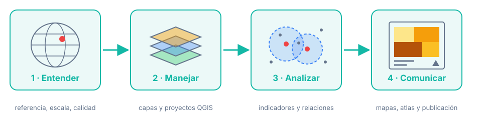

# Curso Introductorio de QGIS

**Aprende a pensar el territorio con datos y a responder preguntas reales con QGIS.**

Este curso te lleva desde *¿qué es un SIG?* hasta publicar un **atlas territorial** propio. No se trata de memorizar menús: se trata de entender qué estás representando, evitar los errores que arruinan un análisis y comunicar resultados con mapas claros y honestos.

{ loading=lazy }

---

## Cuatro módulos, un mismo caso

-   :material-earth:{ .lg .middle } **Módulo 1 · Fundamentos SIG**

    ---

    Territorio, geodesia, sistemas de referencia, UTM, escala, calidad del dato. **Sin software.**

    [:octicons-arrow-right-24: Empezar aquí](modulo-01/index.md)

-   :material-application-outline:{ .lg .middle } **Módulo 2 · Introducción a QGIS**

    ---

    Interfaz, proyectos portables, tablas con coordenadas, SRC, simbología, ráster y servicios web.

    [:octicons-arrow-right-24: Ir al módulo](modulo-02/index.md)

-   :material-vector-intersection:{ .lg .middle } **Módulo 3 · Edición y análisis espacial**

    ---

    Digitalización, formularios, indicadores, relaciones espaciales, relieve y procesos reproducibles.

    [:octicons-arrow-right-24: Ir al módulo](modulo-03/index.md)

-   :material-map-legend:{ .lg .middle } **Módulo 4 · Diseño cartográfico**

    ---

    Clasificación y color, jerarquía visual, etiquetado, composiciones, atlas y publicación.

    [:octicons-arrow-right-24: Ir al módulo](modulo-04/index.md)

!!! example "El caso conductor"

    **¿Qué zonas de Cochabamba tienen peor acceso a servicios de salud y educación, y dónde convendría intervenir primero?**

    Cada módulo avanza sobre esta pregunta. Al terminar tendrás un proyecto completo: datos depurados, análisis reproducible y un atlas publicado. También puedes trabajar con tu propio municipio.

---

## ¿Por dónde empiezo?

=== "Soy nuevo en SIG"

    1. Lee el [Programa](programa.md) (5 min).
    2. Empieza por el [Módulo 1](modulo-01/index.md) en orden: los conceptos se construyen unos sobre otros.
    3. Responde cada autoevaluación **antes** de abrir las respuestas.

=== "Ya uso SIG, pero no QGIS"

    1. Repasa en el Módulo 1 los temas [1.4 Sistemas de referencia](modulo-01/04-sistemas-referencia.md) y [1.6 Sistema UTM](modulo-01/06-sistema-utm.md).
    2. Descarga el [paquete de datos](descargas/index.md).
    3. Continúa en el [Módulo 2](modulo-02/index.md).

=== "Necesito resultados en un día"

    Sigue la [ruta exprés](practicas/index.md#ruta-expres): seis laboratorios clave que te llevan de un CSV a un mapa publicado.

---

## Qué necesitas

| Recurso | Detalle |
|---|---|
| Computadora | Windows, macOS o Linux; 8 GB de RAM recomendados |
| Software | **QGIS 4.x** (gratuito). Ver [2.1 Preparar un entorno de trabajo](modulo-02/01-entorno-trabajo.md) |
| Datos | [Paquete de datos del curso](descargas/index.md) |
| Tiempo | ≈ 126 horas en total, a tu ritmo |

---

## Cómo está hecha cada lección

| Sección | Para qué sirve |
|---|---|
| :material-target: **En esta lección** | Objetivos, tiempo estimado, datos y producto |
| :material-lightbulb-on-outline: **Idea central** | Los conceptos imprescindibles, con figuras |
| :material-hand-pointing-right: **Hazlo conmigo** | Laboratorio guiado paso a paso |
| :material-rocket-launch-outline: **Inténtalo tú** | Reto práctico sin pasos guiados |
| :material-check-decagram-outline: **¿Lo hiciste bien?** | Cómo verificar tu resultado |
| :material-help-circle-outline: **Comprueba lo aprendido** | Autoevaluación con respuestas desplegables |
| :material-book-open-variant: **Referencias** | Fuentes académicas, oficiales y de datos |

---

<small>Contenido bajo licencia [CC BY-SA 4.0](acerca.md#licencia). Datos de OpenStreetMap © colaboradores de OpenStreetMap (ODbL).</small>
