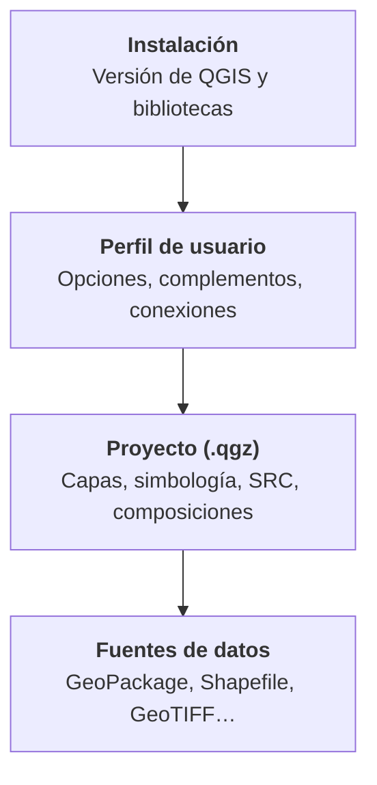

# 2.1 Preparar un entorno de trabajo

*«En mi computadora el proyecto se abre bien, pero en la tuya no aparecen las capas.»* Si alguna vez escuchaste esta frase, ya conoces el problema que resuelve esta lección. Antes de hacer el primer mapa vamos a dejar listo un entorno **conocido, ordenado y reproducible**: la misma versión de QGIS, un perfil limpio para el curso y una estructura de carpetas que no rompa los proyectos.

!!! abstract "En esta lección"

    **Aprenderás a:**

    - Elegir la versión de QGIS adecuada y entender su ciclo de publicación.
    - Instalar QGIS y verificar la instalación.
    - Crear y usar un perfil de usuario exclusivo para el curso.
    - Diferenciar las preferencias de la aplicación de las propiedades del proyecto.
    - Organizar las carpetas para que los proyectos sean portables.

    **Tiempo:** 60 min (20 de lectura · 40 de práctica) · **Datos:** [paquete del curso](../descargas/index.md) · **Producto:** carpeta `curso-qgis/`, perfil `curso-qgis` y ficha del entorno.

---

## Idea central

### Un entorno tiene cuatro capas

Casi todos los problemas de «a mí me funciona y a ti no» se explican al distinguir **dónde vive cada cosa**:



| Capa | Qué contiene | ¿Viaja al compartir el proyecto? |
|---|---|---|
| **Instalación** | El programa y sus bibliotecas (GDAL, PROJ) | No: cada persona tiene la suya |
| **Perfil de usuario** | Preferencias, complementos, conexiones guardadas | No: queda en tu computadora |
| **Proyecto** | Qué capas hay, cómo se ven y con qué propiedades | Sí: es el archivo `.qgz` |
| **Fuentes de datos** | Los datos propiamente dichos | Solo si los envías junto con el proyecto |

!!! danger "La confusión más frecuente"

    Un proyecto de QGIS **no contiene los datos**: contiene **referencias** a ellos. Si envías solo el `.qgz`, la otra persona verá capas **no disponibles**. Lo resolveremos en la lección [2.3](03-gestionar-proyectos.md).

!!! info "Entorno reproducible"

    Es el que otra persona puede **recrear** siguiendo una descripción precisa: la misma versión del programa, la misma configuración básica, los mismos complementos y la misma organización de carpetas.

### Qué versión instalar

QGIS publica una **nueva versión cada cuatro meses** y una **corrección cada mes** (4.2.1, 4.2.2…). Las versiones pares (4.0, 4.2, 4.4) son publicadas; las impares (4.1, 4.3), versiones en desarrollo. Periódicamente, una versión se designa **LTR** (*Long Term Release*, soporte extendido).

| Tipo | Características | Recomendada para |
|---|---|---|
| **LTR** · soporte extendido | Más probada, recibe correcciones durante al menos un año | Instituciones, producción, cursos largos |
| **LR** · última versión | Funciones más recientes; se reemplaza cada cuatro meses | Quien quiere las novedades |
| **Desarrollo** (*nightly*) | En construcción, puede fallar | Solo pruebas, **nunca** trabajo real |

--8<-- "snippets/version-qgis.md"

!!! tip "Regla del curso"

    **Todo el grupo usa la misma versión mayor y menor** (por ejemplo, 4.4). Las diferencias de corrección (4.4.0 frente a 4.4.1) no suelen causar problemas.

??? info "Para saber más · QGIS 3 y QGIS 4"

    En **marzo de 2026** se publicó **QGIS 4.0**, la primera versión mayor en ocho años. Su cambio principal es interno: la migración a **Qt 6**, la biblioteca de la interfaz. Consecuencias:

    - Los **complementos** deben ser compatibles con Qt 6; algunos de QGIS 3 aún no funcionan.
    - Los **proyectos** de QGIS 3 se abren en QGIS 4, pero uno guardado en QGIS 4 **puede no abrirse bien** en QGIS 3.
    - Las carpetas de configuración son **distintas**: tus complementos y preferencias de QGIS 3 no pasan solos a QGIS 4.

    Cada versión tiene un **nombre en clave**, tomado de la ciudad que organizó una reunión de desarrolladores: *Solothurn* (3.44), *Belém do Pará* (4.2).

### Preferencias de la aplicación frente a propiedades del proyecto

Esta distinción te ahorrará muchas confusiones:

<div class="grid cards" markdown>

-   :material-cog-outline:{ .lg .middle } **Preferencias de la aplicación**

    ---

    **Configuración ▸ Opciones**. Se guardan en el **perfil**, afectan a **todos** los proyectos y **no viajan** con el proyecto.

-   :material-file-cog-outline:{ .lg .middle } **Propiedades del proyecto**

    ---

    **Proyecto ▸ Propiedades**. Se guardan **dentro del `.qgz`**, afectan **solo a ese proyecto** y **viajan** con él.

</div>

| Ejemplos de preferencias (perfil) | Ejemplos de propiedades (proyecto) |
|---|---|
| Idioma y tema de la interfaz | SRC del proyecto |
| SRC para proyectos nuevos | Unidades y elipsoide para mediciones |
| Comportamiento ante capas sin SRC | Rutas relativas o absolutas |
| Rutas de complementos | Título, metadatos, autoensamblado |

!!! example "Regla práctica"

    Si una configuración es necesaria para que **el proyecto funcione o se interprete correctamente**, debe estar en las **propiedades del proyecto**. Si la pones en Opciones, tu colega no la verá.

---

## Hazlo conmigo

### Paso 1 · Instalar QGIS

=== "Windows"

    1. Ingresa a <https://qgis.org/download/>.
    2. Descarga el instalador `.msi` de la versión acordada para el curso.
    3. Ejecútalo con las opciones por defecto. Al terminar, QGIS aparece en el menú Inicio.

    !!! captura "Captura pendiente · 2.1-01"

        - **Tipo:** Imagen (PNG)
        - **Archivo:** `assets/images/modulo-02/2-1/2-1-01-pagina-descargas.png`
        - **Qué mostrar:** La página de descargas de QGIS con las opciones de la **última versión** y la **LTR** para Windows.
        - **Sugerencia:** Resalta con un recuadro la versión acordada para el curso.

    !!! captura "Captura pendiente · 2.1-02 (opcional)"

        - **Tipo:** GIF animado
        - **Archivo:** `assets/images/modulo-02/2-1/2-1-02-instalador-windows.gif`
        - **Qué mostrar:** Los pasos principales del instalador `.msi`, desde la bienvenida hasta el final de la instalación.

    ??? info "Para saber más · instalador en red OSGeo4W"

        Permite tener **varias versiones en paralelo** (por ejemplo, la LTR y la última) y actualizar solo los componentes que cambiaron. Recomendado cuando ya tienes experiencia.

        Por su tamaño, el instalador normal **no incluye** las mallas de transformación entre datums: QGIS te pedirá descargarlas cuando una transformación las necesite (lección [2.6](06-problemas-coordenadas.md)).

=== "macOS"

    1. Ingresa a <https://qgis.org/download/> y descarga el `.dmg` de la versión acordada (funciona en Intel y Apple Silicon).
    2. Abre el `.dmg` y **arrastra** QGIS a **Aplicaciones**.
    3. Abre QGIS. La primera vez, macOS puede pedirte que confirmes que quieres abrir una aplicación descargada de internet.

    !!! captura "Captura pendiente · 2.1-03 (opcional)"

        - **Tipo:** GIF animado
        - **Archivo:** `assets/images/modulo-02/2-1/2-1-03-instalacion-macos.gif`
        - **Qué mostrar:** Arrastrar QGIS a la carpeta **Aplicaciones** desde el archivo `.dmg`.

=== "Linux"

    **Flatpak** (cualquier distribución):

    ```bash
    flatpak install flathub org.qgis.qgis
    flatpak run org.qgis.qgis
    ```

    **Repositorios oficiales** para Debian y Ubuntu: sigue la guía <https://qgis.org/resources/installation-guide/#debian--ubuntu>.

    !!! warning "Ubuntu 22.04 y 24.04"

        Sus repositorios oficiales solo ofrecen la **LTR 3.44**, porque sus dependencias no son compatibles con QGIS 4. Para usar QGIS 4, instala con **Flatpak** o actualiza la distribución.

    !!! captura "Captura pendiente · 2.1-04 (opcional)"

        - **Tipo:** GIF animado
        - **Archivo:** `assets/images/modulo-02/2-1/2-1-04-flatpak-terminal.gif`
        - **Qué mostrar:** La terminal ejecutando `flatpak install flathub org.qgis.qgis` y la pregunta sobre qué versión instalar.

### Paso 2 · Verificar la instalación

1. Abre QGIS y ve a **Ayuda ▸ Acerca de**.
2. Anota la **versión exacta** de QGIS y las versiones de **GDAL** y **PROJ**.

!!! captura "Captura pendiente · 2.1-05"

    - **Tipo:** Imagen (PNG)
    - **Archivo:** `assets/images/modulo-02/2-1/2-1-05-acerca-de.png`
    - **Qué mostrar:** La ventana **Ayuda ▸ Acerca de** con las versiones de **QGIS**, **GDAL** y **PROJ** visibles.

!!! tip "¿Por qué anotar GDAL y PROJ?"

    **GDAL** lee y escribe los formatos de datos; **PROJ** transforma coordenadas entre sistemas de referencia ([1.4](../modulo-01/04-sistemas-referencia.md)). Cuando algo funciona distinto en dos computadoras con la «misma» versión de QGIS, la diferencia suele estar aquí.

### Paso 3 · Crear el perfil del curso

Un **perfil de usuario** es una carpeta donde QGIS guarda **toda tu configuración personal**: preferencias, complementos, conexiones, estilos e historial. Cada perfil es independiente; al instalar QGIS existe uno llamado `default`.

1. Ve a **Configuración ▸ Perfiles de usuario ▸ Nuevo perfil…**
2. Escribe **`curso-qgis`** (sin espacios ni tildes).
3. Se abre una **nueva ventana** de QGIS, limpia, con ese perfil. Cierra la anterior.
4. Comprueba en **Configuración ▸ Perfiles de usuario** que `curso-qgis` está marcado como activo.

!!! captura "Captura pendiente · 2.1-06"

    - **Tipo:** GIF animado
    - **Archivo:** `assets/images/modulo-02/2-1/2-1-06-crear-perfil.gif`
    - **Qué mostrar:** El recorrido **Configuración ▸ Perfiles de usuario ▸ Nuevo perfil…**, la escritura del nombre `curso-qgis` y la apertura de la nueva ventana de QGIS.

!!! captura "Captura pendiente · 2.1-07"

    - **Tipo:** Imagen (PNG)
    - **Archivo:** `assets/images/modulo-02/2-1/2-1-07-menu-perfiles.png`
    - **Qué mostrar:** El menú **Configuración ▸ Perfiles de usuario** desplegado, con el perfil `curso-qgis` marcado como activo.

Para encontrar la carpeta del perfil usa **Configuración ▸ Perfiles de usuario ▸ Abrir carpeta de perfil activo**.

!!! captura "Captura pendiente · 2.1-08"

    - **Tipo:** GIF animado
    - **Archivo:** `assets/images/modulo-02/2-1/2-1-08-abrir-carpeta-perfil.gif`
    - **Qué mostrar:** La opción **Abrir carpeta de perfil activo** y el explorador de archivos mostrando el contenido de la carpeta del perfil.

| Sistema | Ubicación habitual de los perfiles en QGIS 4 |
|---|---|
| Windows | `%APPDATA%\QGIS\QGIS4\profiles\` |
| Linux | `~/.local/share/QGIS/QGIS4/profiles/` |
| macOS | `~/Library/Application Support/QGIS/QGIS4/profiles/` |

!!! warning "Cuida la carpeta del perfil"

    No la borres sin respaldo (perderías complementos, conexiones y estilos) y **no guardes datos ni proyectos dentro**: es solo para configuración. Para respaldar o trasladar un perfil, copia su carpeta con QGIS cerrado.

??? info "Para saber más · abrir QGIS directamente con un perfil"

    Desde la terminal: `qgis --profile curso-qgis`. En Windows, crea un acceso directo a QGIS y agrega `--profile curso-qgis` al final del campo **Destino** de sus propiedades.

    !!! captura "Captura pendiente · 2.1-09 (opcional)"

        - **Tipo:** Imagen (PNG)
        - **Archivo:** `assets/images/modulo-02/2-1/2-1-09-acceso-directo-perfil.png`
        - **Qué mostrar:** La ventana de propiedades de un acceso directo de Windows con `--profile curso-qgis` agregado en el campo **Destino**.

### Paso 4 · Configurar las preferencias del curso

Con el perfil `curso-qgis` activo, abre **Configuración ▸ Opciones** y ajusta:

| Pestaña | Opción | Valor | Por qué |
|---|---|---|---|
| **General** | Idioma de la interfaz | Español | Coincide con este material (requiere reiniciar) |
| **General** | Avisar al abrir proyectos de versiones anteriores | Activado | Detectar problemas de compatibilidad |
| **General** | Código Python embebido en proyectos | Preguntar o no permitir | **Seguridad**: un proyecto desconocido podría ejecutar código |
| **SRC y transformaciones** | Comportamiento ante capas sin SRC | Pedir el SRC o dejarlo sin definir | Decidir **conscientemente** el sistema de referencia |

Si no encuentras una opción, escríbela en el **buscador** de la parte superior izquierda de la ventana de Opciones.

!!! captura "Captura pendiente · 2.1-12"

    - **Tipo:** Imagen (PNG)
    - **Archivo:** `assets/images/modulo-02/2-1/2-1-12-opciones-general-idioma.png`
    - **Qué mostrar:** La pestaña **General** de **Configuración ▸ Opciones**, con la opción de idioma de la interfaz resaltada.

!!! captura "Captura pendiente · 2.1-13"

    - **Tipo:** Imagen (PNG)
    - **Archivo:** `assets/images/modulo-02/2-1/2-1-13-opciones-src-capas-sin-src.png`
    - **Qué mostrar:** La pestaña **SRC y transformaciones** de **Configuración ▸ Opciones**, con la opción de comportamiento ante capas sin SRC resaltada.

!!! tip "Explora sin miedo"

    Casi todas las preferencias se pueden revertir. Y si algo sale muy mal, crea un **perfil nuevo** y empieza de cero sin reinstalar.

### Paso 5 · Decidir sobre complementos

Los **complementos** (*plugins*) agregan funciones a QGIS. Se gestionan en **Complementos ▸ Administrar e instalar complementos…**, que muestra para cada uno su descripción, versión, autor, calificaciones y enlaces a su documentación.

!!! captura "Captura pendiente · 2.1-15"

    - **Tipo:** Imagen (PNG)
    - **Archivo:** `assets/images/modulo-02/2-1/2-1-15-administrador-complementos.png`
    - **Qué mostrar:** El administrador de complementos con la sección **Todos** activa, un complemento seleccionado y su ficha de información visible.

!!! danger "Un complemento es código que se ejecuta en tu computadora"

    Puede leer y escribir archivos y conectarse a internet. Instala **solo desde el repositorio oficial**, usa **Instalar a partir de ZIP** únicamente con fuentes de confianza y **no actives los experimentales** si no sabes lo que haces.

Antes de instalar uno, verifica que QGIS no tenga ya esa herramienta, que sea **compatible con QGIS 4** y que se haya actualizado recientemente. **En este curso no instalarás complementos por ahora**: cada lección indicará cuáles necesita.

### Paso 6 · Crear la carpeta del curso

1. Descarga el [paquete de datos del curso](../descargas/index.md) y descomprímelo en una ubicación **local y corta**, por ejemplo `C:\curso-qgis\` o `~/curso-qgis/`.
2. Comprueba que tiene esta estructura:

    ```text
    curso-qgis/
    ├── datos/
    │   ├── originales/    ← datos tal como se recibieron; nunca se modifican
    │   ├── ejercicios/    ← datos con errores intencionales para practicar
    │   └── trabajo/       ← copias, datos procesados y resultados intermedios
    ├── proyectos/         ← archivos de proyecto .qgz
    ├── estilos/           ← estilos reutilizables (.qml)
    ├── salidas/           ← mapas, tablas y archivos exportados
    └── documentos/        ← ficha del entorno, notas, metadatos e informes
    ```

!!! captura "Captura pendiente · 2.1-17"

    - **Tipo:** Imagen (PNG)
    - **Archivo:** `assets/images/modulo-02/2-1/2-1-17-estructura-carpetas.png`
    - **Qué mostrar:** El explorador de archivos mostrando la carpeta `curso-qgis/` con sus subcarpetas.

**Reglas para nombrar carpetas y archivos:**

| Regla | :material-check: Correcto | :material-close: Evitar |
|---|---|---|
| Sin espacios | `limites_municipales.gpkg` | `Limites Municipales.gpkg` |
| Sin tildes, ñ ni símbolos | `ninez_poblacion.csv` | `niñez_población (2).csv` |
| Minúsculas y guion bajo | `unidades_educativas.gpkg` | `UnidadesEducativas.GPKG` |
| Fechas año-mes-día | `predios_2026-09-16.gpkg` | `predios_16-9-26.gpkg` |
| Versiones controladas | `informe_v02.docx` | `informe_final_final_corregido.docx` |

!!! warning "Ubicaciones problemáticas"

    - **Carpetas sincronizadas** (OneDrive, Google Drive, Dropbox): pueden **bloquear o dañar** un GeoPackage mientras QGIS lo usa.
    - **Rutas muy largas**, **Escritorio** y **Descargas**: fallos en Windows y desorden.
    - **Unidades externas o de red**: si cambia la letra de unidad, el proyecto pierde sus fuentes.

!!! tip "Los datos originales son sagrados"

    Nunca edites `datos/originales/`. Trabaja sobre **copias** en `datos/trabajo/`; así siempre podrás volver al punto de partida y documentar los cambios (linaje, [1.13](../modulo-01/13-calidad-informacion.md)).

### Paso 7 · Guardar el primer proyecto

1. Crea un proyecto nuevo y abre **Proyecto ▸ Propiedades ▸ General**.
2. Escribe un **título**: «Curso QGIS · Cochabamba».
3. Verifica que **Guardar rutas** esté en **Relativas**.
4. Guarda como `proyectos/reto_2-1_entorno.qgz`.

!!! captura "Captura pendiente · 2.1-18"

    - **Tipo:** GIF animado
    - **Archivo:** `assets/images/modulo-02/2-1/2-1-18-guardar-proyecto.gif`
    - **Qué mostrar:** Crear un proyecto nuevo, completar el título y las rutas relativas en **Proyecto ▸ Propiedades ▸ General**, y guardarlo en la carpeta `proyectos/`.

---

## Inténtalo tú

!!! example "Reto 2.1 · Un entorno que otra persona pueda recrear"

    Documenta tu entorno en `documentos/ficha_entorno.md` para que un compañero pueda reproducirlo **sin preguntarte nada**:

    ```text
    FICHA DEL ENTORNO DE TRABAJO
    Nombre:
    Fecha:
    Sistema operativo y versión:
    Método de instalación (MSI, OSGeo4W, DMG, Flatpak, repositorio):
    Versiones de QGIS / GDAL / PROJ:
    Perfil de usuario y ubicación de su carpeta:
    Ubicación de la carpeta del curso:
    Idioma de la interfaz:
    Comportamiento ante capas sin SRC:
    Complementos externos instalados (nombre y versión):
    Observaciones o problemas encontrados:
    ```

    Luego **intercambia la ficha** con un compañero. ¿Sus entornos son equivalentes? ¿Qué diferencia podría causar problemas al compartir proyectos?

    **Entregables:** la ficha completa y una captura de **Ayuda ▸ Acerca de**.

---

## ¿Lo hiciste bien?

| Criterio | Se cumple si… |
|---|---|
| Versión | La versión instalada coincide con la acordada para el curso |
| Perfil | `curso-qgis` existe y está activo |
| Carpetas | `curso-qgis/` está en una ubicación local y corta, con la estructura indicada |
| Proyecto | `proyectos/reto_2-1_entorno.qgz` tiene título y rutas relativas |
| Ficha | Permite a otra persona recrear el entorno |
| Reflexión | Identificas las diferencias con el entorno de tu compañero y su posible efecto |

### Errores frecuentes

| Síntoma | Causa probable | Solución |
|---|---|---|
| QGIS no arranca tras instalar un complemento | Complemento incompatible | Inicia con `--noplugins` y desactívalo, o usa un perfil nuevo |
| La interfaz aparece en inglés | Toma el idioma del sistema | **Configuración ▸ Opciones ▸ General**, define el idioma y reinicia |
| Mis preferencias «desaparecieron» | Se abrió otro perfil | **Configuración ▸ Perfiles de usuario**: verifica el activo |
| No encuentro un complemento de QGIS 3 | No es compatible con QGIS 4 o está en otro perfil | Revisa el administrador de complementos en el perfil correcto |
| QGIS pide descargar mallas de transformación | Una transformación entre datums las necesita | Acepta la descarga ([2.6](06-problemas-coordenadas.md)) |
| Advertencias al abrir un proyecto | Se guardó con otra versión | Usa la misma versión que el grupo |
| Comportamiento extraño sin motivo | Configuración dañada | Prueba con un perfil nuevo |

---

## Comprueba lo aprendido

??? question "1. ¿Qué diferencia hay entre una versión LTR y la última versión (LR)?"

    La **LTR** es de **soporte extendido**: más probada, recibe correcciones durante al menos un año y cambia poco; es la adecuada para instituciones y cursos. La **LR** trae las **funciones más recientes** y se reemplaza cada cuatro meses.

??? question "2. Configuraste en Opciones que las capas sin SRC te pidan definirlo. ¿Tu compañero verá lo mismo al abrir tu proyecto?"

    **No.** Esa configuración es una **preferencia de la aplicación**: vive en **tu perfil**, no en el proyecto. Tu compañero tendrá el comportamiento de **su** perfil.

??? question "3. ¿Para qué sirve crear un perfil nuevo cuando QGIS se comporta de forma extraña?"

    Para saber si el problema está en la **configuración del perfil** o en la **instalación**. Si con un perfil nuevo QGIS funciona bien, el problema estaba en el perfil anterior.

??? question "4. ¿Por qué no conviene trabajar dentro de una carpeta de OneDrive o Google Drive?"

    Porque la **sincronización** puede bloquear o modificar archivos que QGIS está usando, como un GeoPackage, y **dañarlos**. Además, esas rutas suelen ser largas y distintas en cada computadora.

??? question "5. ¿Qué tres precauciones tomarías antes de instalar un complemento?"

    Verificar que provenga del **repositorio oficial**, que sea **compatible** con tu versión de QGIS y que esté **actualizado**; además, comprobar que QGIS **no tenga ya** una herramienta equivalente.

??? question "6. ¿Por qué `limites municipales (versión final).shp` es un mal nombre?"

    Tiene **espacios**, **tildes** y **paréntesis**, que causan problemas en rutas y herramientas, y «versión final» no es una **versión controlada**. Mejor: `limites_municipales_2026-09.gpkg`.

??? question "7. Repaso del Módulo 1 · ¿Qué biblioteca de QGIS se encarga de convertir coordenadas geográficas a UTM?"

    **PROJ**. Es la que aplica las transformaciones entre sistemas de referencia que estudiaste en [1.4](../modulo-01/04-sistemas-referencia.md) y [1.6](../modulo-01/06-sistema-utm.md).

---

## Tu proyecto

En la carpeta `curso-qgis/` ya tienes los datos del **caso conductor**: el municipio de **Cochabamba**. Abre `datos/originales/LEEME.md` y anota en tu ficha:

- Qué archivos recibiste y en qué formato está cada uno.
- Qué **SRC** declara el `LEEME.md` para cada archivo.

En la lección [2.4](04-incorporar-datos.md) comprobarás si esas declaraciones son ciertas.

---

## Referencias

- QGIS Project. (s. f.). *Guía de instalación*. <https://qgis.org/resources/installation-guide/>
- QGIS Project. (s. f.). *Hoja de ruta y calendario de versiones*. <https://qgis.org/resources/roadmap/>
- QGIS Project. (s. f.). *Repositorio de complementos de QGIS*. <https://plugins.qgis.org>
- QGIS Project. (s. f.). *Manual de usuario: Configuración de QGIS*. <https://docs.qgis.org/latest/es/docs/user_manual/introduction/qgis_configuration.html>
- QGIS Project. (s. f.). *Manual de usuario: Comenzando*. <https://docs.qgis.org/latest/es/docs/user_manual/introduction/getting_started.html>
- Wilson, G., Bryan, J., Cranston, K., Kitzes, J., Nederbragt, L., & Teal, T. K. (2017). Good enough practices in scientific computing. *PLOS Computational Biology, 13*(6), e1005510. <https://doi.org/10.1371/journal.pcbi.1005510>
