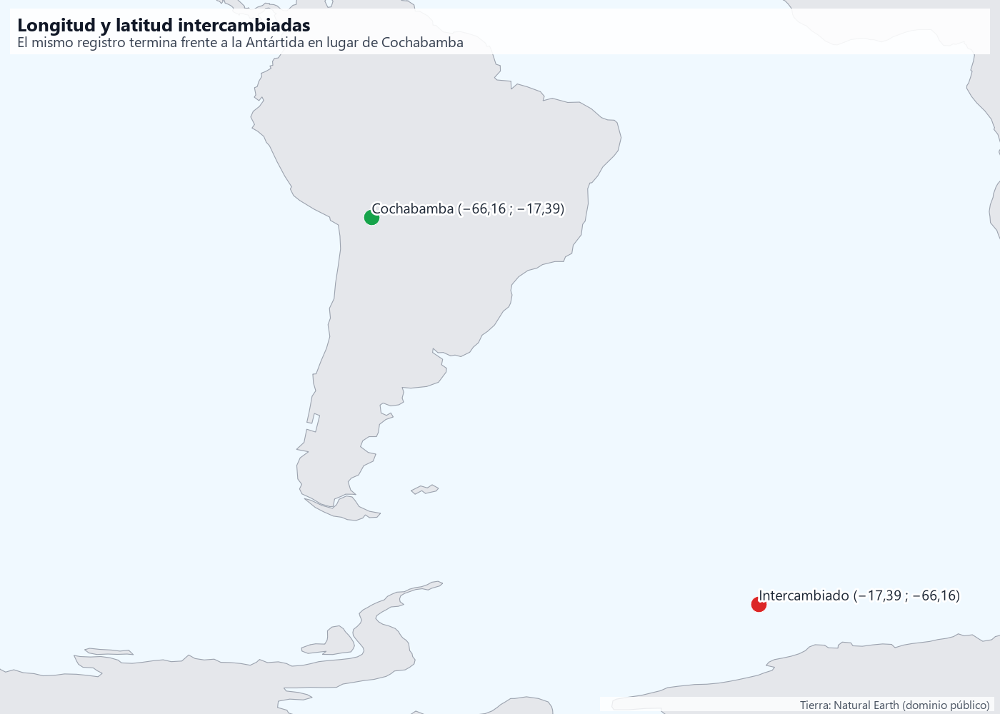
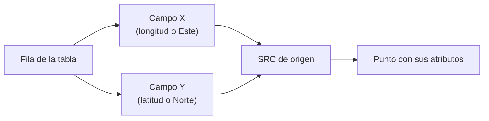
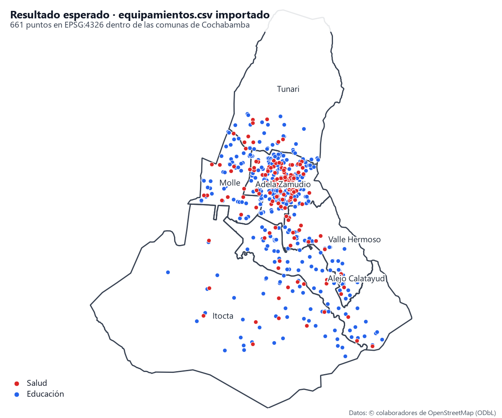

# 2.5 Convertir una tabla en información geográfica

La Dirección de Salud te envía una planilla con 665 establecimientos y dos columnas: *Longitud* y *Latitud*. La importas, QGIS no muestra ningún error… y 22 puntos aparecen **frente a la Antártida**. Nadie se equivocó al importar: el error venía en la tabla. Esta lección te enseña a convertir una tabla en puntos **y a desconfiar del resultado** hasta comprobarlo.

{ loading=lazy }

!!! abstract "En esta lección"

    **Aprenderás a:**

    - Reconocer delimitador, separador decimal y codificación de un archivo de texto.
    - Revisar los **tipos de campo** antes de importar.
    - Elegir correctamente X, Y y el **SRC de origen** de las coordenadas.
    - Importar con **Texto delimitado** y **validar** cantidad, extensión y posición.
    - Diagnosticar coordenadas intercambiadas, ausentes o con signo erróneo, y documentar las correcciones.

    **Tiempo:** 100 min (30 de lectura · 70 de práctica) · **Datos:** `datos/originales/equipamientos.csv`, `datos/ejercicios/equipamientos_errores.csv` · **Producto:** `datos/trabajo/equipamientos.gpkg` y una tabla de diagnóstico.

---

## Idea central

### X + Y + SRC = posición

Una tabla con columnas de coordenadas todavía **no tiene geometría**: tiene los números para construirla. Para que esos números sean un lugar, QGIS necesita saber **tres cosas**:



| Sistema | X | Y | Ejemplo en Cochabamba |
|---|---|---|---|
| Geográfico (EPSG:4326) | Longitud | Latitud | X = −66,157 · Y = −17,394 |
| UTM 19 S (EPSG:32719) | Este | Norte | X = 802 100 · Y = 8 075 100 |

!!! danger "El SRC que eliges al importar es el de los datos, no el del proyecto"

    La pregunta correcta es: **¿en qué sistema se generaron estos números?** Si eliges otro, no los transformas: le dices a QGIS que los **interprete** de otra manera, y los puntos aparecerán en otro lugar ([2.6](06-problemas-coordenadas.md)).

### Un CSV es texto con reglas

`CSV` sugiere «separado por comas», pero en Bolivia y otros países que usan **coma decimal** lo habitual es separar campos con **punto y coma**:

```text
id_equip;nombre;tipo;subtipo;longitud;latitud;fuente;fecha
EQ-0646;Hospital Clínico Viedma;salud;hospital;-66,148460;-17,385631;OpenStreetMap;2026-10-08
```

| Concepto | Qué hace | En `equipamientos.csv` |
|---|---|---|
| **Separador de campos** | Divide las columnas | `;` |
| **Separador decimal** | Forma parte de un número | `,` |
| **Codificación** | Cómo se guardaron los caracteres | UTF-8 |
| **Encabezado** | Nombres de los campos | Primera fila |

Si eliges mal el **delimitador**, toda la fila aparece en una sola columna. Si eliges mal la **codificación**, *Educación* se lee `Educación`. Si eliges mal el **separador decimal**, las coordenadas se leen como texto y no hay puntos.

### Los tipos de campo importan

| Valor | Parece | Debe ser | Por qué |
|---|---|---|---|
| `EQ-0021` | Texto | Texto | Es un identificador |
| `00125` | Número | **Texto** | Perderías los ceros iniciales |
| `-66,148012` | Número | Decimal | Es una coordenada |
| `S/D` en una columna numérica | — | `NULL` | Un solo `S/D` puede convertir toda la columna en texto |
| `2026-10-08` | Texto | Fecha | Para ordenar y filtrar por periodo |

!!! warning "Cero no es «sin dato»"

    Nunca rellenes una coordenada faltante con `0`: (0, 0) es un lugar real del golfo de Guinea. Una coordenada desconocida es `NULL` y ese registro queda **sin geometría**.

---

## Hazlo conmigo

### Paso 1 · Mirar el archivo antes de importarlo

Abre `datos/originales/equipamientos.csv` con un editor de texto (no con la hoja de cálculo, que «arregla» cosas sin avisar). Anota: delimitador, separador decimal, número de filas (661 más el encabezado) y qué columnas tienen las coordenadas.

### Paso 2 · Importar con Texto delimitado

1. **Capa ▸ Añadir capa ▸ Añadir capa de texto delimitado…** (o ++ctrl+l++ ▸ **Texto delimitado**).
2. **Nombre de archivo:** `datos/originales/equipamientos.csv`. **Codificación:** UTF-8.
3. **Formato de archivo:** **Delimitadores personalizados** ▸ marca solo **Punto y coma**.
4. **Opciones de registros y campos:** marca **Primer registro tiene nombres de campos**, **Detectar tipos de campo** y **La coma es el separador decimal**.
5. **Definición de geometría:** **Coordenadas de punto** · **Campo X:** `longitud` · **Campo Y:** `latitud`.
6. **SRC de geometría:** **EPSG:4326 - WGS 84**.
7. Revisa la **vista previa**: columnas separadas, tildes correctas, `longitud` y `latitud` como números. Solo entonces, **Añadir**.

!!! captura "Captura pendiente · 2.5-05"

    - **Tipo:** Imagen (PNG) anotada
    - **Archivo:** `assets/images/modulo-02/2-5/2-5-05-texto-delimitado.png`
    - **Qué mostrar:** La ventana **Texto delimitado** con `equipamientos.csv`: punto y coma, coma decimal, X = longitud, Y = latitud, EPSG:4326 y la vista previa correcta.

### Paso 3 · Validar: ¿cuántos, dónde y cómo?

| Control | Cómo | Esperado |
|---|---|---|
| **Cantidad** | Clic derecho ▸ **Mostrar recuento de objetos** | 661 = filas del archivo |
| **Extensión** | **Zoom a la capa** | Todo dentro del municipio |
| **Referencia** | Superponer `Comunas` | Ningún punto fuera de las comunas |
| **Registros conocidos** | Localizador: `f Viedma` | El hospital aparece en el centro norte de la ciudad |

{ loading=lazy }

### Paso 4 · Consolidar en GeoPackage

La capa de texto delimitado sigue **dependiendo del CSV**. Una vez validada:

1. Clic derecho ▸ **Exportar ▸ Guardar objetos como…**
2. **Formato:** GeoPackage · **Archivo:** `datos/trabajo/equipamientos.gpkg` · **Capa:** `equipamientos`.
3. **SRC:** **EPSG:32719** (aquí sí reproyectas: el resultado tendrá coordenadas en metros).

!!! warning "Exporta después de validar"

    Convertir a GeoPackage un CSV mal interpretado solo transforma un error temporal en uno permanente.

---

## Inténtalo tú

!!! example "Reto 2.5 · La planilla con errores"

    Importa `datos/ejercicios/equipamientos_errores.csv` y responde con evidencia:

    1. **Codificación:** ¿qué ves en el encabezado `Código` con UTF-8? ¿Qué codificación lo resuelve?
    2. **Cantidad:** ¿cuántas filas tiene el archivo y cuántos puntos genera QGIS? ¿Qué registros no tienen geometría y por qué?
    3. **Posición:** con **Zoom a la capa**, ¿qué ocurre con la extensión? Selecciona los puntos lejanos y ábrelos en la tabla: ¿qué tienen en común sus valores de longitud y latitud?
    4. **Duplicados:** ¿hay filas idénticas? ¿Cómo lo comprobaste?
    5. **Categorías:** ¿de cuántas formas distintas está escrito el campo `Tipo`?

    Construye una **tabla de diagnóstico** (no corrijas nada todavía):

    | id_equip | problema | evidencia | hipótesis | acción propuesta | estado |
    |---|---|---|---|---|---|
    | EQ-0003 | Aparece frente a la Antártida | Longitud −17,42; latitud −66,20 | X e Y intercambiadas en la fuente | Intercambiar en una copia, conservando los originales | REVISAR |

    Usa para **estado**: `VALIDA`, `REVISAR`, `SIN_COORDENADAS` o `CORREGIDA`.

    **Para ir más allá:** en una copia, crea las columnas `lon_corr` y `lat_corr` con los valores corregidos, reimporta y comprueba que los 22 puntos vuelven a Cochabamba. Conserva siempre las columnas originales.

---

## ¿Lo hiciste bien?

| Criterio | Se cumple si… |
|---|---|
| Configuración | Delimitador `;`, coma decimal, X = longitud, Y = latitud, EPSG:4326 |
| Conteo | `equipamientos.csv`: 661 puntos. `equipamientos_errores.csv`: 665 filas, 662 puntos, 3 sin coordenadas |
| Diagnóstico | Detectaste los **22** registros con X/Y intercambiadas, los 4 duplicados y las 6 grafías de `Tipo` |
| Trazabilidad | El CSV original no se modificó; las correcciones propuestas están documentadas |
| Resultado | `datos/trabajo/equipamientos.gpkg` existe, en EPSG:32719, con 661 entidades |

### Errores frecuentes

| Síntoma | Causa probable | Qué revisar |
|---|---|---|
| Toda la fila en una sola columna | Delimitador incorrecto | Coma, punto y coma, tabulación |
| `Educación`, `C�digo` | Codificación incorrecta | UTF-8 frente a Latin-1 (ISO-8859-1) |
| No se crean puntos | Coordenadas leídas como texto | Separador decimal, `S/D`, espacios |
| `0012` aparece como `12` | Código interpretado como número | Forzar tipo texto |
| **Todos** los puntos lejos | X/Y elegidos al revés o SRC incorrecto | Configuración de importación |
| **Algunos** puntos lejos | Errores en filas concretas | Las filas originales |
| Puntos en el hemisferio norte | Signo de la latitud | Valores positivos y negativos |
| Menos puntos que filas | Coordenadas vacías o no numéricas | Buscar `NULL` y `S/D` |

---

## Comprueba lo aprendido

??? question "1. ¿Qué tres cosas necesita QGIS para convertir una fila en un punto?"

    El **campo X**, el **campo Y** y el **SRC** en que se expresaron esas coordenadas.

??? question "2. Un archivo `.csv` usa `;` entre campos. ¿Está mal hecho?"

    No. Es habitual donde la coma es separador decimal. Lo importante es configurarlo bien.

??? question "3. El proyecto está en EPSG:32719 y la tabla trae grados. ¿Qué SRC eliges al importar?"

    **EPSG:4326**, el de las coordenadas originales. QGIS las reproyectará al vuelo para dibujarlas.

??? question "4. QGIS creó todos los puntos sin errores. ¿Están bien ubicados?"

    No necesariamente: un X/Y intercambiado o un signo erróneo siguen siendo números válidos.

??? question "5. ¿Cómo distingues un error de **importación** de un error **en los datos**?"

    Si **todos** los puntos están mal, probablemente configuraste mal X, Y o el SRC. Si solo **algunos** lo están, el problema está en esas filas de la fuente.

??? question "6. Dos establecimientos tienen exactamente las mismas coordenadas. ¿Son duplicados?"

    No necesariamente: pueden ser dos servicios en el mismo edificio. Compara también nombre, tipo e identificador.

??? question "7. ¿Por qué conservar las columnas de coordenadas originales después de corregir?"

    Para mantener la **trazabilidad**: poder explicar por qué el resultado difiere del archivo recibido.

??? question "8. Repaso de 1.9 · Una coordenada tiene 8 decimales. ¿Es más exacta que otra con 4?"

    No. Los decimales expresan **precisión numérica**; la **exactitud** depende de cómo se midió el punto. Ocho decimales en grados son ~1 mm: casi siempre es **falsa precisión**.

---

## Tu proyecto

Ya tienes los equipamientos del caso conductor como una capa de trabajo en UTM. Revisa la distribución: ¿hay comunas con muy pocos puntos? Anótalo como **hipótesis** («la comuna X tiene menos cobertura») y también como **posible problema de datos** («o faltan registros en OpenStreetMap»). Contrastarás ambas en [2.7](07-leer-datos.md) y [3.7](../modulo-03/07-proximidad-superposicion.md).

---

## Referencias

- Broman, K. W., & Woo, K. H. (2018). Data organization in spreadsheets. *The American Statistician, 72*(1), 2–10. <https://doi.org/10.1080/00031305.2017.1375989>
- Shafranovich, Y. (2005). *Common Format and MIME Type for Comma-Separated Values (CSV) Files* (RFC 4180). IETF. <https://www.rfc-editor.org/info/rfc4180>
- QGIS Project. (s. f.). *Manual de usuario: Archivos de texto delimitado*. <https://docs.qgis.org/latest/es/docs/user_manual/managing_data_source/opening_data.html#importing-a-delimited-text-file>
- QGIS Project. (s. f.). *Una introducción amable a los SIG: Sistemas de referencia de coordenadas*. <https://docs.qgis.org/latest/es/docs/gentle_gis_introduction/coordinate_reference_systems.html>
- OpenStreetMap contributors. (2026). *Extracto de Bolivia* [Base de datos, ODbL]. Geofabrik. <https://download.geofabrik.de/south-america/bolivia.html>
