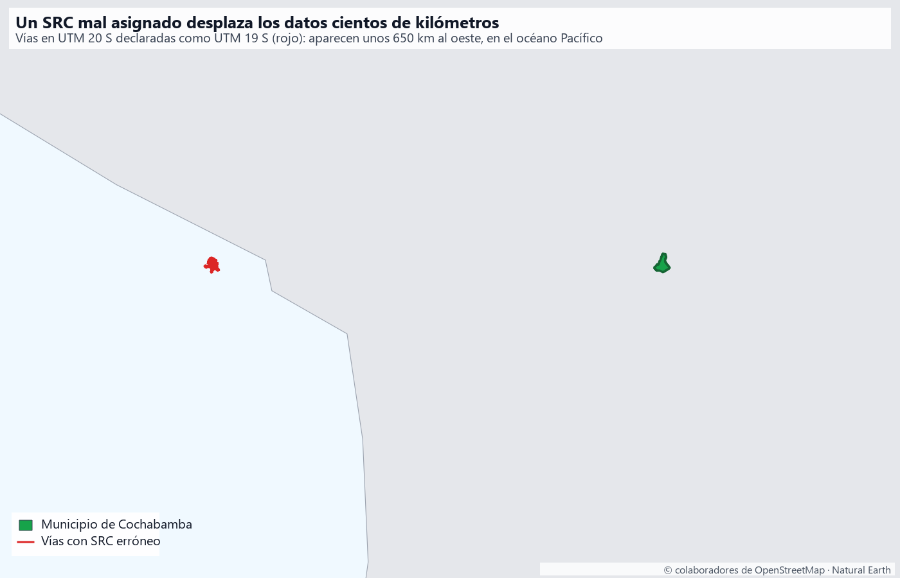
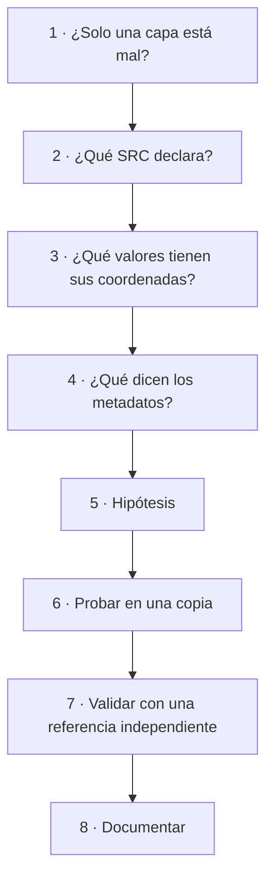

# 2.6 Resolver problemas de coordenadas

Un colega te pasa la red vial principal de Cochabamba. La cargas y… aparece en el **océano Pacífico**, unos 650 km al oeste. Nadie movió las calles: alguien declaró mal en qué sistema estaban sus coordenadas. Es el problema más frecuente de los SIG y casi siempre se resuelve en dos minutos **si sabes diagnosticar**; si no, se «arregla» moviendo capas a mano y se arruina todo lo que viene después.

{ loading=lazy }

!!! abstract "En esta lección"

    **Aprenderás a:**

    - Distinguir el **SRC de una capa** del **SRC del proyecto** y entender la reproyección al vuelo.
    - Diferenciar **asignar** un SRC de **reproyectar** una capa, y elegir la operación correcta.
    - Aplicar un **protocolo de diagnóstico** a una capa desplazada.
    - Reconocer cuándo interviene una **transformación de datum**.
    - Medir distancias y áreas con unidades y método adecuados.

    **Tiempo:** 90 min (30 de lectura · 60 de práctica) · **Datos:** `datos/ejercicios/comunas_sin_prj.shp`, `datos/ejercicios/vias_principales_src_erroneo.gpkg` · **Producto:** dos capas corregidas en `datos/trabajo/` y una ficha de diagnóstico.

---

## Idea central

### Dos SRC distintos con funciones distintas

| | SRC de la **capa** | SRC del **proyecto** |
|---|---|---|
| Qué indica | En qué sistema **están escritas** las coordenadas de esa fuente | En qué sistema se **dibuja** el mapa y se miden las cosas |
| Dónde se ve | **Propiedades de la capa ▸ Información** | Esquina inferior derecha (EPSG:…) y **Proyecto ▸ Propiedades ▸ SRC** |
| Si lo cambias | Cambias la **interpretación** de los números | Cambias solo la **vista**: las fuentes no se tocan |

QGIS lleva cada capa al SRC del proyecto **mientras dibuja**: es la **reproyección al vuelo**. Por eso dos capas en EPSG:4326 y EPSG:32719 pueden superponerse perfectamente. **Coincidir en el mapa no significa compartir SRC.**

!!! captura "Captura pendiente · 2.6-03"

    - **Tipo:** GIF animado
    - **Archivo:** `assets/images/modulo-02/2-6/2-6-03-cambio-src-proyecto.gif`
    - **Qué mostrar:** Cambiar el SRC del proyecto entre EPSG:32719 y EPSG:4326 mientras `Comunas` (32719) y `Ríos` (4326) permanecen superpuestas.

### Asignar no es reproyectar

Esta es la distinción más importante de la lección:

| | **Asignar** (declarar) un SRC | **Reproyectar** (transformar) |
|---|---|---|
| Qué hace | Dice a QGIS «estos números están en tal sistema» | Calcula **nuevos números** en otro sistema |
| ¿Cambian las coordenadas? | **No** | **Sí** |
| ¿Cambia la posición en el mundo? | **Sí**, si la declaración anterior era distinta | **No**, si se hizo bien |
| Úsala cuando | La capa **no tiene** SRC o lo tiene **mal declarado** | La capa está bien declarada y la necesitas **en otro sistema** |
| En QGIS | Clic derecho ▸ **Capa ▸ Establecer SRC de la capa** | **Procesos ▸ Reproyectar capa** o **Exportar ▸ Guardar objetos como…** |

!!! danger "Error crítico"

    Una capa correcta en EPSG:4326 **no** se convierte a UTM cambiándole el SRC en sus propiedades. Así solo consigues que QGIS lea «−66,15» como **66 metros** al oeste del falso Este: la capa desaparece cerca del ecuador. Para convertir, **reproyecta**.

!!! example "Una analogía"

    Una dirección escrita como «Calle 5 n.º 120». **Asignar** es decir en qué ciudad está: si te equivocas de ciudad, llegas a otro lugar. **Reproyectar** es traducir la dirección al sistema de otra ciudad para que el mismo edificio tenga una dirección nueva.

### Los números dan pistas

| Valores | Probablemente | Ejemplo en Cochabamba |
|---|---|---|
| X entre −180 y 180, Y entre −90 y 90 | Grados (EPSG:4326, 4674…) | −66,157 · −17,394 |
| X ≈ 800 000, Y ≈ 8 000 000 | UTM 19 S | 802 110 · 8 075 114 |
| X ≈ 160 000, Y ≈ 8 000 000 | UTM 20 S | 164 541 · 8 074 592 |
| X ≈ −7 360 000, Y ≈ −1 960 000 | Pseudo-Mercator (EPSG:3857) | Mapas base web |

Son **pistas**, no pruebas: PSAD56 / UTM 19 S (EPSG:24879) y WGS 84 / UTM 19 S (EPSG:32719) tienen números muy parecidos y lugares separados unos **400 m** ([1.4](../modulo-01/04-sistemas-referencia.md)). La prueba está en los **metadatos** y en la **procedencia**.

---

## Hazlo conmigo

### Protocolo de diagnóstico

Ante una capa desplazada, **no muevas nada** y sigue este orden:

### Caso 1 · Una capa sin SRC

1. Añade `datos/ejercicios/comunas_sin_prj.shp`. QGIS te avisa que la capa **no tiene SRC** (o le asigna uno por defecto, según tu configuración de [2.1](01-entorno-trabajo.md)).
2. **Pregunta 2:** **Propiedades ▸ Información**: SRC *desconocido*.
3. **Pregunta 3:** activa la herramienta de identificación y lee una coordenada: **X ≈ 800 000, Y ≈ 8 070 000**. Son metros, no grados.
4. **Pregunta 4:** el archivo es una exportación de `limites.gpkg ▸ comunas`, documentada en EPSG:32719. Falta el `.prj`.
5. **Hipótesis:** las coordenadas están en EPSG:32719 y solo falta la declaración.
6. **Asignar:** clic derecho ▸ **Capa ▸ Establecer SRC de la capa** ▸ **EPSG:32719**.
7. **Validar:** debe coincidir exactamente con la capa `Comunas` del proyecto base.
8. **Hazlo permanente:** **Exportar ▸ Guardar objetos como…** ▸ `datos/trabajo/comunas_corregidas.gpkg`.

!!! captura "Captura pendiente · 2.6-05"

    - **Tipo:** GIF animado
    - **Archivo:** `assets/images/modulo-02/2-6/2-6-05-asignar-src.gif`
    - **Qué mostrar:** Capa sin SRC, corrección mediante **Establecer SRC de la capa** y coincidencia posterior con la capa de referencia.

### Caso 2 · Una capa con el SRC mal declarado

1. Añade `datos/ejercicios/vias_principales_src_erroneo.gpkg`. Declara **EPSG:32719**, pero **Zoom a la capa** la muestra en el Pacífico.
2. Lee una coordenada de la capa en su propio sistema: **X ≈ 153 000–172 000**. En la zona 19 S, Cochabamba tiene X ≈ 800 000.
3. Esos valores coinciden con los de **UTM 20 S** (tabla anterior).
4. **Hipótesis:** las coordenadas están en EPSG:32720 y alguien declaró 32719.
5. **Asignar** EPSG:32720. La capa debe saltar sobre Cochabamba y coincidir con `vias.gpkg`.
6. Ahora sí, **reproyecta** a la zona de trabajo: **Procesos ▸ Reproyectar capa** · **SRC de destino:** EPSG:32719 · salida `datos/trabajo/vias_principales.gpkg`.
7. **Valida** que los números cambiaron (X ≈ 800 000) y la posición **no**.

!!! captura "Captura pendiente · 2.6-06"

    - **Tipo:** Imagen (PNG) anotada
    - **Archivo:** `assets/images/modulo-02/2-6/2-6-06-reproyectar-capa.png`
    - **Qué mostrar:** El algoritmo **Reproyectar capa** con capa de entrada, SRC de destino EPSG:32719 y archivo de salida en `datos/trabajo/`.

!!! warning "No adivines códigos hasta que «calce»"

    Probar EPSG al azar hasta que la capa coincida puede darte uno **parecido** pero incorrecto (por ejemplo, PSAD56 en lugar de WGS 84, con 400 m de diferencia). El mapa **valida** una hipótesis basada en evidencia; no reemplaza a los metadatos.

!!! danger "Nunca muevas una capa a mano para que coincida"

    Desplazar geometrías con la herramienta de edición destruye la relación con el sistema original y propaga el error a todo lo que derive de ellas.

### Caso 3 · Cuando interviene un cambio de datum

Al reproyectar entre sistemas con **datums distintos** (por ejemplo, PSAD56 → WGS 84 o SIRGAS 2000), QGIS necesita una **transformación de datum** y puede ofrecerte varias, con distinta exactitud y **área de uso**.

!!! captura "Captura pendiente · 2.6-07"

    - **Tipo:** Imagen (PNG)
    - **Archivo:** `assets/images/modulo-02/2-6/2-6-07-transformaciones.png`
    - **Qué mostrar:** El diálogo de selección de transformaciones mostrando origen, destino, exactitud y área de uso.

- Elige la transformación cuya área de uso incluya **Bolivia** y cuya exactitud sea la mejor disponible.
- Si QGIS pide descargar una **malla de transformación**, acéptalo.
- Entre WGS 84 y SIRGAS 2000 la diferencia es de centímetros: para trabajos a escala municipal suele tratarse como despreciable, pero **documéntalo**.
- Para precisión catastral, usa los **parámetros oficiales del IGM** (MARGEN-SIRGAS).

### Caso 4 · Medir con las unidades correctas

Abre **Proyecto ▸ Propiedades ▸ General** y revisa **Elipsoide**, **Unidades de distancia** y **Unidades de superficie**.

!!! captura "Captura pendiente · 2.6-08"

    - **Tipo:** Imagen (PNG) anotada
    - **Archivo:** `assets/images/modulo-02/2-6/2-6-08-unidades-medicion.png`
    - **Qué mostrar:** Propiedades del proyecto con elipsoide, unidades de distancia y unidades de superficie.

| Método | Cómo calcula | Cuándo usarlo |
|---|---|---|
| **Elipsoidal** (por defecto en la herramienta Medir) | Sobre el elipsoide WGS 84 | Medidas reales de distancia y superficie |
| **Cartesiano / planimétrico** | Sobre el plano del SRC | Solo si el SRC es proyectado y adecuado para la zona |

Mide la distancia entre la plaza principal y la Laguna Alalay con ambos métodos. En UTM 19 S, Cochabamba está a ~300 km del meridiano central, por eso el valor cartesiano es ~0,07 % mayor: unos **3 m por cada 4 km**.

!!! warning "Grados no son metros"

    Un algoritmo de Procesos que calcula sobre una capa en **EPSG:4326** devuelve **grados**: un «buffer de 500» serían 500 grados. Antes de analizar, trabaja con capas **proyectadas en metros** (lo harás en el Módulo 3).

---

## Inténtalo tú

!!! example "Reto 2.6 · Ficha de diagnóstico"

    Para **cada** una de las dos capas de ejercicio, completa esta ficha en `documentos/diagnostico_src.md`:

    | Paso | Capa 1 · comunas_sin_prj | Capa 2 · vias_principales_src_erroneo |
    |---|---|---|
    | Síntoma observado | | |
    | SRC declarado | | |
    | Coordenadas de ejemplo (X, Y) | | |
    | Evidencia externa (metadatos, procedencia) | | |
    | Hipótesis | | |
    | Operación aplicada (asignar o reproyectar) y por qué | | |
    | Referencia usada para validar | | |
    | Resultado y archivo generado | | |

    Después responde: ¿qué habría pasado si en la capa 2 hubieras **reproyectado** de 32719 a 32720 en lugar de **asignar**?

---

## ¿Lo hiciste bien?

| Criterio | Se cumple si… |
|---|---|
| Diagnóstico | Usaste las coordenadas y los metadatos, no la prueba y error |
| Operación | Capa 1: **asignar** 32719. Capa 2: **asignar** 32720 y luego **reproyectar** a 32719 |
| Validación | Ambas coinciden con `limites.gpkg` y `vias.gpkg` |
| Persistencia | Las correcciones están guardadas en `datos/trabajo/`, no solo en el proyecto |
| Reflexión | Explicas que reproyectar desde un SRC mal declarado «traslada el error» con exactitud |

### Errores frecuentes

| Síntoma | Causa probable | Qué hacer |
|---|---|---|
| La capa aparece cerca de (0, 0), frente a África | Grados interpretados como metros | Asignar el SRC geográfico correcto |
| La capa es diminuta en algún lugar del mundo | Metros interpretados como grados | Asignar el SRC proyectado correcto |
| Desplazada ~640 km al este u oeste | Zona UTM equivocada | Asignar la zona correcta |
| Desplazada unos cientos de metros | Datum distinto (p. ej. PSAD56) | Asignar el datum correcto y reproyectar con la transformación adecuada |
| Cambié el SRC del proyecto y «nada cambió» | Es lo esperado: solo cambia la vista | Revisar el SRC de la capa |
| Un buffer de 500 cubre medio continente | La capa está en grados | Reproyectar a un SRC en metros |

---

## Comprueba lo aprendido

??? question "1. ¿Cambiar el SRC del proyecto modifica las coordenadas guardadas en las capas?"

    No. Solo cambia cómo se **dibuja** el mapa y cómo se mide en él.

??? question "2. Una capa tiene coordenadas correctas pero perdió su `.prj`. ¿Asignas o reproyectas?"

    **Asignas** el SRC en que están las coordenadas.

??? question "3. Una capa está bien definida en EPSG:4326 y la necesitas en UTM. ¿Asignas o reproyectas?"

    **Reproyectas**. Asignar 32719 la mandaría al lugar equivocado.

??? question "4. Tras una reproyección correcta, ¿qué cambia y qué no?"

    Cambian los **números** de las coordenadas; la **posición** en el mundo se mantiene.

??? question "5. Una capa declara EPSG:4326 pero tiene X = 802 110 e Y = 8 075 114. ¿Qué indica?"

    Que probablemente son metros UTM mal declarados como grados. Confirma con los metadatos antes de asignar.

??? question "6. ¿Por qué una zona UTM equivocada desplaza tanto la capa?"

    Porque cada zona es un plano distinto con su propio meridiano central y su falso Este: el mismo número representa lugares separados unos 640 km.

??? question "7. ¿Por qué pueden existir varias transformaciones entre dos SRC?"

    Porque hay distintos métodos y parámetros de cambio de datum, con diferente exactitud y área de uso.

??? question "8. Repaso de 1.6 · ¿Por qué en Cochabamba encontrarás datos en las zonas 19 S y 20 S?"

    Porque la ciudad está a unos 17 km del meridiano 66° O, límite entre ambas zonas; distintas instituciones eligen una u otra.

---

## Tu proyecto

Decide y **documenta** el SRC de trabajo de tu caso conductor (en el curso: **EPSG:32719**). Escribe en tu `LEEME.txt` por qué lo elegiste, qué fuentes vienen en otros sistemas y cómo las vas a transformar. Esa decisión condiciona todas las mediciones del Módulo 3.

---

## Referencias

- Iliffe, J., & Lott, R. (2008). *Datums and Map Projections for Remote Sensing, GIS and Surveying* (2.ª ed.). Whittles.
- Snyder, J. P. (1987). *Map Projections: A Working Manual* (USGS Professional Paper 1395). <https://doi.org/10.3133/pp1395>
- IOGP. (s. f.). *EPSG Geodetic Parameter Dataset*. <https://epsg.org>
- QGIS Project. (s. f.). *Manual de usuario: Trabajar con proyecciones*. <https://docs.qgis.org/latest/es/docs/user_manual/working_with_projections/working_with_projections.html>
- QGIS Project. (s. f.). *Manual de entrenamiento: Reproyectar y transformar datos*. <https://docs.qgis.org/latest/es/docs/training_manual/vector_analysis/reproject_transform.html>
