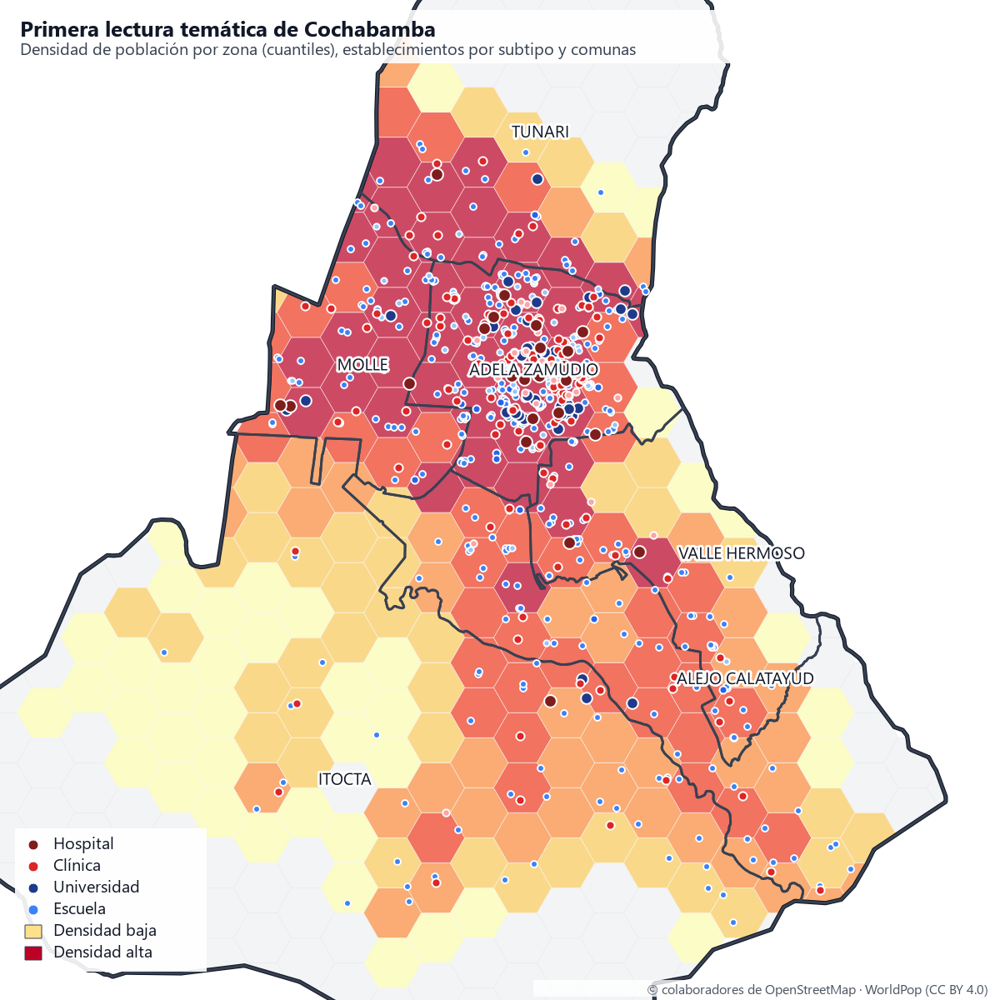

# 2.9 Representar y etiquetar datos vectoriales

Hasta ahora tus capas tenían colores al azar. En esta lección harás que el mapa **diga algo**: dónde vive más gente, dónde están los hospitales y dónde las escuelas, y cómo se llama cada comuna, sin que el mapa se convierta en un amasijo de puntos y letras. Es tu primera **lectura temática** de Cochabamba.

{ loading=lazy }

!!! abstract "En esta lección"

    **Aprenderás a:**

    - Elegir entre simbología **simple**, **categorizada** y **graduada** según el tipo de dato.
    - Aplicar una paleta coherente con lo que representas.
    - Etiquetar con una expresión y controlar la colocación.
    - Mostrar capas y etiquetas solo a ciertas **escalas**.
    - Guardar y reutilizar **estilos** (`.qml`).

    **Tiempo:** 90 min (25 de lectura · 65 de práctica) · **Datos:** `limites.gpkg`, `datos/trabajo/equipamientos.gpkg` · **Producto:** `proyectos/reto_2-9_representacion.qgz` y tres estilos en `estilos/`.

---

## Idea central

### El tipo de dato decide la simbología

| Si el dato es… | Ejemplo | Simbología | Variable visual ([1.7](../modulo-01/07-fundamentos-cartografia.md)) |
|---|---|---|---|
| Uno solo, sin distinciones | Límite municipal | **Símbolo único** | — |
| **Categorías** sin orden | Subtipo de equipamiento | **Categorizado** | Tono (color), forma |
| **Cantidades ordenadas** | Densidad de población | **Graduado** | Valor (claro → oscuro), tamaño |
| Condiciones combinadas | Hospitales con nombre | **Basado en reglas** | Lo que decidas |

!!! danger "No uses colores de arcoíris para cantidades"

    Un gradiente rojo-amarillo-verde-azul no tiene orden visual evidente: el ojo no sabe si el verde es «más» que el amarillo. Para cantidades usa una **secuencia de claro a oscuro** de uno o dos tonos.

!!! warning "Cuidado con los conteos absolutos en polígonos"

    Colorear zonas por **población total** favorece a las zonas grandes. Para comparar áreas de distinto tamaño usa **tasas o densidades** (habitantes por km²). Lo profundizarás en [4.3](../modulo-04/03-elegir-representacion-tematica.md).

### Jerarquía y legibilidad

- **Figura y fondo:** el tema (zonas, equipamientos) con colores saturados; la referencia (límites, vías) en grises finos.
- **Pocas clases:** 4–6 clases graduadas y no más de 7–8 categorías por mapa.
- **Etiquetas con propósito:** etiqueta lo que el lector necesita para orientarse, no todo.

---

## Hazlo conmigo

### Paso 1 · Abrir el panel Estilo de capas

Presiona ++f7++. El panel aplica los cambios **en vivo** (casilla **Actualización en vivo**) y tiene pestañas para **Simbología**, **Etiquetas**, **Máscaras** e **Historial**.

!!! captura "Captura pendiente · 2.9-01"

    - **Tipo:** Imagen (PNG) anotada
    - **Archivo:** `assets/images/modulo-02/2-9/2-9-01-panel-simbologia.png`
    - **Qué mostrar:** El panel Estilo de capas con el selector de tipo de simbología, el selector de símbolos, las pestañas de etiquetas e historial y la casilla de actualización en vivo.

### Paso 2 · Graduado: densidad de población

1. Selecciona **Zonas de análisis** ▸ **Graduado**.
2. En **Valor**, abre el editor de expresiones (ε) y escribe: `"pob_2020" / "area_km2"`.
3. **Rampa de color:** *YlOrRd* (amarillo → rojo). **Modo:** *Cuantiles*. **Clases:** 5. **Clasificar**.
4. En **Formato de leyenda**, precisión **0** decimales.
5. Las 125 zonas sin población distorsionan las clases. **Duplica** la capa (clic derecho ▸ **Duplicar capa**): en la copia de abajo usa un **símbolo único** gris claro; en la de arriba aplica el **filtro** `"pob_2020" > 0` (lo viste en [2.8](08-seleccionar-filtrar.md)) y vuelve a **Clasificar**.
6. Bordes: blanco, 0,1 mm.

!!! captura "Captura pendiente · 2.9-03"

    - **Tipo:** Imagen (PNG) anotada
    - **Archivo:** `assets/images/modulo-02/2-9/2-9-03-graduado.png`
    - **Qué mostrar:** Simbología graduada de densidad con la expresión, la rampa YlOrRd, el modo Cuantiles, 5 clases y el histograma.

??? question "¿Por qué cuantiles y no intervalos iguales?"

    Porque la densidad está muy **sesgada**: muchas zonas con poca población y pocas muy densas. Con intervalos iguales casi todo el municipio quedaría en la clase más clara. En [4.4](../modulo-04/04-evaluar-clasificaciones-colores.md) compararás los métodos con detalle.

### Paso 3 · Categorizado: equipamientos por subtipo

1. Selecciona **equipamientos** ▸ **Categorizado** ▸ **Valor:** `subtipo` ▸ **Clasificar**.
2. Ajusta los colores con lógica: **salud** en rojos (hospital oscuro, clínica medio, consultorio claro); **educación** en azules.
3. Hospitales y universidades más grandes (3 mm); el resto, 2 mm. Borde blanco 0,2 mm para que los puntos se distingan del fondo.
4. Desmarca la categoría vacía (*todos los demás valores*) si no existe.

!!! captura "Captura pendiente · 2.9-02"

    - **Tipo:** Imagen (PNG)
    - **Archivo:** `assets/images/modulo-02/2-9/2-9-02-categorizado.png`
    - **Qué mostrar:** Simbología categorizada por `subtipo`, con salud en rojos y educación en azules.

### Paso 4 · Etiquetas de las comunas

1. Selecciona **Comunas** ▸ pestaña **Etiquetas** ▸ **Etiquetas sencillas**.
2. **Valor:** `upper("nombre")` (expresión: todo en mayúsculas).
3. **Texto:** 9 pt, gris oscuro, **espaciado de letras** 1,5.
4. **Búfer:** 1 mm blanco al 80 %.
5. **Ubicación:** **Desplazamiento desde el centroide**, marcando **Forzar a que el punto esté dentro del polígono**.

!!! captura "Captura pendiente · 2.9-04"

    - **Tipo:** Imagen (PNG)
    - **Archivo:** `assets/images/modulo-02/2-9/2-9-04-etiquetas.png`
    - **Qué mostrar:** Configuración de etiquetas de comunas: expresión upper, tamaño, búfer y ubicación.

| Geometría | Colocación habitual |
|---|---|
| Punto | Alrededor del punto (cartográfica) |
| Línea | Paralela o curvada sobre la línea |
| Polígono | Horizontal en el interior, o desplazada desde el centroide |

### Paso 5 · Visibilidad por escala

Los 661 equipamientos saturan el mapa a escala municipal. Haz que **los nombres** solo aparezcan de cerca:

1. Equipamientos ▸ **Etiquetas** ▸ **Valor:** `"nombre"` ▸ **Representación** ▸ **Visibilidad dependiente de la escala**: mínima **1:15 000**.
2. Para la capa **vías**: **Propiedades ▸ Representación** ▸ visible solo a escalas mayores que **1:50 000**.

Acércate y aléjate: los nombres y las calles locales aparecen y desaparecen.

!!! captura "Captura pendiente · 2.9-06"

    - **Tipo:** GIF animado
    - **Archivo:** `assets/images/modulo-02/2-9/2-9-06-visibilidad-escala.gif`
    - **Qué mostrar:** Hacer zoom progresivamente y mostrar cómo aparecen las vías y los nombres de equipamientos a partir de cierta escala.

### Paso 6 · Guardar y reutilizar estilos

1. En el panel Estilo de capas: **Estilo ▸ Guardar estilo…** ▸ formato **Archivo de estilo QML** ▸ `estilos/zonas_densidad.qml`.
2. Repite con `estilos/equipamientos_subtipo.qml` y `estilos/comunas_etiquetas.qml`.
3. Prueba: aplica **Estilo ▸ Restablecer** y luego **Cargar estilo…** con tu archivo.

!!! captura "Captura pendiente · 2.9-07"

    - **Tipo:** GIF animado
    - **Archivo:** `assets/images/modulo-02/2-9/2-9-07-guardar-estilo.gif`
    - **Qué mostrar:** Guardar un estilo QML, restablecer la simbología y volver a cargarlo.

!!! tip "El paquete ya trae estilos"

    En `estilos/` encontrarás estilos de comunas, vías, ríos, equipamientos, DEM y Sentinel-2. Ábrelos: son un buen ejemplo de cómo se organizan.

??? info "Para saber más · simbología basada en reglas"

    Para «hospitales y clínicas **con nombre** en rojo, el resto en gris», usa **Basado en reglas** con dos reglas:

    ```sql
    "subtipo" IN ('hospital', 'clinica') AND "nombre" IS NOT NULL
    ELSE
    ```

    Cada regla puede tener su propio símbolo, etiqueta y rango de escalas.

---

## Inténtalo tú

!!! example "Reto 2.9 · Lectura temática de Cochabamba"

    Construye en `proyectos/reto_2-9_representacion.qgz` un mapa que permita responder **a simple vista**:

    1. ¿Qué comunas concentran las zonas más densas?
    2. ¿Los hospitales están cerca de la población o concentrados en el centro?
    3. ¿Qué comuna parece tener menos escuelas para su población?

    Requisitos: densidad graduada (5 clases, secuencial), equipamientos categorizados con lógica de color, comunas etiquetadas, nombres de equipamientos solo a partir de 1:15 000, ríos y vías en tonos de fondo, y tres estilos guardados.

    **Entregable:** el proyecto, los `.qml` y una exportación del mapa (**Proyecto ▸ Importar/Exportar ▸ Exportar mapa a imagen**) en `salidas/lectura_tematica.png` con tus respuestas en tres líneas.

---

## ¿Lo hiciste bien?

| Criterio | Se cumple si… |
|---|---|
| Elección | Densidad → graduado secuencial; subtipo → categorizado |
| Color | Salud y educación se distinguen; la densidad va de claro a oscuro |
| Jerarquía | El tema domina; límites y vías no compiten con él |
| Etiquetas | Legibles, con búfer, sin saturar a escala municipal |
| Escala | Nombres y calles aparecen solo de cerca |
| Reutilización | Los tres `.qml` cargan correctamente en otro proyecto |
| Lectura | Las tres respuestas se apoyan en lo que muestra el mapa |

### Errores frecuentes

| Síntoma | Causa probable | Solución |
|---|---|---|
| La graduada sale toda de un color | Muchas zonas con 0 o datos sesgados | Excluye ceros; prueba cuantiles |
| La leyenda muestra 7 decimales | Formato de leyenda por defecto | Ajusta la precisión |
| No aparecen etiquetas | Escala fuera de rango o etiquetas en conflicto | Revisa la visibilidad y **Mostrar todas las etiquetas** |
| Etiquetas fuera de los polígonos | Colocación por defecto | Fuerza el punto dentro del polígono |
| El estilo no se aplica en otra capa | Los nombres de campo no coinciden | El `.qml` depende de los campos |

---

## Comprueba lo aprendido

??? question "1. ¿Qué simbología usarías para el tipo de suelo de cada predio? ¿Y para su superficie?"

    Tipo de suelo: **categorizado** (categorías sin orden). Superficie: **graduado** (cantidad ordenada).

??? question "2. ¿Por qué no conviene colorear zonas por población total?"

    Porque las zonas grandes acumulan más población solo por su tamaño. Se usa una **densidad o tasa**.

??? question "3. ¿Para qué sirve la visibilidad dependiente de la escala?"

    Para mostrar el detalle solo cuando la escala permite leerlo, evitando saturar el mapa a escalas pequeñas.

??? question "4. ¿Qué guarda un archivo `.qml`?"

    El **estilo** de una capa (simbología, etiquetas, visibilidad…), no los datos.

??? question "5. Repaso de 1.7 · ¿Qué variable visual comunica mejor «más o menos»?"

    El **valor** (luminosidad: claro a oscuro) y el **tamaño**. El tono (color) comunica diferencias de tipo.

---

## Tu proyecto

Exporta tu lectura temática y escribe debajo **una hipótesis** del caso conductor, por ejemplo: «Las zonas densas del sur de Itocta y Alejo Calatayud tienen pocos establecimientos de salud cercanos». La pondrás a prueba con un análisis de proximidad en [3.7](../modulo-03/07-proximidad-superposicion.md).

---

## Referencias

- Brewer, C. A. (2016). *Designing Better Maps: A Guide for GIS Users* (2.ª ed.). Esri Press.
- Harrower, M., & Brewer, C. A. (2003). ColorBrewer.org: An online tool for selecting colour schemes for maps. *The Cartographic Journal, 40*(1), 27–37. <https://doi.org/10.1179/000870403235002042>
- Kraak, M.-J., & Ormeling, F. (2020). *Cartography: Visualization of Geospatial Data* (4.ª ed.). CRC Press.
- QGIS Project. (s. f.). *Manual de usuario: Propiedades de simbología*. <https://docs.qgis.org/latest/es/docs/user_manual/working_with_vector/vector_properties.html#symbology-properties>
- QGIS Project. (s. f.). *Manual de usuario: Propiedades de etiquetas*. <https://docs.qgis.org/latest/es/docs/user_manual/working_with_vector/vector_properties.html#labels-properties>
