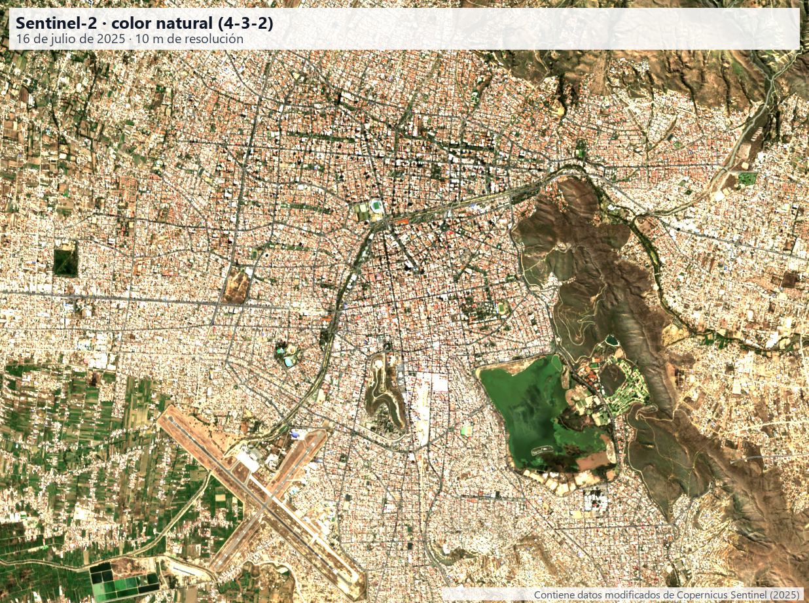
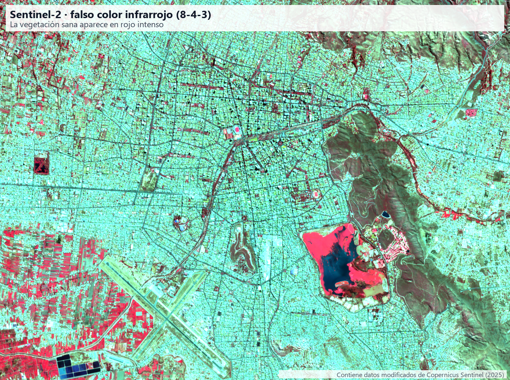
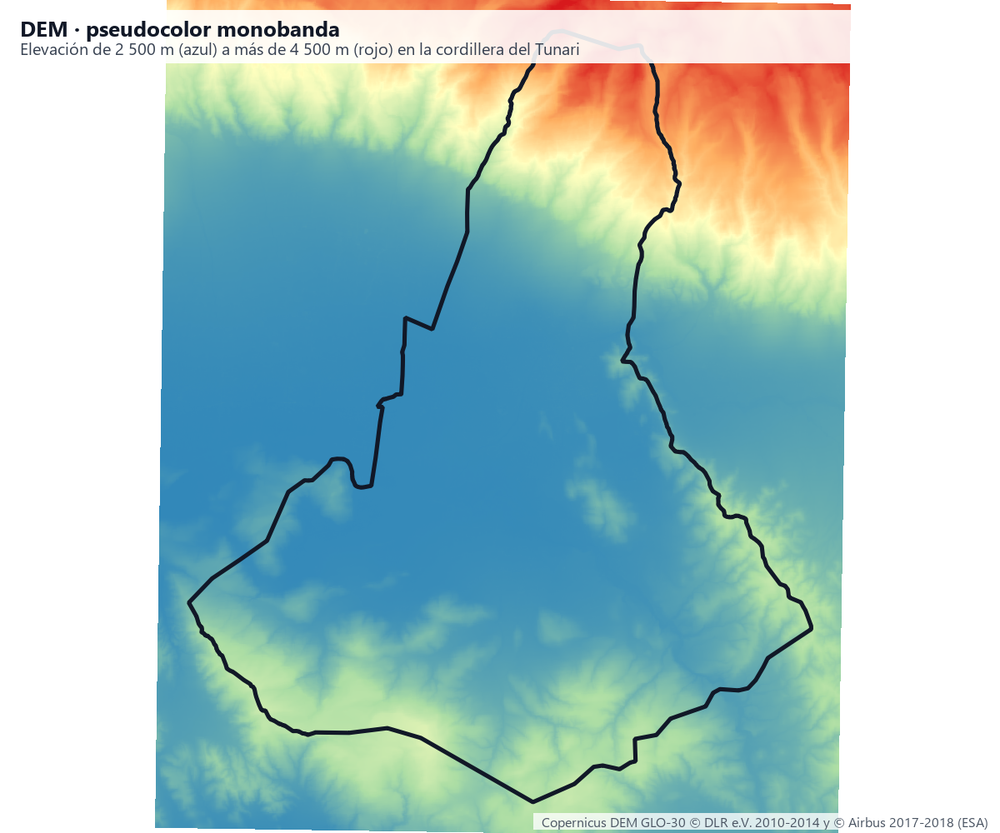

# 2.10 Explorar imágenes y superficies ráster

Desde el satélite Sentinel-2, la ciudad de Cochabamba se ve gris y parda en julio, la época seca. Pero si le pides al mismo archivo que muestre el **infrarrojo cercano**, los parques, las riberas y los cultivos se encienden en rojo. Nada cambió en los datos: cambió **cómo los miras**. En esta lección aprenderás a leer un ráster y a elegir la representación que revela lo que buscas.

{ loading=lazy }

{ loading=lazy }

!!! abstract "En esta lección"

    **Aprenderás a:**

    - Leer dimensiones, tamaño de celda, bandas, tipo de dato y NoData de un ráster.
    - Consultar **valores de celda** y distinguirlos del color que ves.
    - Usar el **histograma** y el **estiramiento de contraste**.
    - Representar un DEM en **gris** y **pseudocolor**, y una imagen en **color natural** y **falso color**.

    **Tiempo:** 90 min (25 de lectura · 65 de práctica) · **Datos:** `dem_copernicus_30m.tif`, `sentinel2_2025-07-16.tif`, `poblacion_worldpop_2020.tif` · **Producto:** `proyectos/reto_2-10_raster.qgz` y cuatro estilos ráster.

---

## Idea central

### Un ráster es una matriz de números

Cada **celda** guarda un número. Lo que ese número significa depende del dato:

| Ráster | Bandas | Cada celda guarda | Tipo |
|---|---|---|---|
| `dem_copernicus_30m.tif` | 1 | Elevación en metros (2 526 – 4 564) | Float32 |
| `sentinel2_2025-07-16.tif` | 4 | Reflectancia × 10 000 en azul, verde, rojo e infrarrojo cercano | UInt16 |
| `poblacion_worldpop_2020.tif` | 1 | Personas estimadas por celda | Float32 |

!!! danger "El color que ves no es el dato"

    QGIS **traduce** números a colores según la simbología. Un mismo DEM puede verse gris, multicolor o sombreado: los valores no cambian. Para conocer el dato, **identifica la celda**; no interpretes el color.

### Resolución: tamaño de celda, no calidad

- **10 m** (Sentinel-2): distingues manzanas y grandes edificios, no casas.
- **30 m** (DEM): adecuado para el relieve regional, no para una obra en una calle.
- **≈ 90 m** (WorldPop): una celda cubre casi una hectárea; sirve para patrones, no para personas concretas.

Más celdas no significa más información: remuestrear el DEM a 1 m no crea detalle ([1.9](../modulo-01/09-escala-resolucion-precision.md)).

### NoData no es cero

El ráster de población usa **−99999** para decir «aquí no hay dato». Si QGIS no lo supiera, esas celdas arruinarían el mínimo, la media y la simbología. Un 0, en cambio, puede ser un dato real («cero personas»).

### Bandas y composiciones

Una pantalla tiene tres canales: **rojo, verde y azul**. Una **composición RGB** asigna una banda del ráster a cada canal:

| Composición | Rojo | Verde | Azul | Útil para |
|---|---|---|---|---|
| **Color natural** | Banda 3 (rojo) | Banda 2 (verde) | Banda 1 (azul) | Ver «como el ojo»: calles, techos, suelo |
| **Falso color infrarrojo** | Banda 4 (IR cercano) | Banda 3 (rojo) | Banda 2 (verde) | Vegetación sana en rojo intenso |

!!! warning "Los números de banda dependen del archivo"

    En Sentinel-2 original, el rojo es la banda **B04** y el infrarrojo la **B08**. En nuestro archivo recortado son las bandas **3** y **4**, porque solo incluye B02, B03, B04 y B08. **Lee siempre la descripción de cada banda** en **Propiedades ▸ Información**.

---

## Hazlo conmigo

### Paso 1 · Ficha del ráster

Abre **Propiedades ▸ Información** de cada ráster y completa:

| | DEM | Sentinel-2 | Población |
|---|---|---|---|
| Columnas × filas | 821 × 964 | 1 237 × 923 | 274 × 321 |
| Tamaño de celda | 0,000278° (≈ 30 m) | 10 m | 0,000833° (≈ 90 m) |
| Bandas | 1 | 4 | 1 |
| Tipo de dato | Float32 | UInt16 | Float32 |
| NoData | — | — | −99999 |
| SRC | EPSG:4326 | EPSG:32719 | EPSG:4326 |

!!! captura "Captura pendiente · 2.10-02"

    - **Tipo:** Imagen (PNG) anotada
    - **Archivo:** `assets/images/modulo-02/2-10/2-10-02-propiedades-raster.png`
    - **Qué mostrar:** Pestaña **Información** de `sentinel2_2025-07-16.tif` con dimensiones, bandas y sus descripciones, tipo de dato, tamaño de celda y SRC.

### Paso 2 · Identificar celdas

Con **Identificar** (++ctrl+shift+i++), haz clic en el **Cristo de la Concordia** (cerro San Pedro, al este del centro):

- En el DEM: una elevación cercana a **2 830 m**, unos 270 m sobre la plaza principal (≈ 2 565 m).
- En Sentinel-2: **cuatro valores**, uno por banda.

!!! captura "Captura pendiente · 2.10-03"

    - **Tipo:** GIF animado
    - **Archivo:** `assets/images/modulo-02/2-10/2-10-03-identificar-pixel.gif`
    - **Qué mostrar:** Identificación sobre el DEM y después sobre la imagen multibanda en el mismo lugar.

### Paso 3 · Histograma y contraste

1. **Propiedades ▸ Histograma** del DEM: **Calcular histograma**. La mayoría de las celdas está entre 2 550 y 2 700 m (el valle); una cola larga sube al Tunari.
2. **Simbología** ▸ **Gris monobanda**. Cambia **Configuración de valores mín./máx.** entre **Mín./máx.** y **Recorte acumulativo 2–98 %**. ¿Qué cambia en el valle?

!!! captura "Captura pendiente · 2.10-05"

    - **Tipo:** Imagen (PNG)
    - **Archivo:** `assets/images/modulo-02/2-10/2-10-05-histograma.png`
    - **Qué mostrar:** Histograma del DEM con la concentración de valores en el valle y la cola hacia la cordillera.

!!! tip "El estiramiento no cambia el dato"

    El contraste decide qué rango de valores ocupa la escala de grises. Con recorte acumulativo, los valores extremos (cumbres) se saturan y el valle gana detalle.

### Paso 4 · Pseudocolor para el DEM

1. **Simbología ▸ Pseudocolor monobanda** · **Interpolación:** Lineal · **Rampa:** *Spectral* invertida · **Mín.** 2 500 · **Máx.** 4 500 · **Clasificar**.
2. Debajo, agrega un **sombreado**: duplica el DEM y elige **Sombreado** (*hillshade*), con **opacidad** del DEM coloreado al 60 %.

{ loading=lazy }

### Paso 5 · Composiciones de Sentinel-2

1. **Simbología ▸ Color multibanda**: **Rojo** banda 3, **Verde** banda 2, **Azul** banda 1. **Mejora de contraste:** estirar a mín./máx. con **recorte acumulativo**.
2. Guarda el estilo como `estilos/s2_color_natural.qml`.
3. Cambia a **Rojo** banda 4, **Verde** banda 3, **Azul** banda 2. Guarda como `estilos/s2_falso_color.qml`.
4. Compara: ¿dónde está la vegetación más vigorosa en pleno invierno seco?

!!! captura "Captura pendiente · 2.10-08"

    - **Tipo:** Imagen (PNG) compuesta
    - **Archivo:** `assets/images/modulo-02/2-10/2-10-08-composiciones-rgb.png`
    - **Qué mostrar:** La misma extensión en color natural (3-2-1) y en falso color infrarrojo (4-3-2), con la configuración de bandas visible.

### Paso 6 · Hacer transparente el NoData

En `poblacion_worldpop_2020`: **Propiedades ▸ Transparencia** ▸ verifica que **Valor sin datos** muestra −99999. Aplica **Pseudocolor** con rampa *Reds* y observa: las celdas sin edificaciones son transparentes.

---

## Inténtalo tú

!!! example "Reto 2.10 · Cuatro miradas al mismo territorio"

    Prepara un proyecto con cuatro vistas (usa **temas del mapa**, [2.2](02-orientarse-interfaz.md)) y exporta cada una a `salidas/`:

    1. DEM en gris con recorte acumulativo.
    2. DEM en pseudocolor con sombreado.
    3. Sentinel-2 en color natural.
    4. Sentinel-2 en falso color infrarrojo.

    Para **cinco lugares** dentro de la imagen (plaza principal, Laguna Alalay, aeropuerto Jorge Wilstermann, la ribera arbolada del río Rocha y una parcela agrícola del oeste) anota: elevación, valores de las bandas 3 y 4, y qué ves en cada composición.

    **Pregunta:** calcula a mano `(B4 − B3) / (B4 + B3)` para la laguna y para un parque. ¿Qué signo tiene cada uno? (Es el **NDVI**, que calcularás con la calculadora ráster en [3.8](../modulo-03/08-preparar-combinar-raster.md)).

---

## ¿Lo hiciste bien?

| Criterio | Se cumple si… |
|---|---|
| Ficha | Dimensiones, celda, bandas, tipo, NoData y SRC correctos para los tres ráster |
| Representación | DEM en gris y pseudocolor; imagen en 3-2-1 y 4-3-2 |
| Interpretación | Explicas por qué el falso color resalta la vegetación |
| NoData | El ráster de población muestra transparencia donde no hay dato |
| NDVI | El agua da valores negativos; la vegetación, positivos |

### Errores frecuentes

| Síntoma | Causa probable | Solución |
|---|---|---|
| La imagen se ve casi negra | Contraste mín./máx. con valores extremos | Recorte acumulativo 2–98 % |
| Colores «raros» en color natural | Bandas mal asignadas | Revisa la descripción de cada banda |
| Un marco negro alrededor del ráster | NoData no definido | **Transparencia ▸ Valor sin datos** |
| El DEM se ve plano | Rango de colores demasiado amplio | Ajusta mín./máx. al área de interés |
| Identificar muestra un número distinto al color | Es lo esperado | El color es simbología; el número es el dato |

---

## Comprueba lo aprendido

??? question "1. ¿Qué diferencia hay entre el valor de una celda y su color en pantalla?"

    El valor es el **dato** almacenado; el color es la **simbología** que QGIS aplica. El mismo valor puede verse de muchos colores.

??? question "2. ¿Una celda de 10 m es «mejor» que una de 30 m?"

    Tiene más **detalle espacial**, pero eso no garantiza más **exactitud** ni que sea adecuada para tu escala de trabajo.

??? question "3. ¿Por qué no se usa una composición RGB para un DEM?"

    Porque el DEM tiene **una sola banda**. Se representa en gris o pseudocolor.

??? question "4. ¿Por qué la vegetación aparece roja en el falso color 4-3-2?"

    Porque la vegetación sana refleja mucho **infrarrojo cercano**, y en esa composición el IR se asigna al canal **rojo** de la pantalla.

??? question "5. ¿Qué pasaría con la media del ráster de población si −99999 no se declarara NoData?"

    Sería un número absurdamente negativo: cada celda sin dato «restaría» 99 999 personas.

??? question "6. Repaso de 1.11 · ¿Por qué la elevación se representa como ráster?"

    Porque es un **fenómeno continuo**: tiene un valor en cada lugar.

---

## Tu proyecto

Mira la imagen en falso color junto a tus zonas densas: ¿hay barrios densos **sin áreas verdes**? Es una segunda dimensión del acceso a servicios (los espacios públicos). Anota la observación como pregunta abierta para el informe final.

---

## Referencias

- Lillesand, T., Kiefer, R. W., & Chipman, J. (2015). *Remote Sensing and Image Interpretation* (7.ª ed.). Wiley.
- Chuvieco, E. (2020). *Fundamentals of Satellite Remote Sensing: An Environmental Approach* (3.ª ed.). CRC Press.
- European Space Agency. (s. f.). *Sentinel-2 User Handbook*. <https://sentinel.esa.int/web/sentinel/user-guides/sentinel-2-msi>
- European Space Agency. (2022). *Copernicus DEM Product Handbook*. <https://spacedata.copernicus.eu/collections/copernicus-digital-elevation-model>
- QGIS Project. (s. f.). *Manual de usuario: Propiedades de capas ráster*. <https://docs.qgis.org/latest/es/docs/user_manual/working_with_raster/raster_properties.html>
