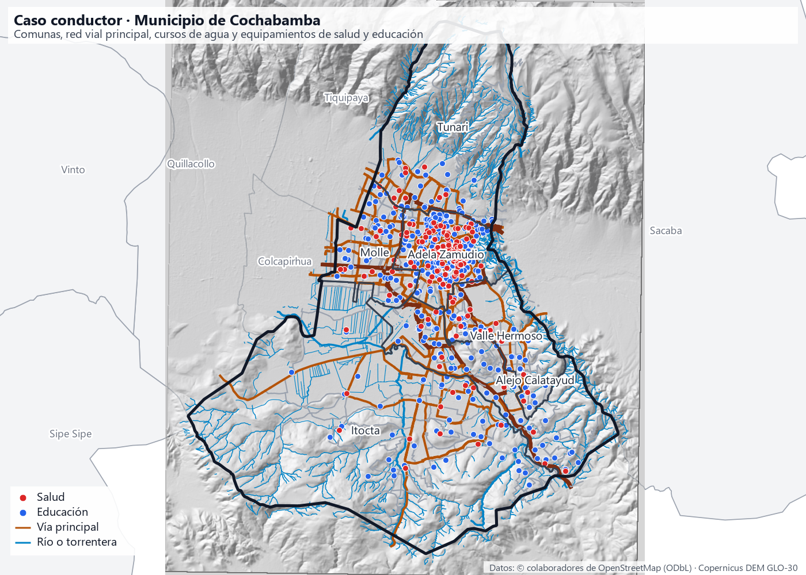

# Módulo 2 · Introducción al uso de QGIS

!!! abstract "Objetivo del módulo"

    **Manejar QGIS con autonomía, comprender cómo organiza la información y construir un proyecto que otra persona pueda abrir y utilizar.**

---

## Presentación

En el **Módulo 1** construimos la base conceptual: qué representamos, bajo qué referencia, a qué escala, con qué precisión, mediante qué modelo y con qué calidad. Ahora es momento de llevar esos conceptos a la práctica con **QGIS**.

Este módulo no busca recorrer todos los menús del programa. Busca algo más importante: que puedas **trabajar con autonomía**, entendiendo **cómo QGIS organiza la información**, para resolver por tu cuenta los problemas que aparecen en el trabajo real.

!!! quote ""

    Un proyecto que solo funciona en la computadora de quien lo hizo **no es un proyecto terminado**.

Por eso, a lo largo del módulo, pondremos especial atención en cuatro aspectos que suelen generar la mayoría de los problemas:

-   :material-file-tree-outline:{ .lg .middle } **Proyecto frente a fuentes de datos**

    ---

    Un proyecto de QGIS **no contiene los datos**: contiene referencias a ellos. Entender esta diferencia es la clave para compartir proyectos.

-   :material-link-variant:{ .lg .middle } **Rutas y capas no disponibles**

    ---

    Cómo guardar proyectos portables y cómo **reparar** las capas cuando sus archivos cambiaron de lugar.

-   :material-table-arrow-right:{ .lg .middle } **Importación de tablas**

    ---

    Cómo convertir una tabla con coordenadas en información geográfica, sin errores de codificación, tipos de campo ni coordenadas intercambiadas.

-   :material-earth-arrow-right:{ .lg .middle } **Sistemas de referencia**

    ---

    Cómo diagnosticar y corregir capas desplazadas, y la diferencia entre **asignar** y **reproyectar** un sistema de referencia.

---

## Estructura del módulo

El módulo se organiza en **doce lecciones** agrupadas en cinco bloques. Cada lección termina con un **reto práctico** que aplica lo aprendido a una situación real.

### Bloque 1 · Entorno y proyectos

-   **2.1 Preparar un entorno de trabajo**

    ---

    Instalación, versiones, perfiles de usuario, preferencias, complementos y organización de carpetas.

    **Reto:** preparar un entorno reproducible para el curso.

    [:octicons-arrow-right-24: Ir a la lección](01-entorno-trabajo.md)

-   **2.2 Orientarse y trabajar con fluidez**

    ---

    Paneles, navegador, localizador, identificación, marcadores espaciales, orden y agrupación de capas.

    **Reto:** preparar la reunión del equipo con seis marcadores de Cochabamba.

    [:octicons-arrow-right-24: Ir a la lección](02-orientarse-interfaz.md)

-   **2.3 Comprender y gestionar proyectos**

    ---

    Proyecto `.qgz`, fuentes externas, rutas relativas, propiedades, copias y reparación de capas no disponibles.

    **Reto:** entregar un proyecto que funcione en cualquier computadora.

    [:octicons-arrow-right-24: Ir a la lección](03-gestionar-proyectos.md)

### Bloque 2 · Datos y coordenadas

-   **2.4 Incorporar datos y reconocer sus diferencias**

    ---

    GeoPackage, Shapefile, GeoJSON y GeoTIFF; geometrías, extensión, campos, bandas y metadatos.

    **Reto:** inventariar el paquete de datos y decidir qué sirve.

    [:octicons-arrow-right-24: Ir a la lección](04-incorporar-datos.md)

-   **2.5 Convertir una tabla en información geográfica**

    ---

    Importación de CSV: separadores, codificación, tipos de campo, coordenadas X/Y y SRC de origen.

    **Reto:** encontrar los 22 establecimientos que aparecen frente a la Antártida.

    [:octicons-arrow-right-24: Ir a la lección](05-tablas-coordenadas.md)

-   **2.6 Resolver problemas de coordenadas**

    ---

    SRC de capa y de proyecto, asignación frente a reproyección, transformaciones, unidades y mediciones.

    **Reto:** devolver al lugar correcto unas vías que aparecen en el Pacífico.

    [:octicons-arrow-right-24: Ir a la lección](06-problemas-coordenadas.md)

### Bloque 3 · Explorar y consultar

-   **2.7 Leer los datos antes de utilizarlos**

    ---

    Tabla de atributos, identificación, estadísticas, valores nulos, identificadores y coherencia.

    **Reto:** construir una matriz de control de calidad.

    [:octicons-arrow-right-24: Ir a la lección](07-leer-datos.md)

-   **2.8 Seleccionar, filtrar y extraer información**

    ---

    Selección manual y por expresión, filtros de capa, operadores y exportación de entidades.

    **Reto:** dos subconjuntos reproducibles para dos equipos.

    [:octicons-arrow-right-24: Ir a la lección](08-seleccionar-filtrar.md)

### Bloque 4 · Representar y conectar

-   **2.9 Representar y etiquetar datos vectoriales**

    ---

    Símbolos, categorías, graduación, etiquetas, visibilidad por escala y estilos reutilizables.

    **Reto:** primera lectura temática de Cochabamba.

    [:octicons-arrow-right-24: Ir a la lección](09-simbologia-etiquetas.md)

-   **2.10 Explorar imágenes y superficies ráster**

    ---

    Bandas, resolución, NoData, valores de píxel, escala de grises, pseudocolor y combinaciones RGB.

    **Reto:** cuatro miradas al mismo territorio (y tu primer NDVI a mano).

    [:octicons-arrow-right-24: Ir a la lección](10-explorar-raster.md)

-   **2.11 Conectar información disponible en internet**

    ---

    XYZ, WMS/WMTS y WFS; imágenes cartográficas frente a entidades; cobertura, atribución y dependencia.

    **Reto:** ficha de servicios web: imagen o dato, licencia y dependencia.

    [:octicons-arrow-right-24: Ir a la lección](11-servicios-web.md)

### Bloque 5 · Taller

-   **2.12 Construir y entregar un proyecto funcional**

    ---

    Integración de capas, revisión de fuentes, estilos, nombres, metadatos y solución de problemas frecuentes.

    **Reto:** entregar un proyecto que pueda abrirse desde otra ubicación.

    [:octicons-arrow-right-24: Ir a la lección](12-taller-proyecto.md)

---

## De los conceptos al software

Cada lección de este módulo aplica en QGIS uno o varios temas del Módulo 1. Si algo no queda claro en la práctica, la explicación conceptual está en el tema correspondiente.

| Lección | Temas del Módulo 1 que aplica |
|---|---|
| 2.1 Preparar un entorno de trabajo | 1.1 SIG como sistema · 1.15 Ecosistema de geotecnologías |
| 2.2 Orientarse y trabajar con fluidez | 1.2 Localización · 1.8 Escala en un SIG |
| 2.3 Comprender y gestionar proyectos | 1.12 Dato geoespacial · 1.13 Linaje |
| 2.4 Incorporar datos y reconocer sus diferencias | 1.11 Modelos vectorial y ráster · 1.12 Metadatos |
| 2.5 Convertir una tabla en información geográfica | 1.3 Latitud y longitud · 1.4 Identificación de un SRC · 1.12 Atributos |
| 2.6 Resolver problemas de coordenadas | 1.4 Sistemas de referencia · 1.5 Proyecciones · 1.6 UTM |
| 2.7 Leer los datos antes de utilizarlos | 1.12 Atributos e identificadores · 1.13 Calidad |
| 2.8 Seleccionar, filtrar y extraer información | 1.2 Relaciones espaciales · 1.12 Escalas de medición |
| 2.9 Representar y etiquetar datos vectoriales | 1.7 Cartografía · 1.10 Generalización |
| 2.10 Explorar imágenes y superficies ráster | 1.9 Resolución · 1.11 Modelo ráster |
| 2.11 Conectar información disponible en internet | 1.14 Geotecnologías · 1.15 Web GIS e IDE |
| 2.12 Construir y entregar un proyecto funcional | Integración de todo el módulo |

---

## Cómo están organizadas las lecciones

Todas las lecciones siguen la misma secuencia, para que siempre sepas dónde estás:

| Sección | Para qué sirve |
|---|---|
| **En esta lección** | Objetivos, tiempo estimado, datos y producto |
| **Idea central** | Los conceptos imprescindibles, con tablas y figuras |
| **Hazlo conmigo** | Laboratorio guiado paso a paso con los datos de Cochabamba |
| **Inténtalo tú** | Reto autónomo, con datos que a veces traen errores a propósito |
| **¿Lo hiciste bien?** | Criterios para verificar tu resultado y errores frecuentes |
| **Comprueba lo aprendido** | Autoevaluación con respuestas desplegables, incluida una pregunta de repaso |
| **Tu proyecto** | Cómo avanza el caso conductor |
| **Referencias** | Fuentes académicas, oficiales y de datos |

### Convenciones

| Convención | Significado | Ejemplo |
|---|---|---|
| **Menú ▸ Submenú** | Ruta de menús a seguir | **Proyecto ▸ Propiedades** |
| ++ctrl+s++ | Atajo de teclado | Guardar el proyecto |
| `texto en monoespaciado` | Archivos, carpetas, campos, valores o expresiones | `datos/originales/limites.gpkg` |

!!! note "Los nombres de los menús pueden variar"

    Esta documentación usa la **interfaz de QGIS 4.x en español**. Si un nombre no coincide, busca la herramienta con el **localizador** (++ctrl+k++, lección [2.2](02-orientarse-interfaz.md)).

---

## El caso conductor y los datos

Todos los laboratorios usan el **[paquete de datos del curso](../descargas/index.md)**: el municipio de **Cochabamba**, con comunas, zonas de población, 661 establecimientos de salud y educación, red vial, ríos, un modelo de elevación y una imagen Sentinel-2. Algunos archivos de `datos/ejercicios/` traen **errores intencionales** (coordenadas intercambiadas, SRC mal declarado, codificaciones mezcladas) para que aprendas a diagnosticarlos.

{ loading=lazy }

!!! example "Un hilo conductor"

    Cada reto aporta una pieza al **taller 2.12**: entregar un proyecto que **otra persona pueda abrir** y que muestre, con datos verificados, dónde están los servicios y dónde vive la población de Cochabamba.

---

## Recomendaciones para el estudio

- **Sigue el orden de las lecciones.** Cada una usa lo aprendido en las anteriores, en especial las lecciones 2.1 y 2.3.
- **Practica con tus propias manos.** Leer los pasos no reemplaza hacerlos en QGIS.
- **Equivócate a propósito.** Mover archivos, asignar un SRC incorrecto o importar una tabla mal configurada, **en una copia de los datos**, es la mejor forma de aprender a reconocer y resolver problemas.
- **Consulta la documentación oficial.** Aprender a buscar en el manual de QGIS es parte de la autonomía que busca este módulo.
- **Vuelve al Módulo 1** cuando algo no tenga sentido: casi siempre la respuesta está en un concepto.

---

## Al terminar el módulo

!!! success "Habrás alcanzado el objetivo del módulo si puedes:"

    - Preparar un entorno de QGIS ordenado y reproducible.
    - Explicar la diferencia entre un **proyecto** y sus **fuentes de datos**, y reparar capas no disponibles.
    - Incorporar datos en distintos formatos y evaluar si sirven para un trabajo.
    - Convertir una tabla con coordenadas en una capa geográfica correcta.
    - Diagnosticar una capa desplazada y decidir si hay que **asignar** o **reproyectar** su sistema de referencia.
    - Revisar, seleccionar, filtrar y exportar información con criterio.
    - Representar datos vectoriales y ráster de forma legible.
    - Incorporar servicios de información disponibles en internet.
    - **Entregar un proyecto que otra persona pueda abrir y utilizar.**

---

## Documentación oficial de referencia

La documentación oficial de QGIS profundiza en los aspectos centrales de este módulo:

- QGIS Project. *Manual de usuario: Trabajar con archivos de proyecto*. <https://docs.qgis.org/latest/es/docs/user_manual/introduction/project_files.html>
- QGIS Project. *Manual de usuario: Abrir datos*. <https://docs.qgis.org/latest/es/docs/user_manual/managing_data_source/opening_data.html>
- QGIS Project. *Manual de usuario: Trabajar con proyecciones*. <https://docs.qgis.org/latest/es/docs/user_manual/working_with_projections/working_with_projections.html>
- QGIS Project. *Manual de usuario de QGIS*. <https://docs.qgis.org/latest/es/docs/user_manual/>
