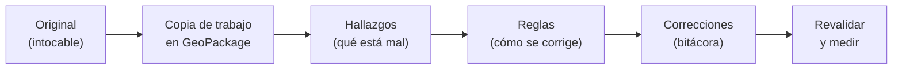

# 3.1 Preparar datos confiables

La unidad de salud te entrega su base de establecimientos «actualizada». Se abre sin errores, los puntos caen en Cochabamba y la tabla tiene todos los campos. Pero hay **7 códigos repetidos** (en 14 registros), **4 puntos duplicados**, `salud` escrito de **tres maneras**, y la capacidad dice `-1`, `S/D` o nada en 495 de 665 registros. Si analizas así, cada resultado del Módulo 3 heredará esos errores. Esta lección te enseña a **auditar**, **corregir con trazabilidad** y **medir** cuánto mejoró la base.

!!! abstract "En esta lección"

    **Aprenderás a:**

    - Preservar el original y trabajar en un **GeoPackage de trabajo**.
    - Auditar identificadores, valores ausentes, duplicados, dominios, rangos, geometrías y SRC.
    - Registrar **hallazgos** con severidad y estado.
    - Corregir con reglas explícitas y una **bitácora** de cambios.
    - Comparar indicadores de calidad **antes y después**.

    **Tiempo:** 2 h (30 min de lectura · 90 de práctica) · **Datos:** `datos/ejercicios/equipamientos_auditoria.gpkg` · **Producto:** `datos/trabajo/auditoria_equipamientos.gpkg` con las capas `equipamientos`, `hallazgos` y `correcciones`.

---

## Idea central

### Una capa puede funcionar y estar equivocada

QGIS no te avisa si un código está repetido o si `-1` significa «no sé». **El software valida formatos, no significados.** La confianza en un dato se construye con evidencia:

| Nivel | Significa | Ejemplo |
|---|---|---|
| **Confirmado** | Verificado con una fuente independiente | La capacidad coincide con el registro del SEDES |
| **Plausible** | No contradice nada conocido, pero no se verificó | Una escuela con 420 alumnos |
| **Sospechoso** | Contradice reglas o expectativas | Capacidad `-1`; dos códigos iguales |
| **Erróneo** | Se demostró que está mal | El mismo establecimiento cargado dos veces |

!!! danger "El error se propaga"

    Si un hospital está duplicado, en la lección 3.6 contarás dos hospitales donde hay uno; en 3.7 el área de cobertura no cambiará, pero el indicador «habitantes por establecimiento» será falso; en el Módulo 4 publicarás un mapa equivocado. **Corregir al principio es lo más barato.**

### Qué se audita

| Dimensión | Regla de ejemplo | Expresión o herramienta |
|---|---|---|
| **Identificadores** | `id_equip` existe, es único y sigue el formato `EQ-0000` | `count("id_equip", "id_equip") > 1`, `regexp_match("id_equip", '^EQ-[0-9]{4}$')` |
| **Completitud** | `nombre` no es nulo ni vacío | `"nombre" IS NULL OR trim("nombre") = ''` |
| **Duplicados** | No hay dos entidades con la misma geometría | **Eliminar geometrías duplicadas** (Procesos) |
| **Dominio** | `tipo` ∈ {salud, educacion}; `estado` ∈ {ACTIVO, CERRADO} | **Valores únicos** del campo |
| **Rango** | `capacidad` entera y mayor que 0 | `to_int("capacidad") <= 0` |
| **Geometría** | Geometrías válidas, no vacías | **Comprobar validez** (Procesos) |
| **Referencia** | SRC declarado y correcto | **Propiedades ▸ Información** ([2.6](../modulo-02/06-problemas-coordenadas.md)) |

### Corregir sin perder la historia



Una corrección **destructiva** sobrescribe el valor y nadie sabrá qué había. Una corrección **trazable** registra: entidad, campo, valor anterior, valor nuevo, regla, fecha y responsable.

---

## Hazlo conmigo

### Paso 1 · Preservar y organizar

1. Agrega `datos/ejercicios/equipamientos_auditoria.gpkg ▸ equipamientos`.
2. **Exportar ▸ Guardar objetos como…** ▸ GeoPackage `datos/trabajo/auditoria_equipamientos.gpkg`, capa `equipamientos`. **No vuelvas a tocar el original.**
3. En el mismo GeoPackage crea dos tablas **sin geometría** (**Capa ▸ Crear capa ▸ Nueva capa GeoPackage**, tipo de geometría *Sin geometría*):

| Tabla | Campos |
|---|---|
| `hallazgos` | `id_hallazgo` (texto), `regla`, `campo`, `n_afectados` (entero), `severidad` (alta / media / baja), `estado` (abierto / corregido / aceptado) |
| `correcciones` | `id_equip`, `campo`, `valor_anterior`, `valor_nuevo`, `regla`, `fecha` (fecha), `responsable` |

!!! captura "Captura pendiente · 3.1-01"

    - **Tipo:** GIF
    - **Archivo:** `assets/images/modulo-03/3-1/3-1-01-crear-geopackage.gif`
    - **Qué mostrar:** Exportar la capa original a un GeoPackage de trabajo y crear en él las tablas `hallazgos` y `correcciones`.

### Paso 2 · Perfilado inicial

Antes de cambiar nada, mide. Completa con **Resumen estadístico** y **Seleccionar por expresión**:

| Indicador | Expresión o método | Valor inicial |
|---|---|---|
| Entidades | Recuento | 665 |
| Códigos repetidos | `count("id_equip", "id_equip") > 1` | 14 entidades (7 códigos) |
| Geometrías duplicadas | **Eliminar geometrías duplicadas** (modo de prueba: mira cuántas eliminaría) | 4 |
| Nombres nulos | `"nombre" IS NULL` | 133 |
| Grafías de `tipo` | Valores únicos | 6 (deberían ser 2) |
| Grafías de `estado` | Valores únicos | 5, incluido `NULL` |
| Capacidad no válida | `NOT regexp_match("capacidad", '^[1-9][0-9]*$') OR "capacidad" IS NULL` | 495 |

!!! captura "Captura pendiente · 3.1-06"

    - **Tipo:** PNG anotado
    - **Archivo:** `assets/images/modulo-03/3-1/3-1-06-valores-unicos.png`
    - **Qué mostrar:** Lista de valores únicos de `tipo` y `estado`, con las grafías inconsistentes resaltadas.

### Paso 3 · Registrar hallazgos

Por cada problema, una fila en `hallazgos`. Ejemplo:

| id_hallazgo | regla | campo | n_afectados | severidad | estado |
|---|---|---|---|---|---|
| H01 | Código único | id_equip | 14 | alta | abierto |
| H02 | Dominio de tipo | tipo | 6 grafías | alta | abierto |
| H03 | Capacidad entera > 0 | capacidad | 495 | media | abierto |
| H04 | Nombre obligatorio | nombre | 133 | baja | aceptado |

!!! tip "Aceptar también es una decisión"

    No todo se corrige: los 133 nombres faltantes no se pueden inventar. Se **aceptan** como limitación y se documentan.

### Paso 4 · Corregir con reglas explícitas

Activa la edición (++ctrl+e++) y usa la **Calculadora de campos** (++ctrl+i++) con **Actualizar campo existente**:

=== "tipo"

    ```sql
    lower(trim("tipo"))
    ```

=== "estado"

    ```sql
    CASE WHEN "estado" IS NULL THEN NULL ELSE upper(trim("estado")) END
    ```

=== "capacidad (nuevo campo entero `capacidad_n`)"

    ```sql
    CASE
      WHEN regexp_match("capacidad", '^[1-9][0-9]*$') THEN to_int("capacidad")
      ELSE NULL
    END
    ```

    Crea un campo nuevo en lugar de sobrescribir: así conservas el valor original como evidencia.

Para los **duplicados**:

1. **Procesos ▸ Eliminar geometrías duplicadas** sobre la capa de trabajo ▸ salida temporal. Comprueba que elimina **4**.
2. Vuelve a seleccionar con `count("id_equip","id_equip") > 1`: quedan **6** entidades (3 códigos). Son entidades **distintas** con el mismo código. Asigna un código nuevo (`EQ-9001`, `EQ-9002`, …) y regístralo en `correcciones`.

!!! captura "Captura pendiente · 3.1-10"

    - **Tipo:** GIF
    - **Archivo:** `assets/images/modulo-03/3-1/3-1-10-registrar-correccion.gif`
    - **Qué mostrar:** Edición de un código repetido y registro simultáneo de la corrección en la tabla `correcciones`.

### Paso 5 · Revisar geometría y SRC

1. **Procesos ▸ Comprobar validez**: ¿hay geometrías no válidas?
2. **Propiedades ▸ Información**: SRC EPSG:32719, extensión dentro del municipio.

!!! captura "Captura pendiente · 3.1-08"

    - **Tipo:** GIF
    - **Archivo:** `assets/images/modulo-03/3-1/3-1-08-comprobar-validez.gif`
    - **Qué mostrar:** El algoritmo **Comprobar validez** con sus tres salidas: válidas, no válidas y errores.

### Paso 6 · Revalidar y medir

Repite el perfilado del paso 2 sobre la capa corregida y compara:

| Indicador | Antes | Después |
|---|---|---|
| Entidades | 665 | 661 |
| Entidades con código repetido | 14 | 0 |
| Grafías de `tipo` | 6 | 2 |
| Capacidad válida | 170 | 169 (el resto es `NULL` documentado) |

!!! captura "Captura pendiente · 3.1-11"

    - **Tipo:** PNG comparativo
    - **Archivo:** `assets/images/modulo-03/3-1/3-1-11-antes-despues.png`
    - **Qué mostrar:** Tabla comparando los indicadores antes y después de la auditoría.

!!! success "La mejor métrica es la honestidad"

    La capacidad válida **no aumentó**: no inventamos datos. Lo que cambió es que ahora sabes exactamente qué puedes y qué no puedes calcular.

---

## Inténtalo tú

!!! example "Reto 3.1 · Informe de auditoría"

    Completa la auditoría y redacta `documentos/informe_auditoria.md` (una página) con:

    1. Tabla de indicadores antes y después.
    2. Lista de hallazgos con su estado final.
    3. Las **reglas** aplicadas (expresiones).
    4. Una recomendación para la institución que entregó los datos: ¿qué tres controles debería incluir su formulario de captura? (Lo construirás en [3.3](03-disenar-formularios-captura.md).)

---

## ¿Lo hiciste bien?

| Criterio | Se cumple si… |
|---|---|
| Preservación | El original sigue intacto; todo se hizo en `auditoria_equipamientos.gpkg` |
| Perfilado | Los valores iniciales coinciden con la tabla del paso 2 |
| Trazabilidad | Cada cambio de código figura en `correcciones` |
| Reglas | `tipo` y `estado` normalizados con expresiones; `capacidad_n` entero |
| Resultado | 661 entidades, 0 códigos repetidos, 2 tipos, 169 capacidades válidas |
| Juicio | Los problemas no corregibles están **aceptados** y documentados |

### Errores frecuentes

| Síntoma | Causa | Solución |
|---|---|---|
| La calculadora no deja editar | La capa no está en edición o es de solo lectura | ++ctrl+e++; trabaja sobre la copia |
| `to_int('S/D')` da error | Conversión de un texto no numérico | Valida antes con `regexp_match` |
| Se eliminaron puntos que no eran duplicados | Comparar solo por atributo | Compara geometría **y** atributos |
| Se perdió el valor original | Se sobrescribió el campo | Crea campos nuevos para valores derivados |

---

## Comprueba lo aprendido

??? question "1. ¿Por qué no basta con que QGIS abra la capa sin errores?"

    Porque el software valida el **formato**, no el **significado**: un código repetido o un `-1` son valores técnicamente válidos.

??? question "2. ¿Qué diferencia hay entre un dato sospechoso y uno erróneo?"

    El sospechoso contradice una regla o expectativa; el erróneo se **demostró** incorrecto con evidencia.

??? question "3. ¿Por qué crear `capacidad_n` en lugar de sobrescribir `capacidad`?"

    Para conservar el valor recibido como evidencia y poder rehacer o auditar la conversión.

??? question "4. Dos puntos tienen el mismo código pero están a 3 km. ¿Son duplicados?"

    Probablemente no: son **dos entidades distintas** con un código mal asignado. Se corrige el código, no se borra un punto.

??? question "5. ¿Qué es una geometría válida y por qué no garantiza una topología correcta?"

    Es una geometría bien formada (sin autointersecciones, anillos cerrados). Pero dos polígonos válidos pueden **superponerse** o dejar **huecos** entre sí: eso es un problema topológico ([3.2](02-digitalizar-editar-precision.md)).

??? question "6. Repaso de 2.7 · ¿Por qué `NULL`, `''` y `-1` no son equivalentes?"

    `NULL` es ausencia; `''` es un texto vacío; `-1` es un número que alguien usó como código. Cada uno se comporta distinto en los cálculos.

---

## Tu proyecto

Usarás esta capa auditada en el resto del módulo. Añade a tu `LEEME.txt` la sección **Calidad** con la tabla antes/después. Desde ahora, todo indicador que calcules deberá decir si usa datos **confirmados, plausibles o aceptados con limitaciones**.

---

## Referencias

- International Organization for Standardization. (2013). *ISO 19157:2013 Geographic information — Data quality*. ISO.
- Devillers, R., & Jeansoulin, R. (Eds.). (2006). *Fundamentals of Spatial Data Quality*. ISTE.
- Veregin, H. (1999). Data quality parameters. En P. A. Longley, M. F. Goodchild, D. J. Maguire & D. W. Rhind (Eds.), *Geographical Information Systems* (2.ª ed., pp. 177–189). Wiley.
- QGIS Project. (s. f.). *Manual de usuario: Calculadora de campos*. <https://docs.qgis.org/latest/es/docs/user_manual/working_with_vector/attribute_table.html#using-the-field-calculator>
- QGIS Project. (s. f.). *Algoritmos de Procesos: Herramientas generales de vectores*. <https://docs.qgis.org/latest/es/docs/user_manual/processing_algs/qgis/vectorgeneral.html>
