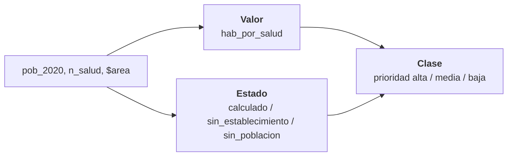

# 3.4 Construir indicadores con expresiones

«¿Cuántos habitantes hay por establecimiento de salud en cada zona?» Parece una división. Pero en 140 zonas habitadas **no hay ningún establecimiento**: dividir entre cero no da «infinito», da un error o, peor, un número inventado. En 125 zonas **no vive nadie**. Un indicador mal construido convierte estas situaciones en resultados que parecen serios y no lo son. Aquí aprenderás a construir indicadores **robustos, documentados y probados**.

!!! abstract "En esta lección"

    **Aprenderás a:**

    - Escribir expresiones con aritmética, texto, condiciones y geometría.
    - Tratar `NULL`, ceros y divisiones entre cero con `coalesce()`, `nullif()` y `CASE`.
    - Distinguir **porcentaje, razón, tasa y densidad**.
    - Elegir entre campo **persistente** y **virtual**.
    - Separar el **valor** del indicador de su **estado** y de su **clasificación**.
    - **Probar** un indicador con casos frontera antes de mapearlo.

    **Tiempo:** 2 h (30 min de lectura · 90 de práctica) · **Datos:** `limites.gpkg ▸ zonas_analisis`, `equipamientos` auditado (3.1) · **Producto:** capa `zonas_indicadores` en `datos/trabajo/indicadores.gpkg` y una ficha técnica.

---

## Idea central

### Cuatro tipos de indicador

| Tipo | Fórmula | Ejemplo | Unidad |
|---|---|---|---|
| **Porcentaje** | parte / total × 100 | Población sin cobertura / población total | % |
| **Razón** | A / B (distintos) | Habitantes por establecimiento | hab./establecimiento |
| **Tasa** | eventos / población × base | Nacimientos por cada 1 000 habitantes | ‰ |
| **Densidad** | cantidad / superficie | Habitantes por km² | hab./km² |

### Cero, `NULL` y «no se puede calcular»

| Situación en la zona | `pob / n_salud` ingenuo | Lo correcto |
|---|---|---|
| 7 406 hab., 30 establecimientos | 247 | **247** |
| 4 496 hab., 0 establecimientos | Error o infinito | `NULL` + estado `sin_establecimiento` |
| 0 hab., 0 establecimientos | Error | `NULL` + estado `sin_poblacion` |
| 0 hab., 2 establecimientos | 0 | `NULL` + estado `sin_poblacion` |

!!! danger "No ocultes un problema con un número"

    `coalesce("pob" / "n_salud", 0)` convierte «no hay establecimiento» en **0 habitantes por establecimiento**: ¡la zona parecería la mejor atendida! Usa `nullif()` para evitar la división entre cero y un campo de **estado** para explicar por qué falta el valor.

### Valor, estado y clase son tres campos distintos



Separarlos permite cambiar los **umbrales** de la clasificación sin rehacer el cálculo, y explicar cada resultado.

---

## Hazlo conmigo

### Paso 1 · Preparar la capa de trabajo

1. Exporta `zonas_analisis` a `datos/trabajo/indicadores.gpkg`, capa `zonas_indicadores`.
2. Agrega la capa `equipamientos` auditada de [3.1](01-preparar-datos-confiables.md) y nómbrala exactamente **equipamientos**.
3. Abre la **Calculadora de campos** (++ctrl+i++) y explora el panel central: funciones, campos y la **vista previa** del resultado.

!!! captura "Captura pendiente · 3.4-01"

    - **Tipo:** PNG anotado
    - **Archivo:** `assets/images/modulo-03/3-4/3-4-01-calculadora-campos.png`
    - **Qué mostrar:** La Calculadora de campos con el nombre del campo, el tipo, la expresión, el panel de funciones y la vista previa.

### Paso 2 · Medidas geométricas

Crea `area_km2_calc` (decimal):

```sql
$area / 1000000
```

`$area` usa el **elipsoide** del proyecto; `area($geometry)` usa el **plano** del SRC de la capa. En UTM 19 S, para Cochabamba difieren ~0,14 % ([2.6](../modulo-02/06-problemas-coordenadas.md)). Elige uno, **documenta cuál** y úsalo siempre.

### Paso 3 · Contar establecimientos por zona

Crea `n_salud` (entero):

```sql
array_length(
  overlay_contains('equipamientos', $id, filter:= "tipo" = 'salud')
)
```

`overlay_contains` devuelve la lista de entidades de otra capa contenidas en cada zona; `array_length` las cuenta. Repite con `n_educacion`.

!!! tip "Comprueba con un caso conocido"

    La zona **Z214** (centro de Adela Zamudio) debe dar **30** establecimientos de salud; **Z158** (Alejo Calatayud), **0**.

### Paso 4 · Indicador robusto con `nullif`

Crea `hab_por_salud` (decimal):

```sql
CASE
  WHEN "pob_2020" = 0 THEN NULL
  ELSE round("pob_2020" / nullif("n_salud", 0), 0)
END
```

Y su **estado** `estado_calc` (texto):

```sql
CASE
  WHEN "pob_2020" = 0 THEN 'sin_poblacion'
  WHEN "n_salud" = 0 THEN 'sin_establecimiento'
  ELSE 'calculado'
END
```

!!! captura "Captura pendiente · 3.4-05"

    - **Tipo:** GIF
    - **Archivo:** `assets/images/modulo-03/3-4/3-4-05-case.gif`
    - **Qué mostrar:** Escribir la expresión CASE del estado y revisar la vista previa en tres zonas distintas.

### Paso 5 · Clasificar con umbrales justificados

Crea `prioridad` (texto):

```sql
CASE
  WHEN "estado_calc" = 'sin_poblacion' THEN 'no_aplica'
  WHEN "estado_calc" = 'sin_establecimiento' AND "pob_2020" / "area_km2_calc" >= 3000 THEN 'alta'
  WHEN "estado_calc" = 'sin_establecimiento' THEN 'media'
  WHEN "hab_por_salud" > 5000 THEN 'media'
  ELSE 'baja'
END
```

!!! warning "El orden del CASE importa"

    QGIS evalúa las condiciones **de arriba hacia abajo** y se detiene en la primera verdadera. Si pones `ELSE 'baja'` antes de revisar el estado, todas las zonas sin establecimiento quedarían como prioridad baja.

El umbral de **3 000 hab./km²** separa aproximadamente las zonas urbanas consolidadas de las periurbanas en este caso (ver [2.8](../modulo-02/08-seleccionar-filtrar.md)); el de **5 000 habitantes por establecimiento** es una decisión de trabajo. Ambos se documentan en la ficha técnica.

### Paso 6 · Persistente o virtual

| | Campo **persistente** | Campo **virtual** |
|---|---|---|
| Se guarda en el archivo | Sí | No: vive en el proyecto |
| Se actualiza solo | No | Sí, al cambiar las entradas |
| Útil para | Resultados finales, entregas | Indicadores en construcción, prototipos |

Crea `densidad` como **virtual** (marca **Crear campo virtual**): `"pob_2020" / "area_km2_calc"`. Cambia la población de una zona y observa cómo se actualiza; los campos persistentes, no.

!!! captura "Captura pendiente · 3.4-08"

    - **Tipo:** GIF comparativo
    - **Archivo:** `assets/images/modulo-03/3-4/3-4-08-persistente-vs-virtual.gif`
    - **Qué mostrar:** Un campo persistente y uno virtual antes y después de modificar un valor de entrada.

### Paso 7 · Probar antes de creer

Comprueba que el indicador devuelve lo esperado en estos **casos de prueba**:

| Zona | pob_2020 | n_salud | hab_por_salud esperado | estado esperado | prioridad esperada |
|---|---|---|---|---|---|
| Z214 | 7 406 | 30 | 247 | calculado | baja |
| Z158 | 4 496 | 0 | NULL | sin_establecimiento | alta |
| Z001 | 0 | 0 | NULL | sin_poblacion | no_aplica |
| Z156 | 5 238 | 0 | NULL | sin_establecimiento | alta |

Luego revisa el conjunto con **Resumen estadístico**: zonas por estado (62 calculadas, 140 sin establecimiento, 125 sin población) y por prioridad (alrededor de 41 de prioridad alta; puede variar en una o dos zonas según uses `$area` o `"area_km2"`).

!!! captura "Captura pendiente · 3.4-11"

    - **Tipo:** PNG anotado
    - **Archivo:** `assets/images/modulo-03/3-4/3-4-11-registros-prueba.png`
    - **Qué mostrar:** La tabla de atributos filtrada con los cuatro casos de prueba y los valores calculados.

---

## Inténtalo tú

!!! example "Reto 3.4 · Indicador de educación y su ficha técnica"

    Construye para educación lo mismo que hicimos para salud:

    1. `n_educacion`, `hab_por_escuela` con su estado y una `prioridad_edu` con umbrales que **tú justifiques**.
    2. Una **ficha técnica** en `documentos/ficha_indicador_educacion.md`:

    | Elemento | Contenido |
    |---|---|
    | Nombre | |
    | Pregunta que responde | |
    | Fórmula (expresión exacta) | |
    | Unidad | |
    | Fuentes y fecha | |
    | Tratamiento de casos especiales | |
    | Umbrales y justificación | |
    | Limitaciones | |
    | Casos de prueba | |

    3. Un mapa de la `prioridad_edu` con simbología categorizada.

---

## ¿Lo hiciste bien?

| Criterio | Se cumple si… |
|---|---|
| Robustez | Ninguna división entre cero; `NULL` donde corresponde |
| Estado | Cada `NULL` tiene un estado que lo explica |
| Separación | Valor, estado y prioridad en campos distintos |
| Pruebas | Los cuatro casos de prueba dan el resultado esperado |
| Conteos | 62 / 140 / 125 zonas por estado; unas 41 de prioridad alta (salud) |
| Documentación | Ficha técnica completa, con umbrales justificados |

### Errores frecuentes

| Síntoma | Causa | Solución |
|---|---|---|
| «División entre cero» | Falta `nullif()` | `"a" / nullif("b", 0)` |
| Zonas sin establecimiento aparecen como «mejor atendidas» | `coalesce(..., 0)` | Usa `NULL` y un estado |
| `overlay_contains` devuelve `NULL` | El nombre de la capa no coincide | Usa el nombre exacto del panel Capas |
| Resultados enteros donde esperabas decimales | Campo creado como entero | Tipo **decimal** con precisión |
| Todo queda en la misma clase | Orden incorrecto del `CASE` | Las condiciones más específicas primero |

---

## Comprueba lo aprendido

??? question "1. ¿Por qué `coalesce(\"pob\" / \"n\", 0)` es peligroso aquí?"

    Porque convierte «no se puede calcular» en **0**, un valor que se interpreta como «excelente cobertura».

??? question "2. ¿Qué hace `nullif(\"n_salud\", 0)`?"

    Devuelve `NULL` si `n_salud` vale 0; así la división da `NULL` en lugar de un error.

??? question "3. ¿Qué diferencia hay entre una razón y una densidad?"

    La razón compara dos cantidades distintas (habitantes / establecimientos); la densidad divide una cantidad por una **superficie**.

??? question "4. ¿Cuándo preferirías un campo virtual?"

    Mientras el indicador está en construcción o cuando las entradas cambian con frecuencia.

??? question "5. ¿Para qué sirven los casos de prueba?"

    Para comprobar, con resultados conocidos de antemano, que la expresión hace lo que crees, incluidos los casos límite.

??? question "6. Repaso de 1.13 · ¿Qué limitación de calidad hereda este indicador de los datos de entrada?"

    Que la población es una **estimación modelada** (WorldPop) y que OSM puede **omitir establecimientos**: un «sin establecimiento» podría ser una omisión.

---

## Tu proyecto

Ya tienes un primer mapa de **prioridad** para el caso conductor. Pero cuenta establecimientos **dentro** de cada zona: una zona sin hospital puede tener uno a 100 m, del otro lado del borde. Esa debilidad la resolverás con relaciones espaciales (3.6) y proximidad (3.7).

---

## Referencias

- Wong, D. W. S. (2009). The modifiable areal unit problem (MAUP). En A. S. Fotheringham & P. A. Rogerson (Eds.), *The SAGE Handbook of Spatial Analysis* (pp. 105–123). SAGE.
- Organización Panamericana de la Salud. (2018). *Indicadores de salud: aspectos conceptuales y operativos*. OPS. <https://iris.paho.org>
- QGIS Project. (s. f.). *Manual de usuario: Expresiones*. <https://docs.qgis.org/latest/es/docs/user_manual/expressions/expression.html>
- QGIS Project. (s. f.). *Manual de usuario: Lista de funciones (overlay, condicionales, matemáticas)*. <https://docs.qgis.org/latest/es/docs/user_manual/expressions/functions_list.html>
