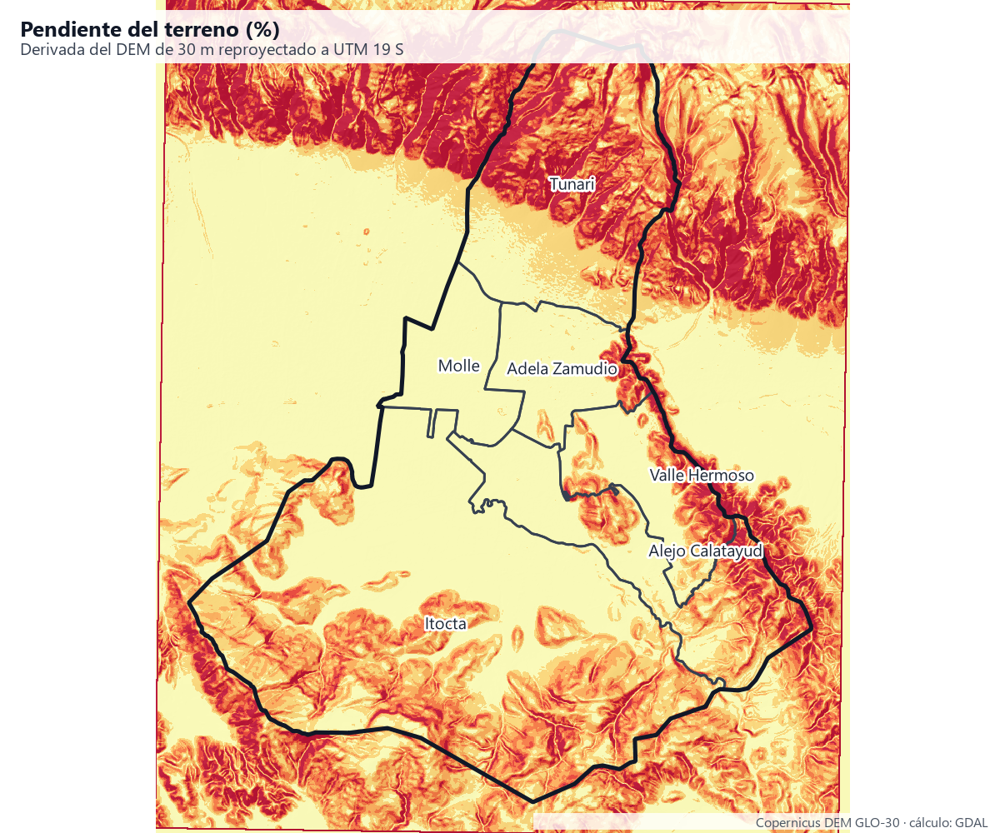

# 3.9 Interpretar relieve y resumirlo por zonas

Cochabamba está en un valle, pero no es plana: casi **la mitad** del municipio tiene pendientes de más del 15 %, el umbral a partir del cual construir es caro y riesgoso, y caminar a un centro de salud cuesta el doble. En Tunari la pendiente **media** supera el 33 %; en Molle apenas llega al 2 %. Del DEM vas a derivar sombreado, pendiente y curvas de nivel, y luego vas a **resumir** el relieve por comuna y por zona para que entre en tus decisiones.

{ loading=lazy }

!!! abstract "En esta lección"

    **Aprenderás a:**

    - Derivar **sombreado**, **pendiente** y **curvas de nivel** desde un DEM.
    - Elegir unidades de pendiente (grados o porcentaje) y entender por qué el DEM debe estar en metros.
    - Calcular **estadísticas zonales** de un ráster por polígono.
    - Elegir el estadístico adecuado (media, mediana, máximo, porcentaje sobre un umbral).

    **Tiempo:** 2 h (30 min de lectura · 90 de práctica) · **Datos:** `dem_utm_30m.tif` (de 3.8), `comunas`, `zonas_analisis` · **Producto:** `datos/trabajo/raster/pendiente_pct.tif`, curvas de nivel y tabla de pendiente por comuna.

---

## Idea central

### Del DEM a sus derivados

| Derivado | Qué representa | Uso típico |
|---|---|---|
| **Sombreado** (*hillshade*) | Iluminación simulada del relieve | Fondo cartográfico; leer formas |
| **Pendiente** | Inclinación del terreno en cada celda | Aptitud constructiva, riesgo, accesibilidad |
| **Orientación** (*aspect*) | Hacia dónde mira la ladera | Insolación, cultivos |
| **Curvas de nivel** | Líneas de igual elevación | Lectura topográfica, mapas impresos |

!!! danger "La pendiente necesita metros en X, Y y Z"

    Si el DEM está en **grados** (EPSG:4326) y la elevación en **metros**, la pendiente sale absurda: casi 90° en todas partes. Usa el DEM reproyectado a UTM de [3.8](08-preparar-combinar-raster.md) o aplica un factor de escala.

### Grados y porcentaje no son lo mismo

| Grados | Porcentaje | Se siente como… |
|---|---|---|
| 2° | 3,5 % | Prácticamente plano |
| 8,5° | 15 % | Cuesta notable; límite usual para urbanizar sin obras especiales |
| 26,6° | 50 % | Ladera empinada |
| 45° | 100 % | Una escalera |

### Resumir un ráster por zonas

Las **estadísticas zonales** calculan, para cada polígono, un resumen de las celdas que caen dentro:

| Estadístico | Responde a | Cuidado |
|---|---|---|
| **Media** | Pendiente típica de la zona | Se deja arrastrar por las laderas extremas |
| **Mediana** | Pendiente de la «mitad» del terreno | Más robusta |
| **Máximo** | Peor caso | Un solo píxel lo determina |
| **% sobre umbral** | Qué parte de la zona es empinada | Requiere un ráster binario previo |

---

## Hazlo conmigo

### Paso 1 · Sombreado

**Ráster ▸ Análisis ▸ Sombreado** · **Entrada:** `dem_utm_30m.tif` · **Acimut:** 315° · **Altitud:** 45° · **Factor Z:** 1. Coloca el sombreado **debajo** del DEM en pseudocolor (opacidad 60 %): el relieve «salta» de la pantalla.

!!! captura "Captura pendiente · 3.9-03"

    - **Tipo:** GIF
    - **Archivo:** `assets/images/modulo-03/3-9/3-9-03-hillshade.gif`
    - **Qué mostrar:** Calcular el sombreado y combinarlo con el DEM en pseudocolor con transparencia.

### Paso 2 · Pendiente

1. **Ráster ▸ Análisis ▸ Pendiente** · **Entrada:** DEM en UTM · marca **Pendiente expresada en porcentaje**.
2. Salida: `pendiente_pct.tif`.
3. Simboliza con *pseudocolor* discreto: 0–5, 5–15, 15–30, 30–60, > 60 %.

!!! captura "Captura pendiente · 3.9-05"

    - **Tipo:** GIF
    - **Archivo:** `assets/images/modulo-03/3-9/3-9-05-pendiente.gif`
    - **Qué mostrar:** Calcular la pendiente en porcentaje y simbolizarla en cinco clases.

!!! tip "Comprueba la escala de valores"

    Si el máximo supera el 1 000 %, probablemente usaste el DEM en grados. En el municipio, el máximo ronda **150–160 %** en las quebradas del Tunari.

### Paso 3 · Curvas de nivel

1. **Ráster ▸ Extracción ▸ Curvas de nivel** · **Intervalo:** 50 m · **Nombre del atributo:** `elev`.
2. Simboliza con reglas: curvas **maestras** (`"elev" % 250 = 0`) más gruesas y etiquetadas; el resto finas.
3. Compara con el sombreado: donde las curvas se juntan, la pendiente es mayor.

!!! captura "Captura pendiente · 3.9-07"

    - **Tipo:** PNG anotado
    - **Archivo:** `assets/images/modulo-03/3-9/3-9-07-etiquetar-curvas.png`
    - **Qué mostrar:** Curvas de nivel normales y maestras con etiquetas de elevación.

### Paso 4 · Estadísticas zonales por comuna

1. **Procesos ▸ Estadísticas zonales** · **Capa de polígonos:** `Comunas` · **Ráster:** `pendiente_pct.tif` · **Prefijo:** `p_` · **Estadísticos:** media, mediana, máximo.
2. Compara con esta tabla:

| Comuna | Media | Mediana | Máximo |
|---|---|---|---|
| Molle | 2,2 % | 1,9 % | 16,7 % |
| Adela Zamudio | 8,5 % | 3,2 % | 69,8 % |
| Itocta | 15,7 % | 12,7 % | 110,1 % |
| Alejo Calatayud | 16,3 % | 9,5 % | 82,2 % |
| Valle Hermoso | 17,9 % | 10,0 % | 83,1 % |
| Tunari | 33,2 % | 30,7 % | 158,4 % |

!!! captura "Captura pendiente · 3.9-08"

    - **Tipo:** GIF
    - **Archivo:** `assets/images/modulo-03/3-9/3-9-08-estadisticas-zonales.gif`
    - **Qué mostrar:** Ejecutar Estadísticas zonales sobre las comunas y revisar los campos nuevos en la tabla.

??? question "¿Por qué en Adela Zamudio la media (8,5 %) es mucho mayor que la mediana (3,2 %)?"

    Porque la mayor parte de la comuna es plana (el centro), pero incluye las laderas del cerro San Pedro. Unas pocas celdas muy empinadas **elevan la media**; la mediana describe mejor el terreno típico.

### Paso 5 · Porcentaje de terreno empinado

1. **Calculadora ráster:** `"pendiente_pct@1" > 15` → `empinado.tif` (1 / 0).
2. **Estadísticas zonales** con la **media** de ese ráster: la media de un ráster 0/1 es la **proporción** de celdas empinadas.
3. En todo el municipio, el **48 %** de las celdas supera el 15 %.

---

## Inténtalo tú

!!! example "Reto 3.9 · Relieve en las zonas sin cobertura"

    Calcula la **pendiente media** de cada zona de análisis y responde:

    1. ¿Cuántas de las 83 zonas habitadas sin cobertura de salud ([3.7](07-proximidad-superposicion.md)) tienen pendiente media **menor de 15 %**?
    2. ¿Cuáles son las cinco zonas sin cobertura **más pobladas y planas**? Son candidatas naturales para un nuevo establecimiento.
    3. Haz un mapa de pendiente por zona (graduado) con el sombreado de fondo y las curvas maestras.

---

## ¿Lo hiciste bien?

| Criterio | Se cumple si… |
|---|---|
| Unidades | Pendiente calculada sobre el DEM en UTM; máximo en torno a 150–160 % |
| Derivados | Sombreado, pendiente y curvas generados y bien simbolizados |
| Zonales | La tabla por comuna coincide con la del paso 4 |
| Interpretación | Explicas la diferencia entre media y mediana en Adela Zamudio |
| Reto | 45 zonas sin cobertura con pendiente media < 15 %; las cinco más pobladas: **Z156**, **Z306**, **Z158**, **Z123** y **Z206** |

### Errores frecuentes

| Síntoma | Causa | Solución |
|---|---|---|
| Pendiente ≈ 90° en todo el mapa | DEM en grados | Usa el DEM en UTM |
| Curvas «dentadas» | DEM con ruido o intervalo muy pequeño | Intervalo mayor; suavizar el DEM |
| Estadísticas zonales vacías | SRC distintos entre polígonos y ráster | Reproyecta los polígonos o el ráster |
| Zonas pequeñas sin valor | Ninguna celda con centro dentro | Ráster más fino o zonas más grandes |

---

## Comprueba lo aprendido

??? question "1. ¿Qué diferencia hay entre 15 % y 15° de pendiente?"

    15 % es una subida de 15 m cada 100 m (≈ 8,5°); 15° equivale a ≈ 27 %.

??? question "2. ¿Por qué la pendiente calculada sobre un DEM en grados es errónea?"

    Porque compara distancias horizontales en **grados** con alturas en **metros**.

??? question "3. ¿Qué estadístico zonal usarías para saber si una zona es «mayormente plana»?"

    La **mediana** o el **porcentaje de celdas** por debajo del umbral, no la media.

??? question "4. ¿El DEM de Copernicus mide el suelo?"

    No exactamente: es un modelo de **superficie** e incluye edificios y árboles. En la ciudad, la pendiente puede verse afectada por los techos.

??? question "5. Repaso de 3.8 · ¿Qué método de remuestreo usaste para reproyectar el DEM y por qué?"

    **Bilineal**, porque la elevación es una variable **continua**.

---

## Tu proyecto

Agrega la pendiente media a tu capa de zonas de prioridad (3.4). Una zona sin cobertura, densa y **plana** es mucho mejor candidata para un nuevo centro de salud que una en ladera. Ese es el tercer criterio de tu decisión en [3.12](12-laboratorio-decision-territorial.md).

---

## Referencias

- Burrough, P. A., McDonnell, R. A., & Lloyd, C. D. (2015). *Principles of Geographical Information Systems* (3.ª ed., cap. 10: Digital elevation models). Oxford University Press.
- Horn, B. K. P. (1981). Hill shading and the reflectance map. *Proceedings of the IEEE, 69*(1), 14–47. <https://doi.org/10.1109/PROC.1981.11918>
- Wilson, J. P., & Gallant, J. C. (Eds.). (2000). *Terrain Analysis: Principles and Applications*. Wiley.
- European Space Agency. (2022). *Copernicus DEM Product Handbook*. <https://spacedata.copernicus.eu/collections/copernicus-digital-elevation-model>
- QGIS Project. (s. f.). *Algoritmos de Procesos: Análisis del terreno ráster y estadísticas zonales*. <https://docs.qgis.org/latest/es/docs/user_manual/processing_algs/qgis/rasteranalysis.html>
