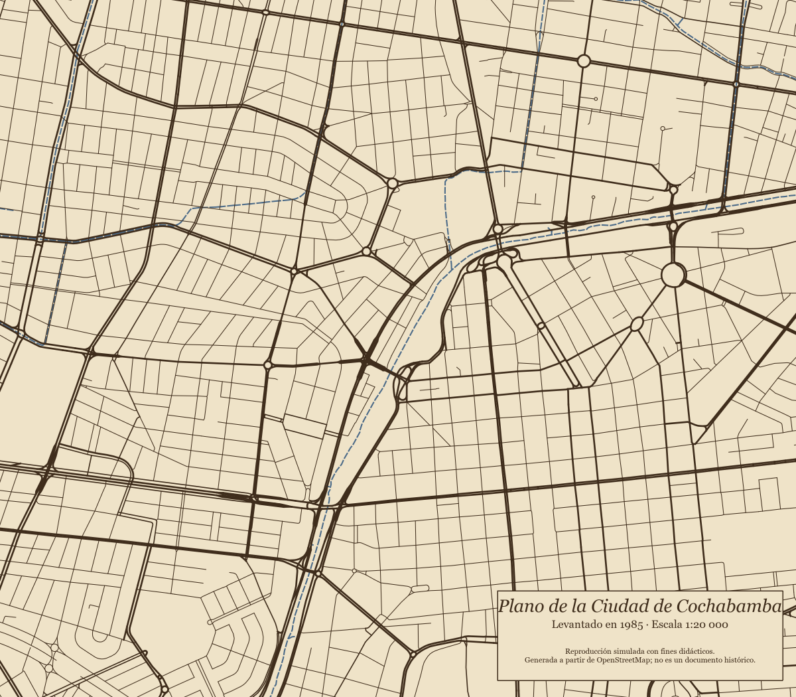

# 3.10 Recuperar información de mapas históricos

En el archivo municipal hay un plano de Cochabamba «levantado en 1985». Es una imagen escaneada: QGIS no sabe dónde está, de qué tamaño es ni hacia dónde mira. Para compararlo con el presente hay que **georreferenciarlo**: encontrar en el plano y en el mapa actual los **mismos lugares** (esquinas, puentes, plazas) y calcular la transformación que los hace coincidir. Bien hecho, el plano se convierte en una capa más; mal hecho, introduce errores de decenas de metros que nadie nota a simple vista.

{ loading=lazy }

!!! warning "Un plano simulado, un procedimiento real"

    El archivo `plano_historico_1985.tif` del paquete es una **simulación didáctica** generada a partir de OpenStreetMap, rotada y sin coordenadas. Permite practicar el procedimiento completo con resultados verificables. Para un trabajo real, busca planos históricos en archivos municipales, en el IGM o en colecciones digitales con licencia abierta.

!!! abstract "En esta lección"

    **Aprenderás a:**

    - Elegir **puntos de control** (GCP) buenos y bien distribuidos.
    - Elegir el **modelo de transformación** adecuado (Helmert, polinomial, *thin plate spline*).
    - Leer los **residuos** y el **error medio cuadrático** (RMSE).
    - Validar el resultado con puntos **independientes**.
    - Digitalizar información del plano georreferenciado.

    **Tiempo:** 2 h (30 min de lectura · 90 de práctica) · **Datos:** `plano_historico_1985.tif`, `vias.gpkg`, mapa base OSM · **Producto:** `datos/trabajo/plano_1985_georref.tif`, el archivo de puntos `.points` y un informe de error.

---

## Idea central

### Puntos de control

Un **punto de control** (GCP) es un lugar identificable a la vez en la imagen (coordenadas en píxeles) y en la referencia (coordenadas en el SRC).

| Buen GCP | Mal GCP |
|---|---|
| Esquina de manzana nítida | Centro de una plaza grande |
| Cruce de dos calles rectas | Un punto sobre una curva suave |
| Puente sobre el río | El borde de un río que cambia de cauce |
| Elemento estable en el tiempo | Un edificio que pudo demolerse |

**Distribución:** reparte los GCP por **toda** la imagen, incluidos los bordes; la transformación es buena donde hay puntos y mala donde no.

### Modelos de transformación

| Modelo | GCP mínimos | Qué corrige | Úsalo cuando… |
|---|---|---|---|
| **Helmert** | 2 | Traslación, rotación y escala uniforme | El plano solo está girado y escalado |
| **Polinomial 1** (afín) | 3 | Además, escalas distintas en X e Y y cizalla | Escaneo levemente deformado |
| **Polinomial 2–3** | 6–10 | Curvaturas suaves | Planos deformados por el papel; cuidado en los bordes |
| ***Thin plate spline*** | 10+ | Deformaciones locales; pasa exactamente por cada GCP | Mapas muy distorsionados; el RMSE será ~0 y **no** indica calidad |

!!! danger "Un RMSE bajo puede ser una trampa"

    Con *thin plate spline* o polinomios de alto grado, el modelo se **ajusta a los GCP** y su RMSE es casi cero, pero entre los puntos puede deformar la imagen. Usa el modelo **más simple** que explique la deformación y valida con puntos que **no** usaste para calcularla.

### Residuo y RMSE

El **residuo** de cada GCP es la distancia entre dónde lo pusiste y dónde lo coloca el modelo. El **RMSE** resume todos ([1.9](../modulo-01/09-escala-resolucion-precision.md)):

> **RMSE = √( (r₁² + r₂² + … + rₙ²) / n )**, donde *rᵢ* es el residuo de cada punto y *n* el número de puntos.

Como regla práctica, un RMSE menor que **1–2 píxeles** del plano (o menor que el error gráfico de su escala: 0,2 mm × 20 000 = **4 m** a 1:20 000) es aceptable.

---

## Hazlo conmigo

### Paso 1 · Preparar el georreferenciador

1. Agrega `vias.gpkg` y el mapa base OSM al proyecto (en EPSG:32719).
2. **Capa ▸ Georreferenciador…** ▸ **Abrir ráster** ▸ `plano_historico_1985.tif`.
3. **Configuración de la transformación:** **Helmert** · **Remuestreo:** cúbico · **SRC de destino:** EPSG:32719 · **Salida:** `datos/trabajo/plano_1985_georref.tif` · marca **Guardar puntos GCP**.

!!! captura "Captura pendiente · 3.10-02"

    - **Tipo:** PNG anotado
    - **Archivo:** `assets/images/modulo-03/3-10/3-10-02-configuracion-transformacion.png`
    - **Qué mostrar:** La ventana Configuración de la transformación con Helmert, remuestreo cúbico, SRC de destino y archivo de salida.

!!! tip "¿Por qué Helmert?"

    Si observas el plano, las calles rectas siguen siendo rectas y las manzanas conservan su forma: solo está **girado** y a otra **escala**. Helmert basta. Si el error fuera alto, pasarías a polinomial 1.

### Paso 2 · Colocar los GCP

1. Con **Añadir punto**, haz clic en una esquina nítida del plano.
2. En el diálogo, pulsa **Desde el lienzo del mapa** y haz clic en la **misma** esquina en el mapa de QGIS (activa el autoensamblado a `vias` para mayor exactitud).
3. Coloca **8 GCP** repartidos: cuatro cerca de las esquinas del plano, dos en el centro y dos en los bordes. Evita el río.
4. Reserva **3 puntos más** para la validación: anótalos, pero **no** los agregues.

!!! captura "Captura pendiente · 3.10-04"

    - **Tipo:** GIF
    - **Archivo:** `assets/images/modulo-03/3-10/3-10-04-anadir-gcp.gif`
    - **Qué mostrar:** Añadir un punto de control en el plano y su correspondiente desde el lienzo del mapa.

### Paso 3 · Leer los residuos

La **tabla de GCP** muestra el residuo de cada punto (en píxeles y en unidades del mapa) y el RMSE arriba.

| Situación | Interpretación | Acción |
|---|---|---|
| Todos los residuos pequeños y parecidos | Buen ajuste | Continúa |
| Un residuo mucho mayor que el resto | GCP mal colocado | Revisa o desactívalo |
| Residuos grandes y sistemáticos en una zona | El modelo no basta | Prueba polinomial 1 |

Objetivo: RMSE **menor de 3 m**.

!!! captura "Captura pendiente · 3.10-06"

    - **Tipo:** PNG anotado
    - **Archivo:** `assets/images/modulo-03/3-10/3-10-06-tabla-gcp-residuos.png`
    - **Qué mostrar:** La tabla de puntos de control con residuos en X, Y y totales, y el RMSE.

### Paso 4 · Generar y validar

1. **Iniciar georreferenciación**. Carga el resultado con 50 % de transparencia sobre `vias`.
2. Para cada uno de los **3 puntos de validación**, mide la distancia entre el punto del plano y el de la referencia (herramienta Medir). Ese es el **error independiente**, más honesto que el RMSE.
3. Guarda el archivo `.points`: permite rehacer o auditar la georreferenciación.

!!! captura "Captura pendiente · 3.10-08"

    - **Tipo:** GIF
    - **Archivo:** `assets/images/modulo-03/3-10/3-10-08-validacion.gif`
    - **Qué mostrar:** El plano georreferenciado semitransparente sobre las vías actuales y la medición de un punto de validación.

### Paso 5 · Comparar modelos

Repite con **Polinomial 2** y con **Thin plate spline** (mismos GCP). Completa:

| Modelo | RMSE (m) | Error medio en validación (m) |
|---|---|---|
| Helmert | | |
| Polinomial 2 | | |
| Thin plate spline | ≈ 0 | |

¿Cuál elegirías? ¿Por qué el de RMSE más bajo no es necesariamente el mejor?

---

## Inténtalo tú

!!! example "Reto 3.10 · Informe de georreferenciación"

    1. Georreferencia el plano con el modelo que justifiques.
    2. Redacta un informe breve (`documentos/georreferenciacion_1985.md`) con: modelo, número y distribución de GCP (una captura), RMSE, error de validación, y el uso para el que el resultado **sí** sirve y para el que **no**.
    3. Digitaliza sobre el plano georreferenciado el **cauce del río Rocha** como lo dibuja el plano, y compáralo con la capa `rios` actual. En un plano real, las diferencias revelarían cambios del cauce o canalizaciones; aquí, revelan tu error de georreferenciación.

---

## ¿Lo hiciste bien?

| Criterio | Se cumple si… |
|---|---|
| GCP | 8 o más, bien definidos y repartidos por toda la imagen |
| Modelo | Elegido con argumentos; no solo por el RMSE |
| Calidad | RMSE < 3 m y error de validación del mismo orden |
| Trazabilidad | Archivo `.points` guardado y modelo documentado |
| Juicio | El informe distingue usos adecuados e inadecuados |

### Errores frecuentes

| Síntoma | Causa | Solución |
|---|---|---|
| Resultado espejado o retorcido | GCP con correspondencias cruzadas | Revisa el orden de los puntos |
| RMSE alto en un punto | GCP mal colocado | Corrígelo o desactívalo |
| Bordes muy deformados | Polinomio de grado alto con pocos GCP en el borde | Más GCP en los bordes o modelo más simple |
| Resultado desplazado cientos de km | SRC de destino distinto al de la referencia | Usa el SRC del proyecto |
| RMSE = 0 | *Thin plate spline* | Valida con puntos independientes |

---

## Comprueba lo aprendido

??? question "1. ¿Qué hace que un punto de control sea bueno?"

    Que sea **nítido**, **estable en el tiempo** e identificable con exactitud en ambas fuentes, y que forme parte de un conjunto **bien repartido**.

??? question "2. ¿Por qué Helmert basta para este plano?"

    Porque solo está rotado y escalado de forma uniforme: las formas se conservan.

??? question "3. ¿Por qué un RMSE de 0 con thin plate spline no garantiza calidad?"

    Porque el modelo pasa exactamente por los GCP; el error real aparece **entre** ellos y solo se mide con puntos independientes.

??? question "4. ¿Qué es el error gráfico de un plano a 1:20 000?"

    Unos **4 m** (0,2 mm × 20 000): por debajo de eso, el propio dibujo no tiene precisión.

??? question "5. Repaso de 1.9 · ¿Por qué validar con puntos que no usaste en el ajuste?"

    Porque los puntos de ajuste están «optimizados» por el modelo; solo los independientes miden la **exactitud** real.

---

## Tu proyecto

En un caso real, un plano histórico te permitiría saber **cómo creció la ciudad**: qué zonas sin cobertura son urbanizaciones recientes. Busca en el archivo de tu municipio (o en el IGM) un plano antiguo y aplica este procedimiento; documenta su fecha, escala y fuente.

---

## Referencias

- Hackeloeer, A., Klasing, K., Krisp, J. M., & Meng, L. (2014). Georeferencing: A review of methods and applications. *Annals of GIS, 20*(1), 61–69. <https://doi.org/10.1080/19475683.2013.868826>
- Fleet, C., Kowal, K. C., & Přidal, P. (2012). Georeferencer: Crowdsourced georeferencing for map library collections. *D-Lib Magazine, 18*(11/12). <https://doi.org/10.1045/november2012-fleet>
- QGIS Project. (s. f.). *Manual de usuario: Georreferenciador*. <https://docs.qgis.org/latest/es/docs/user_manual/working_with_raster/georeferencer.html>
