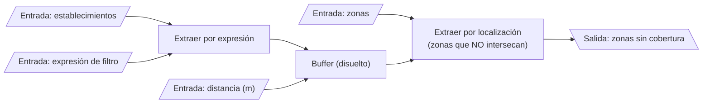

# 3.11 Construir procedimientos reproducibles

En la lección 3.7 calculaste la población sin cobertura con diez clics. Ahora el director pregunta: «¿Y si fueran 800 metros? ¿Y solo con centros públicos? ¿Y con los datos de 2027?». Rehacer todo a mano es lento y, sobre todo, **arriesgado**: un clic distinto y el resultado cambia sin que nadie lo sepa. Un **modelo** convierte tu procedimiento en una herramienta que cualquiera puede ejecutar, con los mismos pasos, cambiando solo los **parámetros**.

!!! abstract "En esta lección"

    **Aprenderás a:**

    - Recuperar lo que hiciste desde el **historial de Procesos**.
    - Ejecutar un algoritmo **por lotes** sobre varias entradas.
    - Construir un modelo en el **Modelador gráfico** con entradas, algoritmos y salidas.
    - Parametrizar el modelo para explorar escenarios.
    - Documentar y versionar el procedimiento.

    **Tiempo:** 2 h (30 min de lectura · 90 de práctica) · **Datos:** `equipamientos` auditado, `zonas_analisis` · **Producto:** `modelos/cobertura_servicios_v01.model3` y una tabla de escenarios.

---

## Idea central

### Del clic a la receta

| Nivel | Cómo trabajas | ¿Reproducible? |
|---|---|---|
| Manual | Menús y clics | Solo si lo documentas con mucho detalle |
| **Historial** | Procesos guarda cada algoritmo ejecutado con sus parámetros | Sí, paso a paso |
| **Por lotes** | Un algoritmo, muchas entradas | Sí, para tareas repetitivas |
| **Modelo** | Cadena de algoritmos con parámetros | Sí, y se comparte como archivo |
| **Script** (Python) | Código | Sí, máxima flexibilidad |

!!! tip "La caja de herramientas de Procesos es la clave"

    Todo lo que se hace con algoritmos de **Procesos** queda registrado y se puede encadenar. Lo que se hace editando a mano (mover vértices, cambiar un valor) no. Por eso, cuando quieras reproducibilidad, **prefiere algoritmos**.

### Anatomía de un modelo

| Elemento | Qué es | Ejemplo |
|---|---|---|
| **Entrada** | Lo que el usuario elige al ejecutar | Capa de establecimientos, distancia |
| **Algoritmo** | Un paso de Procesos | Buffer |
| **Salida** | Resultado que el modelo entrega | Capa de zonas sin cobertura |
| **Intermedio** | Resultado de un paso que no se entrega | El buffer |

---

## Hazlo conmigo

### Paso 1 · Recuperar el historial

1. **Procesos ▸ Historial**. Encontrarás los algoritmos de 3.7 con sus parámetros completos.
2. Haz doble clic sobre el **Buffer**: se abre con los mismos parámetros. Cambia la distancia a 800 y ejecútalo.
3. Copia la línea de un algoritmo: es su llamada en Python (`processing.run("native:buffer", {...})`).

!!! captura "Captura pendiente · 3.11-01"

    - **Tipo:** PNG anotado
    - **Archivo:** `assets/images/modulo-03/3-11/3-11-01-historial.png`
    - **Qué mostrar:** El historial de Procesos con los algoritmos ejecutados en 3.7 y sus parámetros.

### Paso 2 · Ejecución por lotes

Calcula el buffer de 1 km para **cada subtipo** de establecimiento de salud en una sola ejecución:

1. Abre **Buffer** ▸ **Ejecutar como proceso por lotes…**
2. Agrega tres filas: hospital, clínica, consultorio (con capas filtradas o creadas antes con **Dividir capa vectorial**).
3. Usa **Autocompletar** para los nombres de salida: `buffer_hospital.gpkg`, etc.

!!! captura "Captura pendiente · 3.11-04"

    - **Tipo:** GIF
    - **Archivo:** `assets/images/modulo-03/3-11/3-11-04-lotes.gif`
    - **Qué mostrar:** Configurar Buffer como proceso por lotes con tres entradas y nombres de salida autocompletados.

### Paso 3 · Construir el modelo

1. **Procesos ▸ Modelador gráfico**. Nombre: `Cobertura de servicios` · Grupo: `Curso QGIS`.
2. **Entradas** (panel izquierdo):
    - *Capa vectorial* `Establecimientos` (puntos).
    - *Expresión* `Filtro` (predeterminado: `"tipo" = 'salud'`).
    - *Número* `Distancia` (metros, predeterminado 1000, mínimo 100).
    - *Capa vectorial* `Zonas` (polígonos).
3. **Algoritmos** (arrástralos y conéctalos):
    - **Extraer por expresión** (Establecimientos, Filtro).
    - **Buffer** (resultado anterior, Distancia, **disolver**: sí).
    - **Extraer por localización** · **Extraer de:** Zonas · **Predicado:** *disjunto* · **Comparando con:** el buffer.
4. Marca la salida final como **Salida del modelo**: `Zonas sin cobertura`.
5. Guarda en `modelos/cobertura_servicios_v01.model3`.

!!! captura "Captura pendiente · 3.11-07"

    - **Tipo:** PNG anotado
    - **Archivo:** `assets/images/modulo-03/3-11/3-11-07-modelador.png`
    - **Qué mostrar:** El modelo terminado en el Modelador gráfico con entradas, algoritmos conectados y la salida final.

!!! warning "Predicado y regla de cobertura"

    En 3.7 consideraste cubierta una zona si su **punto interior** quedaba dentro del buffer. *Disjunto* considera descubierta una zona solo si **ninguna parte** toca el buffer: es una regla más estricta y dará menos zonas. Elige una, documéntala y úsala siempre igual. Para reproducir 3.7, agrega antes un paso **Punto en la superficie** sobre las zonas.

### Paso 4 · Ejecutar escenarios

Ejecuta el modelo desde la caja de Procesos (aparece en **Modelos ▸ Curso QGIS**) y llena la tabla con la **suma de `pob_2020`** de cada salida:

| Escenario | Filtro | Distancia | Zonas sin cobertura | Población |
|---|---|---|---|---|
| Base | `"tipo" = 'salud'` | 1000 | | |
| Corto | `"tipo" = 'salud'` | 500 | | |
| Hospitales | `"subtipo" = 'hospital'` | 2000 | | |
| Educación | `"tipo" = 'educacion'` | 500 | | |

Compáralos con los de [3.7](07-proximidad-superposicion.md): si usaste la misma regla de cobertura, deben coincidir.

### Paso 5 · Documentar y versionar

- En el modelo: **Propiedades del modelo ▸ Ayuda** con descripción, autor, versión y explicación de cada parámetro.
- En los nombres: `_v01`, `_v02`… y un registro de cambios en `documentos/modelos_cambios.md`.
- Opcional: **Exportar como script de Python** para ver el código equivalente.

??? info "Para saber más · del modelo al script"

    El script exportado usa `processing.run(...)` para cada paso. Es el puente hacia la automatización con PyQGIS: el mismo código que generó los datos y las figuras de este curso (ver `scripts/` en el repositorio).

---

## Inténtalo tú

!!! example "Reto 3.11 · Modelo de prioridad"

    Amplía el modelo para que entregue, además de las zonas sin cobertura, un **campo de prioridad**:

    1. Agrega un paso **Calculadora de campos** que cree `densidad` = `"pob_2020" / ($area / 1e6)`.
    2. Agrega otro que cree `prioridad` = `'alta'` si `densidad >= @umbral_densidad` y `'media'` en otro caso, con `umbral_densidad` como **entrada numérica** del modelo (predeterminado 3000).
    3. Guarda como `cobertura_servicios_v02.model3` y registra el cambio.
    4. Ejecuta con umbrales 2000, 3000 y 5000: ¿cuántas zonas de prioridad alta obtienes en cada caso?

---

## ¿Lo hiciste bien?

| Criterio | Se cumple si… |
|---|---|
| Historial | Reejecutaste un algoritmo desde el historial con otro parámetro |
| Lotes | Tres buffers generados en una sola ejecución |
| Modelo | Cuatro entradas, tres algoritmos, una salida; se ejecuta sin errores |
| Coherencia | El escenario base reproduce el resultado de 3.7 (con la misma regla) |
| Documentación | Ayuda del modelo completa; versión y registro de cambios |

### Errores frecuentes

| Síntoma | Causa | Solución |
|---|---|---|
| El modelo no aparece en Procesos | Guardado fuera de la carpeta de modelos | **Abrir modelo** o guarda en la carpeta de modelos del perfil |
| «Parámetro no válido» | Entrada sin tipo de geometría o SRC adecuado | Restringe el tipo de la entrada |
| Resultado vacío | Predicado invertido | Revisa *interseca* / *disjunto* |
| El buffer sale en grados | Entrada en EPSG:4326 | Agrega **Reproyectar capa** al inicio del modelo |
| Cambié el modelo y ya no coincide con lo anterior | Sin versionado | Guarda con otro número y registra el cambio |

---

## Comprueba lo aprendido

??? question "1. ¿Qué ventaja tiene un modelo sobre el historial?"

    El modelo **encadena** pasos y expone **parámetros**: se ejecuta como una sola herramienta y se comparte como archivo.

??? question "2. ¿Por qué conviene preferir algoritmos de Procesos frente a ediciones manuales?"

    Porque quedan registrados con sus parámetros y se pueden repetir; las ediciones manuales no.

??? question "3. ¿Qué es un parámetro de un modelo?"

    Un valor que el usuario elige al ejecutarlo (capa, número, expresión), sin modificar los pasos.

??? question "4. ¿Por qué *disjunto* y «punto interior dentro del buffer» dan resultados distintos?"

    Porque son **reglas de cobertura** distintas: una exige que ninguna parte toque el buffer; la otra mira solo un punto de la zona.

??? question "5. Repaso de 3.7 · ¿Por qué el modelo debería reproyectar las entradas?"

    Porque el buffer usa las unidades del SRC: en grados, 1000 serían mil grados.

---

## Tu proyecto

Comparte tu `.model3` con un compañero y pídele que lo ejecute con **su** caso. Si funciona sin explicaciones adicionales, es reproducible. Inclúyelo en la entrega del laboratorio 3.12.

---

## Referencias

- Graser, A., & Olaya, V. (2015). Processing: A Python framework for the seamless integration of geoprocessing tools in QGIS. *ISPRS International Journal of Geo-Information, 4*(4), 2219–2245. <https://doi.org/10.3390/ijgi4042219>
- Nüst, D., Granell, C., Hofer, B., Konkol, M., Ostermann, F. O., Sileryte, R., & Cerutti, V. (2018). Reproducible research and GIScience: An evaluation using AGILE conference papers. *PeerJ, 6*, e5072. <https://doi.org/10.7717/peerj.5072>
- QGIS Project. (s. f.). *Manual de usuario: El modelador gráfico*. <https://docs.qgis.org/latest/es/docs/user_manual/processing/modeler.html>
- QGIS Project. (s. f.). *Manual de usuario: La interfaz de procesos por lotes*. <https://docs.qgis.org/latest/es/docs/user_manual/processing/batch.html>
