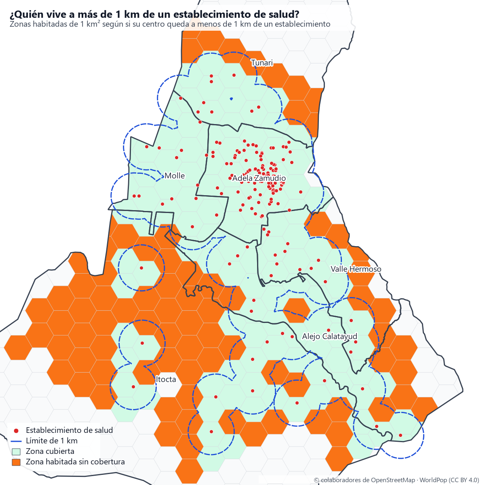

# Módulo 3 · Edición, integración y análisis espacial

!!! abstract "Objetivo del módulo"

    **Producir información nueva y confiable a partir de los datos, y usarla para justificar una decisión territorial que otra persona pueda revisar y repetir.**

---

## Presentación

En el Módulo 2 aprendiste a **mirar** los datos con QGIS. Ahora vas a **trabajar** con ellos: corregirlos, crear nuevos, combinarlos y analizarlos para responder la pregunta del caso conductor:

> **¿Qué zonas de Cochabamba tienen peor acceso a los servicios de salud y dónde convendría ubicar un nuevo centro?**

Al final del módulo tendrás una respuesta con números, mapas y, sobre todo, **argumentos**. Un adelanto de lo que vas a descubrir:

{ loading=lazy }

-   :material-account-group:{ .lg .middle } **≈ 90 000 personas**

    ---

    viven en zonas a más de 1 km de cualquier establecimiento de salud (15 % del municipio).

-   :material-scale-unbalanced:{ .lg .middle } **1 090 frente a 11 378**

    ---

    habitantes por establecimiento de salud en Adela Zamudio y en Alejo Calatayud.

-   :material-terrain:{ .lg .middle } **48 %**

    ---

    del municipio tiene pendientes de más del 15 %.

-   :material-map-marker-star:{ .lg .middle } **6 zonas candidatas**

    ---

    para un nuevo centro de salud… y la elegida depende de qué priorices.

---

## Estructura del módulo

### Bloque 1 · Construir datos confiables

-   **3.1 Preparar datos confiables**

    ---

    Auditoría, hallazgos, correcciones trazables y medición de la calidad.

    **Reto:** informe de auditoría de 665 establecimientos con errores.

    [:octicons-arrow-right-24: Ir a la lección](01-preparar-datos-confiables.md)

-   **3.2 Digitalizar y editar con precisión**

    ---

    Autoensamblado, rastreo, evitar superposiciones, digitalización avanzada y topología.

    **Reto:** áreas verdes de una zona sin cobertura.

    [:octicons-arrow-right-24: Ir a la lección](02-digitalizar-editar-precision.md)

-   **3.3 Diseñar formularios de captura**

    ---

    Widgets, listas de valores, predeterminados y restricciones que previenen errores.

    **Reto:** formulario de áreas verdes que no deje cargar datos inválidos.

    [:octicons-arrow-right-24: Ir a la lección](03-disenar-formularios-captura.md)

### Bloque 2 · Derivar e integrar información

-   **3.4 Construir indicadores con expresiones**

    ---

    `NULL`, `nullif`, `CASE`, campos virtuales y casos de prueba.

    **Reto:** indicador de educación con ficha técnica.

    [:octicons-arrow-right-24: Ir a la lección](04-construir-indicadores-expresiones.md)

-   **3.5 Integrar tablas sin perder información**

    ---

    Claves, cardinalidad, uniones, relaciones y registros sin pareja.

    **Reto:** relación establecimiento → visitas.

    [:octicons-arrow-right-24: Ir a la lección](05-integrar-tablas.md)

-   **3.6 Traducir preguntas en relaciones espaciales**

    ---

    Predicados, selección y unión por localización, conteos y casos límite.

    **Reto:** matriz pregunta → predicado → resultado.

    [:octicons-arrow-right-24: Ir a la lección](06-relaciones-espaciales.md)

### Bloque 3 · Proximidad, superficies y ráster

-   **3.7 Analizar proximidad y superposición**

    ---

    Buffer, recortar, intersección, diferencia y disolver.

    **Reto:** sensibilidad de la cobertura a la distancia y al tipo de establecimiento.

    [:octicons-arrow-right-24: Ir a la lección](07-proximidad-superposicion.md)

-   **3.8 Preparar y combinar ráster**

    ---

    SRC, celda, alineación, remuestreo, NoData y calculadora ráster (NDVI).

    **Reto:** máscara de terreno urbanizable.

    [:octicons-arrow-right-24: Ir a la lección](08-preparar-combinar-raster.md)

-   **3.9 Interpretar el relieve y resumirlo por zonas**

    ---

    Sombreado, pendiente, curvas de nivel y estadísticas zonales.

    **Reto:** las zonas sin cobertura más pobladas y planas.

    [:octicons-arrow-right-24: Ir a la lección](09-relieve-estadisticas-zonales.md)

### Bloque 4 · Recuperar, automatizar y decidir

-   **3.10 Recuperar información de mapas históricos**

    ---

    Puntos de control, modelos de transformación, RMSE y validación independiente.

    **Reto:** informe de georreferenciación de un plano de 1985.

    [:octicons-arrow-right-24: Ir a la lección](10-georreferenciar-mapas-historicos.md)

-   **3.11 Construir procedimientos reproducibles**

    ---

    Historial, procesos por lotes y Modelador gráfico.

    **Reto:** modelo de prioridad con umbral como parámetro.

    [:octicons-arrow-right-24: Ir a la lección](11-procedimientos-reproducibles.md)

-   :material-map-check:{ .lg .middle } **3.12 Laboratorio · Justificar una decisión territorial**

    ---

    Restricciones, criterios, índice compuesto, sensibilidad y memoria técnica.

    [:octicons-arrow-right-24: Ir al laboratorio](12-laboratorio-decision-territorial.md)

---

## Del Módulo 1 y 2 al análisis

| Lección | Conceptos que aplica |
|---|---|
| 3.1 Preparar datos confiables | 1.13 Calidad · 2.7 Leer los datos |
| 3.2 Digitalizar y editar | 1.9 Precisión · 1.12 Topología |
| 3.3 Formularios | 1.12 Identificadores y dominios |
| 3.4 Indicadores | 1.13 Aptitud para el uso · 2.8 Expresiones |
| 3.5 Integrar tablas | 1.12 Atributos · 2.7 Claves |
| 3.6 Relaciones espaciales | 1.2 Relaciones espaciales · 1.12 Topología |
| 3.7 Proximidad | 1.4–1.6 SRC proyectados · 2.6 Unidades |
| 3.8 Ráster | 1.9 Resolución · 1.11 Modelo ráster |
| 3.9 Relieve | 1.3 Alturas · 1.11 Superficies continuas |
| 3.10 Georreferenciar | 1.9 RMSE · 1.8 Escala |
| 3.11 Reproducibilidad | 1.15 Automatización |
| 3.12 Decisión territorial | Todo el curso |

---

## Cómo trabajar este módulo

- **Cada lección produce algo que usarás después.** Guarda tus resultados en `datos/trabajo/` con nombres claros y regístralos en la sección «Historial» de tu `LEEME.txt`.
- **Predice antes de ejecutar.** Escribe qué número esperas; si el resultado se aleja mucho, hay algo que revisar.
- **Prefiere algoritmos de Procesos** a los clics manuales: quedan en el historial y se pueden encadenar en modelos (3.11).
- **Verifica con las cifras de referencia** de cada sección «¿Lo hiciste bien?». Si tu resultado difiere, busca la causa antes de seguir.

!!! tip "Cifras de referencia reproducibles"

    Las cifras de este módulo se calcularon con el script `scripts/soluciones_modulo3.py` del repositorio, sobre el mismo paquete de datos. Pequeñas diferencias (unas pocas zonas o habitantes) pueden deberse a la regla de cobertura o al método de medición elegido; diferencias grandes indican un error.

---

## Al terminar el módulo

!!! success "Habrás alcanzado el objetivo si puedes:"

    - Auditar una base de datos y corregirla con trazabilidad.
    - Digitalizar sin huecos ni solapamientos y diseñar formularios que prevengan errores.
    - Construir indicadores robustos frente a `NULL` y divisiones entre cero.
    - Unir y relacionar tablas sin perder ni duplicar registros.
    - Elegir el predicado y la operación espacial adecuados para cada pregunta.
    - Preparar ráster compatibles y resumirlos por zonas.
    - Automatizar un procedimiento con el Modelador gráfico.
    - **Justificar una decisión territorial mostrando sus supuestos y su sensibilidad.**

---

## Referencias del módulo

- de Smith, M. J., Goodchild, M. F., & Longley, P. A. (2018). *Geospatial Analysis: A Comprehensive Guide* (6.ª ed.). <https://www.spatialanalysisonline.com>
- Longley, P. A., Goodchild, M. F., Maguire, D. J., & Rhind, D. W. (2015). *Geographic Information Science and Systems* (4.ª ed.). Wiley.
- Malczewski, J., & Rinner, C. (2015). *Multicriteria Decision Analysis in Geographic Information Science*. Springer.
- QGIS Project. (s. f.). *Manual de usuario de QGIS*. <https://docs.qgis.org/latest/es/docs/user_manual/>
- QGIS Project. (s. f.). *Manual de entrenamiento: Análisis vectorial y ráster*. <https://docs.qgis.org/latest/es/docs/training_manual/>
