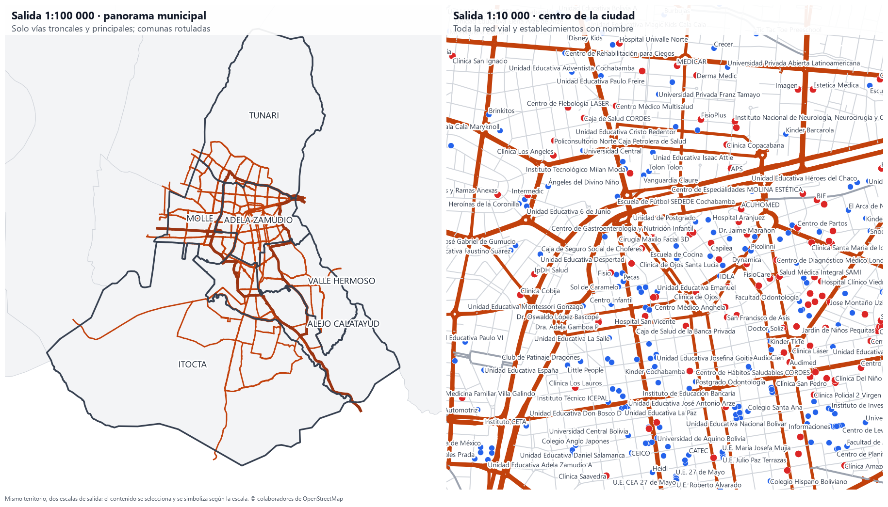

# 4.2 Preparar información para la escala de salida

La red vial de Cochabamba tiene **22 043 tramos**. En una lámina A4 de todo el municipio (≈ 1:100 000), dibujarlos todos produce una mancha gris donde no se distingue ni el río Rocha. En una ficha del centro (≈ 1:10 000), en cambio, cada calle importa. La **escala de salida** decide qué información entra, cuánto detalle tiene y con qué grosor se dibuja.

{ loading=lazy }

!!! abstract "En esta lección"

    **Aprenderás a:**

    - Relacionar escala de salida, tamaño de impresión y **legibilidad mínima**.
    - **Seleccionar** el contenido según la escala con reglas y filtros.
    - **Generalizar** geometrías (simplificar, agregar) de forma controlada.
    - Configurar **visibilidad dependiente de la escala** en capas y etiquetas.

    **Tiempo:** 75 min (25 de lectura · 50 de práctica) · **Datos:** `vias.gpkg`, `rios.shp`, `comunas`, equipamientos · **Producto:** dos versiones de estilo (municipal y de detalle) guardadas como **temas del mapa**.

---

## Idea central

### La escala de salida no es la del lienzo

En pantalla puedes acercarte sin límite; en papel, la escala queda **fija**. Calcúlala:

| Formato | Ancho útil del mapa | Extensión a cubrir | Escala aproximada |
|---|---|---|---|
| A4 horizontal | 19 cm | Municipio (≈ 19 km) | 1:100 000 |
| A4 vertical | 19 cm | Una comuna (≈ 5–12 km) | 1:25 000 – 1:60 000 |
| A3 horizontal | 40 cm | Municipio | 1:50 000 |

### Mínimos de legibilidad

| Elemento | Mínimo en papel | A 1:100 000 equivale a |
|---|---|---|
| Línea | 0,1–0,2 mm | 10–20 m en el terreno |
| Separación entre líneas | 0,2–0,3 mm | 20–30 m |
| Texto | 6–7 pt | — |
| Polígono identificable | ≈ 1 × 1 mm | 100 × 100 m |

Por eso a 1:100 000 las calles locales (separadas 80–100 m) se funden: **no caben**. Es la misma lógica de la generalización ([1.10](../modulo-01/10-generalizacion-cartografica.md)).

### Seleccionar, simplificar, agregar

| Operación | Ejemplo en el caso | En QGIS |
|---|---|---|
| **Selección** | Solo vías troncales y principales a 1:100 000 | Filtro o simbología por reglas |
| **Simplificación** | Menos vértices en el límite municipal | **Procesos ▸ Simplificar** |
| **Agregación** | Zonas → comunas para el mapa del Concejo | **Disolver** por `cod_comuna` |
| **Exageración** | Río Rocha más grueso de lo que «mide» | Grosor del símbolo |
| **Desplazamiento** | Separar símbolos superpuestos en el centro | Desplazamiento de puntos o etiquetas |

!!! warning "Generalizar para mostrar, no para analizar"

    Las geometrías simplificadas son para **representar**. Nunca midas áreas o distancias sobre ellas: guarda la versión original para el análisis.

---

## Hazlo conmigo

### Paso 1 · Selección por reglas según la escala

1. Duplica la capa `vías` y nómbrala **Vías (municipal)**.
2. **Simbología ▸ Basado en reglas**:
    - `"jerarquia" = 'troncal'` → 0,9 mm, marrón oscuro.
    - `"jerarquia" = 'principal'` → 0,5 mm.
    - Ninguna regla para secundarias ni locales.
3. En la capa original **Vías (detalle)**, todas las jerarquías, con grosores de 0,25 a 1,5 mm, y **visibilidad por escala**: máxima 1:25 000.

!!! captura "Captura pendiente · 4.2-03"

    - **Tipo:** PNG anotado
    - **Archivo:** `assets/images/modulo-04/4-2/4-2-03-reglas-escala.png`
    - **Qué mostrar:** Simbología basada en reglas de las vías con columnas de escala mínima y máxima por regla.

!!! tip "Escala por regla"

    En la simbología basada en reglas, cada regla puede tener su propio **rango de escalas**: una sola capa puede mostrar solo troncales de lejos y toda la red de cerca.

### Paso 2 · Simplificar el límite para la escala municipal

1. **Procesos ▸ Simplificar** sobre `limite_municipal` · tolerancia **20 m** (≈ 0,2 mm a 1:100 000).
2. Compara el número de vértices antes y después (**Identificar ▸ Derivado**).
3. Superpón ambos a 1:100 000: no deberías ver diferencia. A 1:5 000, sí.

### Paso 3 · Agregar zonas en comunas

Para el mapa del Concejo, 327 hexágonos son demasiado detalle. **Disolver** las zonas por `cod_comuna` **sumando** la población (o usa la unión de [3.5](../modulo-03/05-integrar-tablas.md)). Ahora puedes calcular indicadores por comuna.

### Paso 4 · Guardar como temas del mapa

Crea dos **temas del mapa** (ícono del ojo en el panel Capas): **Municipal 1:100 000** y **Detalle 1:10 000**, cada uno con sus capas visibles y estilos. En [4.8](08-coordinar-mapas-elementos-complementarios.md) asignarás cada tema a un mapa distinto de la composición.

!!! captura "Captura pendiente · 4.2-06"

    - **Tipo:** GIF
    - **Archivo:** `assets/images/modulo-04/4-2/4-2-06-temas-mapa.gif`
    - **Qué mostrar:** Crear dos temas del mapa y alternar entre ellos.

---

## Inténtalo tú

!!! example "Reto 4.2 · Mismo territorio, dos escalas"

    Prepara, para el brief A (Concejo, A4 municipal) y el brief B (ficha de comuna), la **lista de contenidos** con su tratamiento:

    | Capa | Escala municipal (1:100 000) | Escala de comuna (1:40 000) | Escala de detalle (1:10 000) |
    |---|---|---|---|
    | Vías | Solo troncal y principal | + secundaria | Todas |
    | Ríos | | | |
    | Equipamientos | | | |
    | Etiquetas | | | |
    | Límites | | | |

    Aplica la tabla con reglas y visibilidad por escala, y exporta las tres vistas.

---

## ¿Lo hiciste bien?

| Criterio | Se cumple si… |
|---|---|
| Selección | A 1:100 000 no aparecen calles locales ni nombres de establecimientos |
| Legibilidad | Ninguna línea menor de 0,1 mm ni texto menor de 6 pt en la salida |
| Generalización | La versión simplificada se usa solo para mostrar; el análisis usa la original |
| Temas | Dos (o tres) temas del mapa guardados en el proyecto |
| Tabla | Cada capa tiene un tratamiento justificado por escala |

### Errores frecuentes

| Síntoma | Causa | Solución |
|---|---|---|
| Mancha gris de calles | Toda la red a escala pequeña | Selección por jerarquía |
| Etiquetas superpuestas | Demasiadas para la escala | Visibilidad por escala o prioridad |
| Áreas distintas en el informe y el mapa | Se midió sobre la geometría simplificada | Mide sobre la original |
| Al exportar, las líneas «desaparecen» | Grosor en píxeles en lugar de milímetros | Usa **milímetros** en la simbología |

---

## Comprueba lo aprendido

??? question "1. ¿Por qué las calles locales no deben aparecer a 1:100 000?"

    Porque su separación (≈ 80–100 m) equivale a menos de 1 mm en el papel: se funden en una mancha ilegible.

??? question "2. ¿Qué tolerancia de simplificación es razonable para 1:100 000?"

    Del orden del límite de percepción: ≈ 0,2 mm × 100 000 = **20 m**.

??? question "3. ¿Por qué no medir sobre geometrías generalizadas?"

    Porque la simplificación cambia longitudes y superficies.

??? question "4. Repaso de 1.10 · ¿Qué operación de generalización es dibujar el río más grueso de lo que mide?"

    **Exageración**.

---

## Tu proyecto

Define el contenido exacto de la lámina del Concejo (brief A) con la tabla del reto. Ninguna capa debe entrar «por si acaso»: cada una debe apoyar el mensaje.

---

## Referencias

- McMaster, R. B., & Shea, K. S. (1992). *Generalization in Digital Cartography*. Association of American Geographers.
- Slocum, T. A., McMaster, R. B., Kessler, F. C., & Howard, H. H. (2022). *Thematic Cartography and Geovisualization* (4.ª ed., cap. sobre generalización). CRC Press.
- Brewer, C. A., & Buttenfield, B. P. (2007). Framing guidelines for multi-scale map design using databases at multiple resolutions. *Cartography and Geographic Information Science, 34*(1), 3–15. <https://doi.org/10.1559/152304007780279078>
- QGIS Project. (s. f.). *Manual de usuario: Simbología basada en reglas*. <https://docs.qgis.org/latest/es/docs/user_manual/working_with_vector/vector_properties.html#rule-based-rendering>
