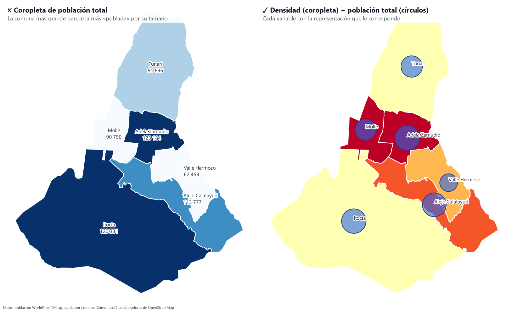

# 4.3 Elegir una representación temática adecuada

Coloreas las comunas por **población total** y el mapa grita que Itocta es la comuna «más poblada»: es la más oscura y la más grande. Pero su densidad es de apenas **856 hab./km²**, ocho veces menos que Adela Zamudio. El error no está en los datos sino en la **representación**: el color de un área dice «intensidad», y la población total no es una intensidad. Cada tipo de dato tiene una forma correcta de mapearse.

{ loading=lazy }

!!! abstract "En esta lección"

    **Aprenderás a:**

    - Distinguir **cantidades absolutas**, **valores relativos** y **categorías**.
    - Elegir entre **coropletas**, **símbolos proporcionales**, **categorías** y **mapas de puntos o de calor**.
    - **Normalizar** antes de colorear áreas.
    - Representar honestamente **valores ausentes** y **extremos**.

    **Tiempo:** 75 min (25 de lectura · 50 de práctica) · **Datos:** comunas con población (3.5), zonas, equipamientos · **Producto:** tres mapas temáticos correctamente representados.

---

## Idea central

### El tipo de dato manda

| Tipo de dato | Ejemplo | Representación adecuada | Variable visual |
|---|---|---|---|
| **Cantidad absoluta** (por unidad) | Población por comuna | **Símbolos proporcionales** | Tamaño |
| **Valor relativo** (tasa, %, densidad) | Habitantes por km²; % sin cobertura | **Coropleta** | Valor (claro → oscuro) |
| **Categoría** | Tipo de establecimiento; estado de cobertura | **Cualitativo** | Tono (color), forma |
| **Ubicaciones puntuales** | Establecimientos | **Puntos**; si son muchos, **mapa de calor** | Posición, densidad |
| **Fenómeno continuo** | Elevación, pendiente | **Ráster** con rampa o curvas de nivel | Valor |

!!! danger "Nunca hagas coropletas de totales"

    Las áreas grandes acumulan más de todo solo por su tamaño, y además **ocupan más espacio visual**. Para colorear áreas, usa **tasas o densidades** (normaliza por área o por población); para totales, usa **símbolos proporcionales**.

### Normalizar

| Total (no colorear) | Normalizado (sí colorear) |
|---|---|
| Población | Población / km² (densidad) |
| Población sin cobertura | Población sin cobertura / población total (%) |
| Establecimientos de salud | Habitantes por establecimiento |

### Símbolos proporcionales bien hechos

- El **área** del círculo, no su radio, debe ser proporcional al valor: tamaño = √valor.
- Usa transparencia y borde para ver los superpuestos.
- Incluye una **leyenda de tamaños** con valores redondos.

### Ausentes y extremos

| Caso | Mal | Bien |
|---|---|---|
| Sin dato | Pintarlo como la clase más baja | Gris o rayado + «Sin dato» en la leyenda |
| Sin población (no aplica) | Pintarlo como densidad 0 | Color neutro + «Sin población» |
| Un valor extremo | Que defina una clase entera vacía | Clase abierta («más de…») o explicación |

---

## Hazlo conmigo

### Paso 1 · El error, a propósito

1. Simboliza `Comunas` (con la población unida) en **graduado** por `t_pob_2020`, 4 clases, rampa *Blues*.
2. Pregunta a alguien: «¿qué comuna tiene más gente?». Probablemente diga Itocta.

### Paso 2 · Densidad en coropleta

1. Crea un campo virtual `densidad` = `"t_pob_2020" / "area_km2"`.
2. **Graduado** por `densidad` · *Cuantiles* · 4 clases · rampa *YlOrRd*.

| Comuna | Densidad (hab./km²) |
|---|---|
| Adela Zamudio | 6 552 |
| Molle | 5 507 |
| Alejo Calatayud | 3 219 |
| Valle Hermoso | 2 931 |
| Tunari | 1 647 |
| Itocta | 856 |

### Paso 3 · Población total con círculos

1. Crea una capa de **puntos en la superficie** de las comunas (**Procesos ▸ Punto en la superficie**).
2. **Símbolo único** círculo · **Tamaño ▸ Definido por datos** (ícono ε) ▸ **Asistente** ▸ campo `t_pob_2020` · método **Flannery** o **área** · tamaño máximo 14 mm.
3. Relleno azul con 40 % de transparencia y borde oscuro.
4. Colócala **encima** de la coropleta de densidad.

!!! captura "Captura pendiente · 4.3-04"

    - **Tipo:** PNG anotado
    - **Archivo:** `assets/images/modulo-04/4-3/4-3-04-asistente-tamano.png`
    - **Qué mostrar:** El asistente de tamaño definido por datos con el campo de población, el método de escala por área y la vista previa de la leyenda.

### Paso 4 · Categorías

Simboliza las zonas por `estado` de cobertura ([3.7](../modulo-03/07-proximidad-superposicion.md)) con tres categorías: **no cubierta** (naranja intenso), **cubierta** (gris claro) y **sin población** (blanco con borde gris). Fíjate: no hay orden entre ellas, así que no uses una rampa.

### Paso 5 · Muchos puntos: mapa de calor

Duplica `equipamientos`, cambia a **Mapa de calor** · radio 800 m · rampa *Reds*. ¿Revela algo que los 661 puntos ocultaban? ¿Qué se pierde?

!!! captura "Captura pendiente · 4.3-06"

    - **Tipo:** PNG comparativo
    - **Archivo:** `assets/images/modulo-04/4-3/4-3-06-puntos-vs-calor.png`
    - **Qué mostrar:** Los 661 equipamientos como puntos y como mapa de calor, lado a lado.

---

## Inténtalo tú

!!! example "Reto 4.3 · Tres variables, tres representaciones"

    Representa correctamente, en tres mapas exportados a `salidas/`:

    1. **Población sin cobertura por comuna** (cantidad absoluta).
    2. **Porcentaje de la población de cada comuna sin cobertura** (relativo).
    3. **Prioridad** de las zonas de 3.4 (categórica ordinal: alta, media, baja, no aplica).

    Para cada uno, justifica en una línea la representación elegida y cómo trataste los casos sin dato o sin población.

---

## ¿Lo hiciste bien?

| Criterio | Se cumple si… |
|---|---|
| Totales | Ninguna coropleta muestra cantidades absolutas |
| Proporcionales | Escala por **área**, con leyenda de tamaños |
| Relativos | Coropleta secuencial con unidad en la leyenda (% o hab./km²) |
| Categorías | Colores distinguibles, sin rampa; si son ordinales, con orden visual |
| Ausentes | «Sin dato» y «sin población» diferenciados y explicados |

### Errores frecuentes

| Síntoma | Causa | Solución |
|---|---|---|
| La comuna más grande «domina» | Coropleta de totales | Normaliza o usa círculos |
| Círculos enormes | Tamaño proporcional al radio | Escala por área (√valor) |
| Círculos que tapan todo | Opacos y grandes | Transparencia, tamaño máximo menor |
| Los ceros parecen «baja intensidad» | Sin población tratada como dato | Categoría aparte |
| El mapa de calor «inventa» zonas calientes | Radio inadecuado | Prueba radios y explica el elegido |

---

## Comprueba lo aprendido

??? question "1. ¿Por qué una coropleta de población total engaña?"

    Porque el color de un área se lee como **intensidad**, y las áreas grandes acumulan más población (y más espacio visual) solo por su tamaño.

??? question "2. ¿Qué debe ser proporcional al valor en un símbolo proporcional?"

    El **área** del símbolo.

??? question "3. ¿Cómo representarías el tipo de establecimiento?"

    Con símbolos **categorizados** por tono o forma, sin rampa de valor.

??? question "4. ¿Qué diferencia hay entre «sin dato» y «cero»?"

    «Sin dato» es ausencia de información; cero es un valor medido. Deben verse distintos en el mapa.

??? question "5. Repaso de 3.4 · ¿Qué tipo de indicador es «habitantes por establecimiento»?"

    Una **razón**: relaciona dos cantidades distintas.

---

## Tu proyecto

Para la lámina del Concejo (brief A), decide la representación principal: ¿porcentaje de población sin cobertura por comuna (coropleta), población sin cobertura (círculos) o zonas no cubiertas (categorías)? Elige **una** como figura principal y justifícala con el mensaje del brief.

---

## Referencias

- Slocum, T. A., McMaster, R. B., Kessler, F. C., & Howard, H. H. (2022). *Thematic Cartography and Geovisualization* (4.ª ed.). CRC Press.
- Dent, B. D., Torguson, J. S., & Hodler, T. W. (2009). *Cartography: Thematic Map Design* (6.ª ed.). McGraw-Hill.
- Flannery, J. J. (1971). The relative effectiveness of some common graduated point symbols in the presentation of quantitative data. *The Canadian Cartographer, 8*(2), 96–109. <https://doi.org/10.3138/J647-1776-745H-3667>
- QGIS Project. (s. f.). *Manual de usuario: Asistente de tamaño definido por datos*. <https://docs.qgis.org/latest/es/docs/user_manual/introduction/general_tools.html#data-defined-override-setup>
