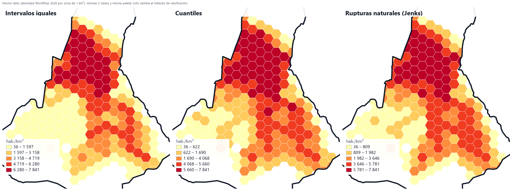

# 4.4 Evaluar clasificaciones y colores

Mira las tres versiones de abajo. Son **los mismos 202 hexágonos habitados**, la **misma variable** (densidad), las **mismas 5 clases** y la **misma paleta**. Solo cambia el método de clasificación. Con intervalos iguales, el sur parece casi vacío; con cuantiles, la mitad de la ciudad parece «muy densa». ¿Cuál es la verdad? Ninguna por sí sola: **clasificar es interpretar**, y un cartógrafo honesto elige el método con criterio y lo declara.

{ loading=lazy }

!!! abstract "En esta lección"

    **Aprenderás a:**

    - Mirar la **distribución** (histograma) antes de clasificar.
    - Comparar **intervalos iguales**, **cuantiles**, **rupturas naturales** y **clases fijas**.
    - Elegir el **número de clases** y redondear los límites.
    - Elegir paletas **secuenciales**, **divergentes** o **cualitativas** según el dato.
    - Comprobar **accesibilidad** (daltonismo, escala de grises).

    **Tiempo:** 90 min (25 de lectura · 65 de práctica) · **Datos:** `zonas_analisis` (densidad) · **Producto:** una clasificación justificada y su comparación con las alternativas.

---

## Idea central

### Cuatro métodos, cuatro mapas

| Método | Cómo corta | Ventaja | Riesgo | Úsalo cuando… |
|---|---|---|---|---|
| **Intervalos iguales** | Rango dividido en partes iguales | Fácil de leer | Con datos sesgados, casi todo cae en una clase | La distribución es uniforme |
| **Cuantiles** | Igual número de entidades por clase | Usa todos los colores | Valores muy distintos en la misma clase; diferencias pequeñas parecen grandes | Interesa el **orden** relativo |
| **Rupturas naturales (Jenks)** | Minimiza la varianza dentro de cada clase | Respeta agrupamientos | Límites «raros»; no comparables entre mapas | Hay grupos naturales en los datos |
| **Clases fijas** | Umbrales elegidos con sentido externo | Comparables en el tiempo y con normas | Requiere justificar los umbrales | Hay referencias (normas, metas) o comparas años |

En el ejemplo de arriba (densidad por hexágono, 5 clases):

| Método | Límites de clase (hab./km²) |
|---|---|
| Intervalos iguales | 36 · 1 597 · 3 158 · 4 719 · 6 280 · 7 841 |
| Cuantiles | 36 · 622 · 1 690 · 4 068 · 5 660 · 7 841 |
| Rupturas naturales | 36 · 809 · 1 982 · 3 646 · 5 781 · 7 841 |

### Paletas según el dato

| Paleta | Para | Ejemplo |
|---|---|---|
| **Secuencial** (claro → oscuro, uno o dos tonos) | Cantidades de menor a mayor | Densidad |
| **Divergente** (dos tonos que se separan de un centro) | Desviaciones respecto de un valor **significativo** | Cambio de población (+/−) respecto de 0 |
| **Cualitativa** (tonos distintos, misma luminosidad) | Categorías sin orden | Tipo de establecimiento |

!!! danger "El arcoíris no tiene orden"

    Las rampas espectrales (rojo-amarillo-verde-azul) no se leen como «más o menos», confunden a las personas con daltonismo y se vuelven ilegibles en escala de grises. Úsalas solo si sabes por qué.

!!! warning "No uses divergente sin un centro con significado"

    Una paleta divergente dice «por encima / por debajo de algo». Si ese «algo» (la media, cero, una meta) no es relevante, usa secuencial.

### Cuántas clases

- **3 a 5**: lectura rápida (mapas para decisión).
- **5 a 7**: más diferenciación (mapas de análisis).
- Más de 7: el ojo ya no distingue los tonos.

---

## Hazlo conmigo

### Paso 1 · Mirar la distribución

1. Filtra las zonas habitadas: `"pob_2020" > 0` (202 zonas).
2. **Simbología ▸ Graduado** · valor `"pob_2020" / "area_km2"` · pestaña **Histograma** ▸ **Cargar valores**.
3. Describe la forma: ¿sesgada? ¿con grupos? ¿con extremos?

!!! captura "Captura pendiente · 4.4-02"

    - **Tipo:** PNG anotado
    - **Archivo:** `assets/images/modulo-04/4-4/4-4-02-histograma.png`
    - **Qué mostrar:** El histograma de densidad en la simbología graduada, con los cortes de clase superpuestos.

### Paso 2 · Tres clasificaciones

Con 5 clases y rampa *YlOrRd*, cambia **Modo** entre **Intervalo igual**, **Cuantil (cuenta igual)** y **Rupturas naturales (Jenks)**. Registra los límites (deben coincidir con la tabla) y exporta las tres vistas.

### Paso 3 · Clases fijas con significado

Usa **Modo ▸ Fijo** o edita los límites a mano con valores **redondos** y explicables:

| Clase | Límites (hab./km²) | Etiqueta en la leyenda |
|---|---|---|
| 1 | 0 – 1 000 | Periurbano o rural |
| 2 | 1 000 – 3 000 | Urbano de baja densidad |
| 3 | 3 000 – 5 000 | Urbano medio |
| 4 | 5 000 – 8 000 | Urbano denso |

El umbral de 3 000 es el mismo que usaste para la prioridad en [3.4](../modulo-03/04-construir-indicadores-expresiones.md): **la coherencia entre análisis y mapa** también es honestidad.

!!! captura "Captura pendiente · 4.4-05"

    - **Tipo:** PNG anotado
    - **Archivo:** `assets/images/modulo-04/4-4/4-4-05-clases-fijas.png`
    - **Qué mostrar:** La tabla de clases editada a mano con límites redondos y etiquetas descriptivas.

### Paso 4 · Leyenda honesta

- **Unidad** en el título de la leyenda: «Habitantes por km² (2020)».
- **Límites redondeados** sin decimales falsos.
- **Sin huecos ni solapes** entre clases (`1 000 – 3 000` y `3 000 – 5 000`: decide dónde va el 3 000 y dilo).
- La clase «Sin población» aparte, en gris.

### Paso 5 · Accesibilidad

1. **Ver ▸ Previsualizar** ▸ simulación de deficiencias de visión del color (protanopía, deuteranopía).
2. **Escala de grises**: ¿siguen distinguiéndose las clases? Si no, aumenta el contraste de luminosidad entre ellas.
3. Verifica la paleta en <https://colorbrewer2.org> (filtros *colorblind safe* y *print friendly*).

!!! captura "Captura pendiente · 4.4-07"

    - **Tipo:** PNG comparativo
    - **Archivo:** `assets/images/modulo-04/4-4/4-4-07-simulacion-daltonismo.png`
    - **Qué mostrar:** La misma coropleta vista normalmente, con simulación de deuteranopía y en escala de grises.

---

## Inténtalo tú

!!! example "Reto 4.4 · Cambiar la interpretación sin cambiar los datos"

    1. Con los mismos datos, crea **dos mapas que cuenten historias opuestas**: uno donde «casi todo el municipio está densamente poblado» y otro donde «la densidad se concentra en el centro». Documenta qué método, número de clases y paleta usaste en cada uno.
    2. Escribe un párrafo: ¿cuál usarías para el Concejo y por qué? ¿Qué pondrías en la leyenda o en una nota para que el lector no se engañe?
    3. Crea la versión final con **clases fijas** y una paleta *colorblind safe*.

---

## ¿Lo hiciste bien?

| Criterio | Se cumple si… |
|---|---|
| Distribución | Describiste el histograma antes de elegir |
| Comparación | Tres métodos con sus límites registrados |
| Justificación | El método final se justifica por el dato y el mensaje, no por el «mejor aspecto» |
| Leyenda | Unidad, límites redondos, sin huecos, clase «sin población» aparte |
| Accesibilidad | Distinguible con daltonismo y en escala de grises |

### Errores frecuentes

| Síntoma | Causa | Solución |
|---|---|---|
| Casi todo de un color | Intervalos iguales con datos sesgados | Cuantiles, Jenks o clases fijas |
| Diferencias pequeñas parecen enormes | Cuantiles | Revisa los límites; considera clases fijas |
| Leyenda con «3 157,92» | Límites automáticos | Redondea y edita etiquetas |
| Dos mapas «comparables» con clases distintas | Jenks o cuantiles calculados por separado | Clases fijas comunes |
| Ilegible impreso en blanco y negro | Misma luminosidad en varias clases | Paleta secuencial de luminosidad creciente |

---

## Comprueba lo aprendido

??? question "1. ¿Por qué los cuantiles pueden exagerar diferencias?"

    Porque obligan a que cada clase tenga el mismo número de entidades: valores casi iguales pueden caer en clases distintas.

??? question "2. ¿Cuándo usarías clases fijas?"

    Cuando hay umbrales con significado externo o necesitas **comparar** mapas de distintas fechas o lugares.

??? question "3. ¿Qué paleta usarías para el cambio de población entre 2012 y 2024?"

    **Divergente** centrada en 0: tonos distintos para ganancia y pérdida.

??? question "4. ¿Por qué no usar arcoíris para la densidad?"

    Porque no tiene un orden visual claro, falla con daltonismo y en gris.

??? question "5. Repaso de 4.3 · ¿Se puede hacer una coropleta de la población sin cobertura por comuna?"

    No como total: hay que **normalizar** (porcentaje de la población de la comuna) o usar símbolos proporcionales.

---

## Tu proyecto

Para la lámina del Concejo, define la clasificación de la variable principal con **clases fijas** y una paleta accesible. Anota en el brief la justificación: la usarás en la memoria técnica del taller 4.12.

---

## Referencias

- Brewer, C. A. (2016). *Designing Better Maps* (2.ª ed.). Esri Press.
- Jenks, G. F. (1967). The data model concept in statistical mapping. *International Yearbook of Cartography, 7*, 186–190.
- Monmonier, M. (2018). *How to Lie with Maps* (3.ª ed.). University of Chicago Press.
- Brewer, C. A., & Pickle, L. (2002). Evaluation of methods for classifying epidemiological data on choropleth maps in series. *Annals of the Association of American Geographers, 92*(4), 662–681. <https://doi.org/10.1111/1467-8306.00310>
- Harrower, M., & Brewer, C. A. (2003). ColorBrewer.org. *The Cartographic Journal, 40*(1), 27–37. <https://doi.org/10.1179/000870403235002042>
