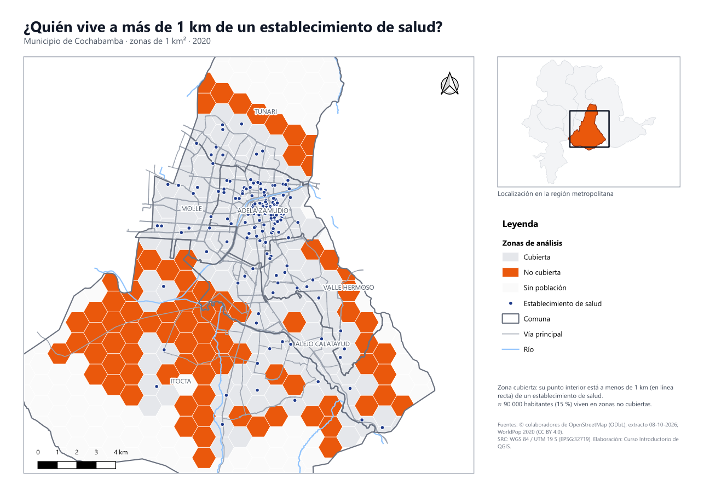

# 4.7 Diseñar una composición reutilizable

Un mapa en pantalla no es un producto: le faltan título, leyenda, escala, fuentes y una página que lo contenga. El **diseñador de impresión** de QGIS arma esa página. Y si la diseñas bien una vez —con márgenes, guías y una estructura clara— la guardas como **plantilla** y todos los mapas del curso (y de tu institución) tendrán el mismo aspecto profesional sin empezar de cero.

{ loading=lazy }

!!! abstract "En esta lección"

    **Aprenderás a:**

    - Configurar **página**, **márgenes** y **guías** en el diseñador de impresión.
    - Agregar y organizar **mapa, título, leyenda, barra de escala, norte, textos y fuentes**.
    - **Alinear**, **distribuir**, **agrupar** y **bloquear** elementos.
    - Guardar y reutilizar una **plantilla** (`.qpt`).

    **Tiempo:** 90 min (20 de lectura · 70 de práctica) · **Datos:** el proyecto con los estilos de 4.5 · **Producto:** `plantillas/curso_a4_horizontal.qpt` y la lámina del Concejo en PDF.

---

## Idea central

### Anatomía de una lámina

| Zona | Contenido | Peso visual |
|---|---|---|
| **Encabezado** | Título que afirma + subtítulo (lugar, unidad, fecha) | Alto |
| **Cuerpo** | Mapa principal (60–75 % de la página) | Máximo |
| **Panel lateral** | Localizador, leyenda, nota de lectura | Medio |
| **Pie** | Escala, fuentes, SRC, autor, fecha | Bajo |

### Una retícula invisible

- **Márgenes** de 10 mm (más si se encuaderna).
- **Columnas**: mapa y panel lateral alineados a las mismas guías.
- **Alineación**: los bordes de los elementos coinciden; nada «flota».
- **Espacio en blanco**: es parte del diseño, no un hueco por llenar.

!!! tip "Elementos obligatorios de una lámina"

    Título · mapa · leyenda · escala · fuente de los datos y fecha · SRC · autoría. El **norte** solo si la orientación no es la habitual o el mapa está rotado (pero en cartografía institucional suele exigirse).

---

## Hazlo conmigo

### Paso 1 · Crear la composición

1. **Proyecto ▸ Nuevo diseño de impresión…** ▸ nombre `Concejo · cobertura de salud`.
2. Clic derecho en la página ▸ **Propiedades de la página** ▸ **A4**, **Horizontal**.
3. **Ver ▸ Mostrar guías** y crea guías a 10 mm de cada borde y una vertical a 200 mm (separa mapa y panel).

!!! captura "Captura pendiente · 4.7-03"

    - **Tipo:** PNG anotado
    - **Archivo:** `assets/images/modulo-04/4-7/4-7-03-pagina-guias.png`
    - **Qué mostrar:** La página A4 horizontal con guías de márgenes y la guía que separa el mapa del panel lateral.

### Paso 2 · El mapa principal

1. **Añadir mapa** y dibújalo entre las guías: de (10, 24) a (200, 200) mm.
2. Propiedades del elemento: **Escala** redonda (por ejemplo 1:90 000), **Bloquear capas** y **Bloquear estilos de capas** (para que no cambie si tocas el proyecto) o, mejor, **Seguir el tema del mapa** de [4.2](02-preparar-informacion-escala-salida.md).
3. **Marco**: gris fino.

### Paso 3 · Título y textos

1. **Añadir etiqueta** para el título: «¿Quién vive a más de 1 km de un establecimiento de salud?», 18 pt negrita.
2. Subtítulo: «Municipio de Cochabamba · zonas de 1 km² · 2020», 10 pt gris.
3. Nota de lectura en el panel: explica en dos líneas qué significa «cubierta».
4. Pie: fuentes, licencia, SRC y elaboración, 6,5 pt.

### Paso 4 · Leyenda, escala y norte

1. **Añadir leyenda** vinculada al mapa principal. Desmarca **Actualización automática** y deja solo lo que el lector necesita, con nombres en lenguaje claro («Zona sin cobertura», no `estado = no_cubierta`).
2. **Añadir barra de escala**: estilo *Caja simple*, unidades km, segmentos de 1 km, sin segmentos a la izquierda.
3. **Añadir flecha de norte** (imagen SVG) pequeña, en una esquina del mapa.

!!! captura "Captura pendiente · 4.7-05"

    - **Tipo:** PNG anotado
    - **Archivo:** `assets/images/modulo-04/4-7/4-7-05-leyenda-personalizada.png`
    - **Qué mostrar:** Las propiedades de la leyenda con la actualización automática desactivada y los elementos renombrados.

### Paso 5 · Ordenar

1. Selecciona elementos y usa **Alinear** (izquierda, arriba) y **Distribuir**.
2. **Agrupa** título y subtítulo; **bloquea** el mapa y las guías para no moverlos por error.
3. Revisa en **Ver ▸ Vista previa** con **Ocultar marcos** y **Ocultar guías**.

### Paso 6 · Guardar como plantilla

**Diseño ▸ Guardar como plantilla…** ▸ `plantillas/curso_a4_horizontal.qpt`. Para usarla: **Proyecto ▸ Administrador de diseños ▸ Crear a partir de plantilla**. Los textos, la retícula y los estilos de elementos se conservan; el mapa toma el proyecto actual.

!!! tip "Variables en la plantilla"

    Reemplaza textos fijos por **variables** (fecha `[% format_date(now(), 'dd/MM/yyyy') %]`, autor `[% @project_author %]`). Así la plantilla se actualiza sola. Lo verás a fondo en [4.9](09-incorporar-informacion-dinamica.md).

---

## Inténtalo tú

!!! example "Reto 4.7 · La plantilla del curso"

    Crea dos plantillas que usarás en el resto del módulo:

    1. `curso_a4_horizontal.qpt` (lámina para presentación).
    2. `curso_a4_vertical.qpt` (ficha para atlas): encabezado, mapa cuadrado, bloque de indicadores debajo, pie.

    Ambas con la misma familia tipográfica, los mismos márgenes y la misma posición del pie. Aplica la horizontal a la lámina del Concejo y expórtala a PDF.

---

## ¿Lo hiciste bien?

| Criterio | Se cumple si… |
|---|---|
| Estructura | Encabezado, cuerpo, panel y pie claramente diferenciados |
| Retícula | Todo alineado a guías; márgenes uniformes |
| Contenido | Elementos obligatorios presentes, en lenguaje claro |
| Escala | Barra con valores redondos y escala del mapa redonda |
| Reutilización | La plantilla crea una lámina nueva sin rehacer nada |

### Errores frecuentes

| Síntoma | Causa | Solución |
|---|---|---|
| La leyenda muestra capas que no están en el mapa | Actualización automática | Desactívala y edita los elementos |
| El mapa cambió al tocar el proyecto | Capas no bloqueadas | **Bloquear capas** o seguir un tema |
| Barra de escala «1,37 km» | Segmentos automáticos | Fija las unidades por segmento |
| Elementos desalineados | Colocados a ojo | Guías y herramientas de alineación |
| Fuentes que cambian en otra computadora | Tipografía no instalada | Usa fuentes libres comunes y documéntalas |

---

## Comprueba lo aprendido

??? question "1. ¿Qué proporción de la página debería ocupar el mapa principal?"

    Del orden del **60–75 %**: es la figura de la lámina.

??? question "2. ¿Por qué desactivar la actualización automática de la leyenda?"

    Para mostrar **solo** lo que el lector necesita, con nombres claros y en el orden que tú decidas.

??? question "3. ¿Qué guarda una plantilla `.qpt`?"

    La composición (página, elementos, estilos, textos y variables), **no** los datos ni el proyecto.

??? question "4. Repaso de 1.8 · ¿Por qué la escala del mapa en la lámina debe ser un número redondo?"

    Para que el lector pueda **medir y comparar** fácilmente; 1:90 000 se entiende, 1:87 413 no.

---

## Tu proyecto

La lámina del Concejo ya existe como PDF. Somételo a la prueba de los 30 segundos con alguien que no conoce el caso y anota qué entendió: es la evidencia de que tu diseño funciona.

---

## Referencias

- Krygier, J., & Wood, D. (2016). *Making Maps* (3.ª ed., caps. sobre composición). Guilford Press.
- Peterson, G. N. (2020). *GIS Cartography: A Guide to Effective Map Design* (3.ª ed.). CRC Press.
- QGIS Project. (s. f.). *Manual de usuario: Diseños de impresión*. <https://docs.qgis.org/latest/es/docs/user_manual/print_composer/index.html>
