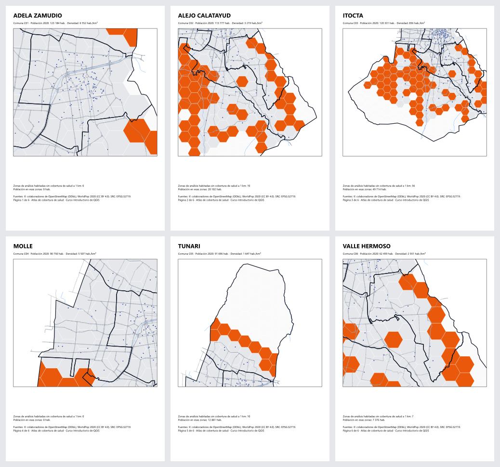
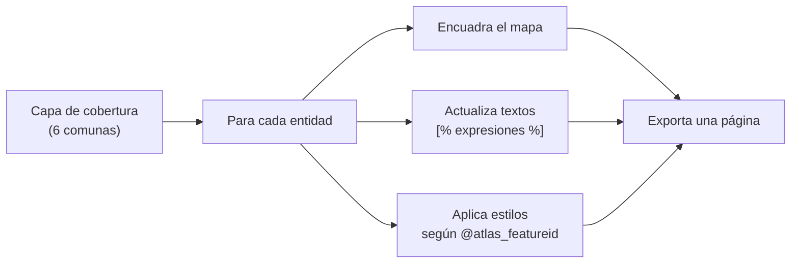

# 4.10 Producir un atlas territorial

La red de salud necesita una ficha **por comuna**: seis mapas con la misma estructura, cada uno centrado en su comuna, con sus cifras. Hacerlos uno por uno es una tarde de trabajo y seis oportunidades de equivocarse. Con un **atlas**, diseñas **una** página y QGIS genera las seis (o las 300, si fueran barrios) en un minuto, cada una con su encuadre, su título y sus indicadores.

{ loading=lazy }

!!! abstract "En esta lección"

    **Aprenderás a:**

    - Configurar la **capa de cobertura** del atlas, su orden y su filtro.
    - Hacer que el mapa **siga** a cada entidad con margen o escalas predefinidas.
    - Usar `@atlas_feature` y `attribute()` en textos dinámicos.
    - **Resaltar** la entidad actual y atenuar las vecinas.
    - Exportar con **nombres de archivo automáticos** o en un único PDF.

    **Tiempo:** 90 min (20 de lectura · 70 de práctica) · **Datos:** comunas con población, zonas con estado de cobertura · **Producto:** `salidas/atlas_comunas.pdf` y una página PNG por comuna.

---

## Idea central

### Cómo funciona un atlas



| Configuración | Qué decide | En el caso |
|---|---|---|
| **Capa de cobertura** | Cuántas páginas y en qué orden | `Comunas` (6), ordenadas por `cod_comuna` |
| **Filtro** | Qué entidades se excluyen | Por ejemplo, solo comunas con población sin cobertura |
| **Mapa controlado por el atlas** | Cómo encuadra | **Margen** del 8 % o **escalas predefinidas** |
| **Nombre de archivo** | Cómo se llama cada salida | `'atlas_' || "cod_comuna" || '_' || "nombre"` |

### Variables del atlas

| Variable | Contiene |
|---|---|
| `@atlas_feature` | La entidad actual (usa `attribute(@atlas_feature, 'campo')`) |
| `@atlas_featureid` | Su identificador |
| `@atlas_featurenumber` / `@atlas_totalfeatures` | «Página 3 de 6» |
| `@atlas_geometry` | Su geometría (para filtros espaciales) |

!!! tip "Escalas predefinidas"

    Con **margen**, cada comuna sale a una escala distinta (Itocta, enorme; Molle, pequeña). Si quieres que sean **comparables**, usa **escalas predefinidas** (1:25 000, 1:50 000, 1:100 000): QGIS elige la menor que haga entrar la comuna.

---

## Hazlo conmigo

### Paso 1 · Configurar el atlas

1. Crea un diseño a partir de `curso_a4_vertical.qpt` (4.7).
2. Panel **Atlas** ▸ **Generar un atlas** · **Capa de cobertura:** `Comunas` · **Ordenar por:** `cod_comuna`.
3. Propiedades del mapa ▸ **Controlado por el atlas** · **Margen alrededor del objeto:** 8 %.
4. Barra de herramientas **Atlas ▸ Vista previa**: navega con las flechas por las seis páginas.

!!! captura "Captura pendiente · 4.10-03"

    - **Tipo:** PNG anotado
    - **Archivo:** `assets/images/modulo-04/4-10/4-10-03-config-atlas.png`
    - **Qué mostrar:** El panel Atlas con la capa de cobertura, el orden y la expresión de nombre de archivo, y el mapa con «Controlado por el atlas».

### Paso 2 · Textos de cada página

Título: `[% upper(attribute(@atlas_feature, 'nombre')) %]`

Subtítulo:

```text
Comuna [% "cod_comuna" %] · Población 2020: [% format_number("t_pob_2020", 0) %] hab. ·
Densidad: [% format_number("t_pob_2020" / "area_km2", 0) %] hab./km²
```

Indicadores (usan otra capa filtrada por la comuna actual):

```text
Zonas habitadas sin cobertura: [% aggregate('zonas', 'count', "cod_zona",
  filter:= "cod_comuna" = attribute(@atlas_feature, 'cod_comuna') AND "estado" = 'no_cubierta') %]
Población en esas zonas: [% format_number(coalesce(aggregate('zonas', 'sum', "pob_2020",
  filter:= "cod_comuna" = attribute(@atlas_feature, 'cod_comuna') AND "estado" = 'no_cubierta'), 0), 0) %] hab.
Página [% @atlas_featurenumber %] de [% @atlas_totalfeatures %]
```

Verifica: Itocta → **56 zonas, 49 714 hab.**; Adela Zamudio y Molle → **0**.

### Paso 3 · Resaltar la comuna actual

En la capa `Comunas`, simbología **basada en reglas**:

| Regla | Estilo |
|---|---|
| `@atlas_featureid = $id` | Sin relleno, borde negro 0,8 mm |
| `ELSE` | Relleno blanco al 60 %, borde gris: «apaga» las comunas vecinas |

Así cada página muestra el contexto pero destaca su comuna (jerarquía de [4.5](05-construir-jerarquia-visual.md)).

!!! captura "Captura pendiente · 4.10-05"

    - **Tipo:** PNG comparativo
    - **Archivo:** `assets/images/modulo-04/4-10/4-10-05-resaltar-entidad.png`
    - **Qué mostrar:** Dos páginas del atlas con la comuna actual resaltada y las vecinas atenuadas.

### Paso 4 · Exportar

1. **Atlas ▸ Exportar atlas como PDF…** con **Exportar como un único archivo**: `salidas/atlas_comunas.pdf`.
2. **Atlas ▸ Exportar atlas como imágenes…** con nombre de archivo:

    ```sql
    'atlas_' || "cod_comuna" || '_' || lower(replace("nombre", ' ', '_'))
    ```

    Obtendrás `atlas_C01_adela_zamudio.png`, etc.

---

## Inténtalo tú

!!! example "Reto 4.10 · Atlas de prioridades"

    Produce un **segundo atlas** con las **6 zonas candidatas** de [3.12](../modulo-03/12-laboratorio-decision-territorial.md) como capa de cobertura:

    - Una página por zona, ordenada por el índice compuesto (de mayor a menor).
    - Mapa a escala fija 1:10 000 con imagen Sentinel-2 de fondo.
    - Indicadores: población, pendiente media, distancia al establecimiento más cercano, distancia a vía principal y posición en el ranking.
    - Nombre de archivo con el ranking: `candidata_01_Z156.png`…

---

## ¿Lo hiciste bien?

| Criterio | Se cumple si… |
|---|---|
| Cobertura | Seis páginas, en orden de código |
| Encuadre | Cada comuna entra completa con margen (o con escalas predefinidas) |
| Textos | Título, cifras y número de página cambian en cada página |
| Cifras | Itocta: 56 zonas y 49 714 hab. sin cobertura |
| Resaltado | La comuna actual destaca; las vecinas están atenuadas |
| Exportación | PDF único y PNG con nombres automáticos |

### Errores frecuentes

| Síntoma | Causa | Solución |
|---|---|---|
| Todas las páginas muestran lo mismo | El mapa no está controlado por el atlas | Activa **Controlado por el atlas** |
| Las cifras no cambian | El filtro no usa `@atlas_feature` | `attribute(@atlas_feature, 'campo')` |
| Escalas muy dispares | Modo margen | Escalas predefinidas |
| Nombres de archivo con espacios o tildes | Expresión sin limpiar | `lower(replace(...))`; evita tildes |
| La comuna actual no se resalta | Regla mal escrita | `@atlas_featureid = $id` |

---

## Comprueba lo aprendido

??? question "1. ¿Qué determina el número de páginas de un atlas?"

    Las entidades de la **capa de cobertura** (después del filtro).

??? question "2. ¿Cómo obtienes el nombre de la comuna actual en un texto?"

    `attribute(@atlas_feature, 'nombre')`, o directamente `"nombre"` si el texto toma los campos de la capa de cobertura.

??? question "3. ¿Cuándo usar escalas predefinidas en lugar de margen?"

    Cuando las páginas deben ser **comparables** entre sí.

??? question "4. Repaso de 4.9 · ¿Por qué el atlas depende de que las cifras sean expresiones?"

    Porque cada página necesita **sus** cifras: solo una expresión filtrada por la entidad actual las produce automáticamente.

---

## Tu proyecto

El atlas por comuna es el **producto B** del caso conductor. Revísalo con el brief de 4.1: ¿responde a lo que la red de salud necesita? Anota lo que mejorarías para la versión 2.

---

## Referencias

- QGIS Project. (s. f.). *Manual de usuario: Generar un atlas*. <https://docs.qgis.org/latest/es/docs/user_manual/print_composer/create_reports.html#generate-an-atlas>
- QGIS Project. (s. f.). *Manual de entrenamiento: Crear un atlas*. <https://docs.qgis.org/latest/es/docs/training_manual/map_composer/index.html>
- Kraak, M.-J., & Ormeling, F. (2020). *Cartography: Visualization of Geospatial Data* (4.ª ed., cap. sobre atlas). CRC Press.
