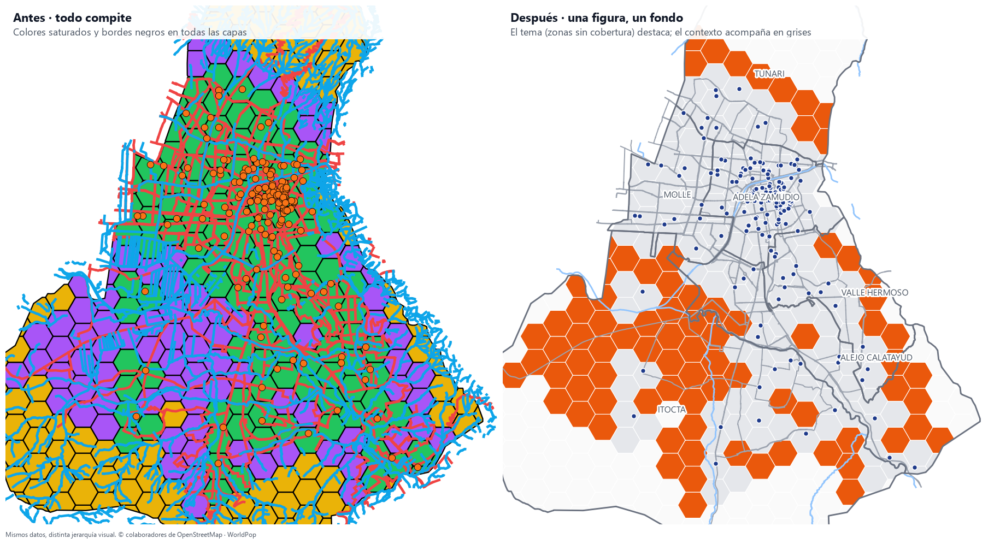

# Módulo 4 · Diseño cartográfico, composición y publicación

!!! abstract "Objetivo del módulo"

    **Convertir los resultados del análisis en mapas que el destinatario entienda en segundos, que no lo engañen y que cualquiera pueda verificar y actualizar.**

---

## Presentación

En el Módulo 3 descubriste que **unas 90 000 personas** viven lejos de un establecimiento de salud y que **seis zonas** son candidatas para un nuevo centro. Ese hallazgo no sirve de nada si se queda en una tabla. En este módulo lo convertirás en una **colección cartográfica**: una lámina para el Concejo, un atlas por comuna para la red de salud y una propuesta de ubicación.

Cada decisión de diseño —qué mostrar, cómo clasificar, qué color, qué etiquetar— **cambia lo que el lector entiende**. Por eso este módulo trata tanto de técnica como de **honestidad cartográfica**.

{ loading=lazy }

---

## Estructura del módulo

### Bloque 1 · Encargo y escala

-   **4.1 Definir el encargo cartográfico**

    ---

    Destinatario, propósito, mensaje, soporte y restricciones. El *brief*.

    [:octicons-arrow-right-24: Ir a la lección](01-definir-encargo-cartografico.md)

-   **4.2 Preparar información para la escala de salida**

    ---

    Selección, simplificación, agregación y visibilidad por escala.

    [:octicons-arrow-right-24: Ir a la lección](02-preparar-informacion-escala-salida.md)

### Bloque 2 · Representación temática

-   **4.3 Elegir una representación temática**

    ---

    Totales con símbolos proporcionales, tasas con coropletas, categorías con tono.

    [:octicons-arrow-right-24: Ir a la lección](03-elegir-representacion-tematica.md)

-   **4.4 Evaluar clasificaciones y colores**

    ---

    Intervalos iguales, cuantiles, Jenks y clases fijas; paletas accesibles.

    [:octicons-arrow-right-24: Ir a la lección](04-evaluar-clasificaciones-colores.md)

-   **4.5 Construir una jerarquía visual**

    ---

    Figura y fondo, un solo acento de color, orden de dibujo.

    [:octicons-arrow-right-24: Ir a la lección](05-construir-jerarquia-visual.md)

### Bloque 3 · Etiquetado y composición

-   **4.6 Resolver el etiquetado**

    ---

    Reglas, prioridades, obstáculos, máscaras y llamadas.

    [:octicons-arrow-right-24: Ir a la lección](06-resolver-etiquetado-mapas-complejos.md)

-   **4.7 Diseñar una composición reutilizable**

    ---

    Página, retícula, elementos obligatorios y plantillas `.qpt`.

    [:octicons-arrow-right-24: Ir a la lección](07-disenar-composicion-reutilizable.md)

-   **4.8 Coordinar mapas y elementos**

    ---

    Localizador, detalle, temas del mapa y cuadrículas.

    [:octicons-arrow-right-24: Ir a la lección](08-coordinar-mapas-elementos-complementarios.md)

### Bloque 4 · Automatización y publicación

-   **4.9 Incorporar información dinámica**

    ---

    Variables y expresiones: cifras que se actualizan solas.

    [:octicons-arrow-right-24: Ir a la lección](09-incorporar-informacion-dinamica.md)

-   **4.10 Producir un atlas territorial**

    ---

    Una página por comuna, con encuadre, textos y resaltado automáticos.

    [:octicons-arrow-right-24: Ir a la lección](10-producir-atlas-territorial.md)

-   **4.11 Revisar y exportar para distintos usos**

    ---

    PDF para imprenta, PNG para informe y web, SVG para edición.

    [:octicons-arrow-right-24: Ir a la lección](11-revisar-exportar-distintos-usos.md)

-   :material-book-open-page-variant:{ .lg .middle } **4.12 Taller editorial · Publicar una colección coherente**

    ---

    Manual de estilo, cuatro productos, control editorial y publicación.

    [:octicons-arrow-right-24: Ir al taller](12-taller-editorial-publicar-coleccion-coherente.md)

---

## Principios del módulo

| Principio | Significa | Lección |
|---|---|---|
| **El mapa empieza con una pregunta** | Sin destinatario ni mensaje no hay diseño posible | 4.1 |
| **La escala decide el detalle** | Lo que no se puede leer, sobra | 4.2 |
| **La representación cambia la lectura** | Totales y tasas no se mapean igual | 4.3–4.4 |
| **No todo debe destacar** | Una figura, un fondo | 4.5 |
| **Etiquetar es seleccionar** | Nombrar lo que importa, sacrificar lo demás | 4.6 |
| **Automatizar no elimina la revisión** | Plantillas y atlas, siempre con control final | 4.7–4.11 |
| **Un producto terminado es verificable** | Fuentes, fechas, métodos y limitaciones visibles | 4.12 |

---

## Productos que construirás

{ loading=lazy }

| Producto | Lección | Formato |
|---|---|---|
| Dos *briefs* cartográficos | 4.1 | Texto |
| Temas del mapa por escala | 4.2 | Proyecto |
| Tres mapas temáticos correctos | 4.3 | PNG |
| Clasificación justificada y accesible | 4.4 | Estilo `.qml` |
| Estilos de jerarquía | 4.5 | `.qml` |
| Plantillas horizontal y vertical | 4.7 | `.qpt` |
| Lámina con localizador | 4.8 | PDF |
| Atlas por comuna | 4.10 | PDF de 6 páginas |
| Colección publicada | 4.12 | PDF, PNG, SVG + manual de estilo + ficha técnica |

---

## Al terminar el módulo

!!! success "Habrás alcanzado el objetivo si puedes:"

    - Escribir el encargo de un mapa y evaluar el resultado con él.
    - Elegir la representación y la clasificación adecuadas, y explicar por qué.
    - Construir una jerarquía visual en la que el mensaje se lee en segundos.
    - Producir composiciones, plantillas y atlas con información dinámica.
    - Exportar para cada uso con la calidad adecuada.
    - **Publicar una colección coherente, honesta y verificable.**

---

## Referencias del módulo

- Brewer, C. A. (2016). *Designing Better Maps: A Guide for GIS Users* (2.ª ed.). Esri Press.
- Field, K. (2018). *Cartography.* Esri Press.
- Kraak, M.-J., & Ormeling, F. (2020). *Cartography: Visualization of Geospatial Data* (4.ª ed.). CRC Press.
- Krygier, J., & Wood, D. (2016). *Making Maps: A Visual Guide to Map Design for GIS* (3.ª ed.). Guilford Press.
- Monmonier, M. (2018). *How to Lie with Maps* (3.ª ed.). University of Chicago Press.
- Slocum, T. A., McMaster, R. B., Kessler, F. C., & Howard, H. H. (2022). *Thematic Cartography and Geovisualization* (4.ª ed.). CRC Press.
- QGIS Project. (s. f.). *Manual de usuario: Diseños de impresión*. <https://docs.qgis.org/latest/es/docs/user_manual/print_composer/index.html>
