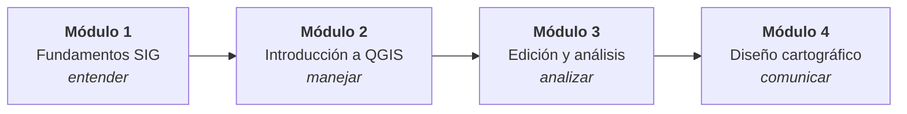

# Programa del curso

El curso avanza del **concepto** a la **herramienta** y de la herramienta al **producto**: primero entendemos qué representa un dato geográfico, después aprendemos a manejarlo en QGIS, luego lo analizamos y, por último, lo comunicamos mediante mapas.

| Módulo | Pregunta que responde | Lecciones | Horas estimadas | Producto del módulo |
|---|---|---|---|---|
| [1 · Fundamentos SIG](modulo-01/index.md) | ¿Qué estamos representando y con qué referencia, escala y calidad? | 15 + práctica | 30 h | Base conceptual del proyecto integrador |
| [2 · Introducción a QGIS](modulo-02/index.md) | ¿Cómo organiza QGIS la información y cómo la incorporo sin errores? | 12 | 30 h | Proyecto QGIS portable y documentado |
| [3 · Edición, integración y análisis espacial](modulo-03/index.md) | ¿Cómo produzco información nueva y confiable a partir de los datos? | 12 | 36 h | Análisis reproducible que justifica una decisión |
| [4 · Diseño cartográfico, composición y publicación](modulo-04/index.md) | ¿Cómo comunico los resultados con mapas claros y honestos? | 12 | 30 h | Colección cartográfica y atlas publicados |
| **Total** | | **51** | **≈ 126 h** | |

!!! info "Software y datos"

    - **QGIS 4.x** (recomendada la versión de largo plazo, LTR, vigente al iniciar el curso). Consulta [Preparar un entorno de trabajo](modulo-02/01-entorno-trabajo.md).
    - **Paquete de datos del curso**, basado en el municipio de **Cochabamba (Cercado)**. Consulta [Descargas](descargas/index.md).

---

## Módulo 1 · Fundamentos de Sistemas de Información Geográfica

*Sin software. Calculadora, cuaderno y curiosidad.*

| Bloque | Lección | Aprenderás a… |
|---|---|---|
| SIG y territorio | [1.1 Sistemas de Información Geográfica](modulo-01/01-sistemas-informacion-geografica.md) | Distinguir un SIG de un programa de mapas e identificar preguntas espaciales |
| | [1.2 Espacio geográfico y territorio](modulo-01/02-espacio-geografico.md) | Modelar objetos, fenómenos y procesos del territorio |
| Geodesia y referencia | [1.3 Fundamentos de geodesia](modulo-01/03-fundamentos-geodesia.md) | Explicar geoide, elipsoide, datum, latitud y longitud |
| | [1.4 Sistemas de referencia de coordenadas](modulo-01/04-sistemas-referencia.md) | Reconocer un SRC geográfico o proyectado y su código EPSG |
| | [1.5 Proyecciones cartográficas](modulo-01/05-proyecciones-cartograficas.md) | Elegir una proyección según lo que debe conservar |
| | [1.6 Sistema UTM](modulo-01/06-sistema-utm.md) | Elegir la zona UTM correcta para cualquier lugar de Bolivia |
| Cartografía y escala | [1.7 Fundamentos de cartografía](modulo-01/07-fundamentos-cartografia.md) | Leer el mapa como modelo y como lenguaje gráfico |
| | [1.8 Escala cartográfica](modulo-01/08-escala-cartografica.md) | Calcular distancias y superficies a partir de la escala |
| | [1.9 Escala, resolución y precisión](modulo-01/09-escala-resolucion-precision.md) | Diferenciar precisión, exactitud y resolución; calcular el RMSE |
| | [1.10 Generalización cartográfica](modulo-01/10-generalizacion-cartografica.md) | Prever las consecuencias de simplificar un dato |
| Datos geoespaciales | [1.11 Modelos de representación](modulo-01/11-modelos-representacion.md) | Elegir entre modelo vectorial y ráster |
| | [1.12 El dato geoespacial](modulo-01/12-dato-geoespacial.md) | Describir geometría, atributos, topología y metadatos |
| | [1.13 Calidad de la información](modulo-01/13-calidad-informacion.md) | Evaluar la aptitud de un dato según ISO 19157 |
| Panorama | [1.14 SIG y otras geotecnologías](modulo-01/14-sig-otras-geotecnologias.md) | Relacionar SIG, CAD, GNSS, teledetección y fotogrametría |
| | [1.15 Ecosistema de geotecnologías](modulo-01/15-ecosistema-geotecnologias.md) | Situar el SIG en el ecosistema actual (web, nube, GeoAI) |
| Práctica | [Práctica integradora del Módulo 1](modulo-01/practica.md) | Diagnosticar un conjunto de datos reales sin abrir QGIS |

---

## Módulo 2 · Introducción a QGIS

*Cada lección termina con un reto práctico.*

| Bloque | Lección | Aprenderás a… |
|---|---|---|
| Entorno y proyectos | [2.1 Preparar un entorno de trabajo](modulo-02/01-entorno-trabajo.md) | Instalar QGIS y organizar un entorno reproducible |
| | [2.2 Orientarse y trabajar con fluidez](modulo-02/02-orientarse-interfaz.md) | Navegar la interfaz, el navegador y el localizador |
| | [2.3 Comprender y gestionar proyectos](modulo-02/03-gestionar-proyectos.md) | Guardar proyectos portables y reparar capas no disponibles |
| Datos y coordenadas | [2.4 Incorporar datos](modulo-02/04-incorporar-datos.md) | Cargar e inspeccionar GeoPackage, Shapefile, GeoJSON y GeoTIFF |
| | [2.5 Convertir una tabla en información geográfica](modulo-02/05-tablas-coordenadas.md) | Importar CSV con coordenadas sin errores de codificación ni de ejes |
| | [2.6 Resolver problemas de coordenadas](modulo-02/06-problemas-coordenadas.md) | Distinguir asignar de reproyectar y corregir capas desplazadas |
| Explorar y consultar | [2.7 Leer los datos antes de utilizarlos](modulo-02/07-leer-datos.md) | Detectar nulos, duplicados y valores sospechosos |
| | [2.8 Seleccionar, filtrar y extraer](modulo-02/08-seleccionar-filtrar.md) | Construir subconjuntos con expresiones y filtros |
| Representar y conectar | [2.9 Representar y etiquetar](modulo-02/09-simbologia-etiquetas.md) | Aplicar simbología categorizada y graduada y etiquetas |
| | [2.10 Explorar imágenes y superficies ráster](modulo-02/10-explorar-raster.md) | Interpretar bandas, NoData, pseudocolor y composiciones RGB |
| | [2.11 Conectar información de internet](modulo-02/11-servicios-web.md) | Usar servicios XYZ, WMS/WMTS y WFS |
| Taller | [2.12 Construir y entregar un proyecto funcional](modulo-02/12-taller-proyecto.md) | Entregar un proyecto que otra persona pueda abrir |

---

## Módulo 3 · Edición, integración y análisis espacial

| Bloque | Lección | Aprenderás a… |
|---|---|---|
| Preparar y editar | [3.1 Preparar datos confiables](modulo-03/01-preparar-datos-confiables.md) | Auditar y organizar datos en GeoPackage |
| | [3.2 Digitalizar y editar con precisión](modulo-03/02-digitalizar-editar-precision.md) | Digitalizar con autoensamblado y control topológico |
| | [3.3 Diseñar formularios de captura](modulo-03/03-disenar-formularios-captura.md) | Prevenir errores con widgets, valores por defecto y restricciones |
| Analizar y combinar | [3.4 Construir indicadores con expresiones](modulo-03/04-construir-indicadores-expresiones.md) | Calcular indicadores reproducibles con el calculador de campos |
| | [3.5 Integrar tablas sin perder información](modulo-03/05-integrar-tablas.md) | Unir tablas controlando claves y cardinalidad |
| | [3.6 Traducir preguntas en relaciones espaciales](modulo-03/06-relaciones-espaciales.md) | Elegir el predicado espacial correcto |
| | [3.7 Analizar proximidad y superposición](modulo-03/07-proximidad-superposicion.md) | Aplicar buffer, recorte, intersección y disolución |
| Ráster y procesos | [3.8 Preparar y combinar ráster](modulo-03/08-preparar-combinar-raster.md) | Alinear, remuestrear y combinar ráster |
| | [3.9 Interpretar el relieve](modulo-03/09-relieve-estadisticas-zonales.md) | Derivar pendiente y sombreado y resumirlos por zonas |
| | [3.10 Recuperar información de mapas históricos](modulo-03/10-georreferenciar-mapas-historicos.md) | Georreferenciar y evaluar el error residual |
| | [3.11 Construir procedimientos reproducibles](modulo-03/11-procedimientos-reproducibles.md) | Automatizar con procesos por lotes y el Modelador gráfico |
| Laboratorio | [3.12 Justificar una decisión territorial](modulo-03/12-laboratorio-decision-territorial.md) | Integrar todo el módulo en una decisión argumentada |

---

## Módulo 4 · Diseño cartográfico, composición y publicación

| Bloque | Lección | Aprenderás a… |
|---|---|---|
| Encargo y escala | [4.1 Definir el encargo cartográfico](modulo-04/01-definir-encargo-cartografico.md) | Fijar destinatario, propósito, mensaje y soporte |
| | [4.2 Preparar información para la escala de salida](modulo-04/02-preparar-informacion-escala-salida.md) | Seleccionar y generalizar según la escala |
| Representación temática | [4.3 Elegir una representación temática](modulo-04/03-elegir-representacion-tematica.md) | Asociar cada tipo de dato con su representación |
| | [4.4 Evaluar clasificaciones y colores](modulo-04/04-evaluar-clasificaciones-colores.md) | Elegir método de clasificación y paleta con honestidad |
| | [4.5 Construir una jerarquía visual](modulo-04/05-construir-jerarquia-visual.md) | Ordenar figura y fondo con contraste y tamaño |
| Etiquetado | [4.6 Resolver el etiquetado](modulo-04/06-resolver-etiquetado-mapas-complejos.md) | Controlar prioridades, obstáculos y máscaras |
| Composición | [4.7 Diseñar una composición reutilizable](modulo-04/07-disenar-composicion-reutilizable.md) | Construir plantillas de composición |
| | [4.8 Coordinar mapas y elementos](modulo-04/08-coordinar-mapas-elementos-complementarios.md) | Integrar localizador, detalle, leyenda y escala |
| Automatización | [4.9 Incorporar información dinámica](modulo-04/09-incorporar-informacion-dinamica.md) | Automatizar textos con variables y expresiones |
| | [4.10 Producir un atlas territorial](modulo-04/10-producir-atlas-territorial.md) | Generar una ficha por unidad territorial |
| Publicación | [4.11 Revisar y exportar](modulo-04/11-revisar-exportar-distintos-usos.md) | Exportar a PDF, SVG e imagen según el destino |
| Taller | [4.12 Publicar una colección coherente](modulo-04/12-taller-editorial-publicar-coleccion-coherente.md) | Publicar una colección cartográfica verificable |

---

## Caso conductor: cobertura de servicios en Cochabamba

Todo el curso gira alrededor de una misma pregunta territorial, para que cada módulo construya sobre el anterior:

> **¿Qué zonas del municipio de Cochabamba tienen peor acceso a servicios de salud y educación, y dónde convendría intervenir primero?**

| Módulo | Qué haces con el caso |
|---|---|
| 1 | Formulas la pregunta, eliges el SRC (UTM 19 S / SIRGAS) y la escala, y evalúas la calidad de las fuentes |
| 2 | Cargas límites, equipamientos y relieve en un proyecto QGIS portable |
| 3 | Corriges datos, calculas indicadores y analizas cobertura y relieve |
| 4 | Publicas un atlas por distrito con mapas claros y honestos |

Si prefieres trabajar con **tu propio municipio o problema**, puedes hacerlo: las actividades están pensadas para adaptarse.

Consulta también el [Syllabus](syllabus.md) para la metodología y la evaluación.
